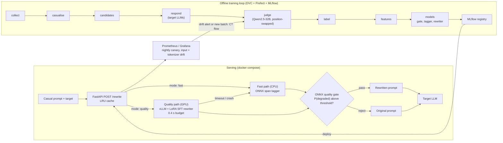
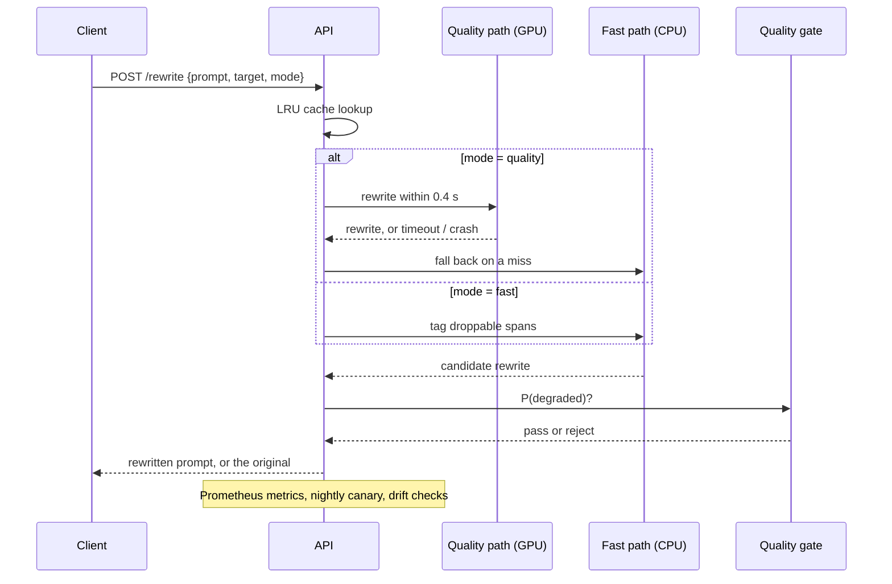

# Terser

**Rewriting casual prompts into token-efficient prompts that get the same output quality.**

[](.github/workflows/ci.yml)
[](.github/workflows/cd.yml)
[](pyproject.toml)
[](dvc.yaml)
[](src/terser/tracking)
[](docs/serving/api.md)
[](LICENSE)

Terser sits between a user and an LLM. It takes a prompt written the way people
talk (filler, hedging, restated requirements) and rewrites it for a specific
target model, so the prompt costs fewer tokens on that model's tokenizer while
the answer keeps the same quality and depth. Every savings number is paired with
a measured quality-preservation number; savings alone never count as success.

It is also a course project that covers all four syllabus units, from concept
learning to MLOps, on one problem ([syllabus map](docs/syllabus_map.md)).

---

## Contents

| Section | |
|---|---|
| [What it does](#what-it-does) | The feature surface, by area |
| [Architecture](#architecture) | Serving paths and the offline loop |
| [How a prompt travels](#how-a-prompt-travels) | Request, rewrite, gate, fallback |
| [Headline results](#headline-results) | The test split, evaluated once |
| [Quick start](#quick-start) | `docker compose up` and one request |
| [Project status](#project-status) | Checkpoints, and what CI proves |
| [Design decisions](#design-decisions) | The tradeoffs, and why |
| [Repository layout](#repository-layout) | Where things live |
| [Documentation](#documentation) | Which file answers which question |
| [Team](#team) | Who built it |

---

## What it does

| Area | Capabilities |
|---|---|
| **Rewriting** | Fast path (CPU, ONNX span tagger) and quality path (GPU, vLLM + LoRA SFT rewriter) |
| **Quality gate** | ONNX classifier that predicts P(degraded) and returns the original prompt when a rewrite is risky |
| **Fallback** | Quality path drops to the fast path on timeout or crash; the original prompt comes back when nothing passes |
| **Tokenizers** | Savings measured on the target model's own tokenizer (Qwen2.5, Phi-3.5) |
| **Data pipeline** | DVC stages: collect → casualise → candidates → respond → judge → label → features |
| **Judging** | Qwen2.5-32B judge, position-swapped, with a written protocol ([ADR-0005](docs/decisions/ADR-0005-judge-protocol.md)) |
| **Models** | Classical, neural, ensembles, clustering, RL over operators, and the generative rewriter |
| **MLOps** | Hydra configs, MLflow registry, Prefect flows, Prometheus/Grafana, nightly canary, input and tokenizer drift |

---

## Architecture



The fast path never needs a GPU. The quality path falls back to the fast path
when it misses its budget, and when no rewriter produces a result the original
prompt comes back ([C11.5](reports/p11_serving_checks.md)). Details:
[ADR-0001](docs/decisions/ADR-0001-ml-lifecycle.md),
[ADR-0010](docs/decisions/ADR-0010-mlops.md), [API](docs/serving/api.md).

---

## How a prompt travels



A rejected rewrite is not an error: the caller gets the original prompt back and
loses nothing but the savings.

---

## Headline results

<!-- results:begin -->
Test split, evaluated once (row 12.1): 992 prompts in 234 source groups, two
targets (Qwen2.5-7B, Phi-3.5-mini), 95% cluster-bootstrap CIs over source groups.
System: Terser full (`sft3bv2` rewriter + quality gate + fallback). Full tables:
[final_results.md](reports/final_results.md). The evaluated rewriter `sft3bv2`
(`sft-qwen3b-lora-v2`, registry v8, Archived) is **not** the one the quick start and the
Docker images serve: they serve v1 `sft-qwen3b-lora` (registry v6, Staging), whose
test-split numbers are not reported here.

| # | Criterion (test split) | Target | Result |
| :---: | :--- | :--- | :--- |
| S1 | Median token savings | ≥ 30% (CI lower bound ≥ 25%) | **fail**: 0.0% [0.0, 0.0] on both targets |
| S2 | Quality preservation, overall | ≥ 95% | **pass**: 96.7% [95.4, 97.8] |
| S3 | Preservation, worst category | ≥ 90% | **fail**: 82.8% [77.8, 87.4] (`reason`, pooled over both targets; Qwen2.5 alone 68.1%) |
| S4 | Net savings after rewriter cost | positive at the 25th-percentile length, every target | **fail**: −58.6% (Qwen2.5), −57.5% (Phi-3.5) |
| S5 | S1–S3 per target model | hold for each target | **fail** on both targets |
| S7 | Fast-path latency | p95 ≤ 150 ms | **pass**: 20.9 ms at 20 RPS ([C11.2](reports/p11_serving_checks.md)) |
| S8 | Quality-path latency, one 24 GB GPU | p95 ≤ 400 ms | **fail**: 438 ms at 5 RPS, every request timed out to the fast path ([C11.3](reports/p11_quality_path.md)) |

S2 passes only because few rewrites are served: of the 626 (Qwen2.5) / 627
(Phi-3.5) rewrites that pass the safeguard, the gate rejects 466 / 589, and the
other 366 / 365 prompts already fell back, so only 160 / 38 of 992 prompts get a
rewrite and the median prompt is served unchanged. No system reaches S1 and S2 together. The systems
that save tokens lose quality: the tuned 1.5B rewriter saves 61.3% at 48.9%
preserved, zero-shot Qwen2.5-32B 54.3% at 55.3%, and LLMLingua-2 51.4% at 26.5%.
On the real-prompt slice (WildChat, reported, not gated) the full system
preserves 97.3% at 0% savings.
<!-- results:end -->

---

## Quick start

> Developing without Docker? Follow
> [CONTRIBUTING.md § Getting started](CONTRIBUTING.md#getting-started). This is the
> container path only.

```bash
# 1 — models: ONNX fast path + Staging LoRA rewriter
dvc pull models/fast models/rewriter/sft-qwen3b-lora

# 2 — the stack: both paths + Prometheus, Pushgateway, Grafana
docker compose up --build
#     CPU-only host (no NVIDIA GPU): fast path and monitoring only
docker compose up --build terser-cpu prometheus pushgateway grafana

# 3 — one request
curl -s localhost:8080/healthz
curl -s -X POST localhost:8080/rewrite -H 'content-type: application/json' \
  -d '{"prompt":"hey so um, could you maybe write a Python function that checks if a string is a palindrome? It should ignore case. Thanks so much!!","target":"qwen2.5","mode":"fast"}'

# 4 — tear down
docker compose down
```

| Endpoint | URL |
| :--- | :--- |
| Rewrite API (`mode` `fast` or `quality`) | http://localhost:8080/rewrite |
| vLLM rewriter (`terser-gpu`, needs an NVIDIA GPU) | http://localhost:8000/v1 |
| Grafana (dashboard "Terser serving") | http://localhost:3000 |
| Prometheus / Pushgateway | http://localhost:9090 / http://localhost:9091 |

The first GPU start downloads `Qwen/Qwen2.5-3B-Instruct` into the `hf-cache`
volume; wait for `terser-gpu` to report healthy. On a Windows Docker host use a
Windows copy of the repo, since a WSL UNC path does not work as a bind-mount
source ([p11_containers_dashboard.md](reports/p11_containers_dashboard.md)).

---

## Project status

33 of 63 checkpoints pass and 30 are open
([status.md](docs/checkpoints/status.md)). Validation-split results so far:

| What | Result | Source |
| :--- | :--- | :--- |
| Headroom exists (C2.7, hard gate) | **pass**: oracle median savings 46.5% (Qwen2.5) / 40.5% (Phi-3.5) | [p2_headroom.md](reports/p2_headroom.md) |
| Rule operators save tokens (C1.4) | **fail**: 1.7% median best-single-operator savings | [p1_tokenizer_study.md](reports/p1_tokenizer_study.md) |
| Rewriter main gate (C8.3, hard gate: ≥ 25% savings at ≥ 92% preserved) | **fail** on every rung: best savings 35.0% at 57.0% preserved (1.5B LoRA v2); best preservation 75.3% at 2.0% savings (7B QLoRA v2) | [p8_rewriter_val.md](reports/p8_rewriter_val.md) |
| vs zero-shot 32B / LLMLingua-2 (C8.4, C8.5) | **fail** | [p8_baselines.md](reports/p8_baselines.md) |
| Fast-path latency (C11.2) | **pass**: p95 20.9 ms at 20 RPS on CPU | [p11_serving_checks.md](reports/p11_serving_checks.md) |
| Quality-path latency and throughput (C11.3, C11.4) | **fail**: at the 0.4 s budget every quality request falls back; the uncapped rewriter needs p95 4.3 s (3B) / 1.8 s (1.5B v2) | [p11_quality_path.md](reports/p11_quality_path.md) |
| Fallback correctness (C11.5) | **pass**: 100% in all five fault scenarios | [p11_serving_checks.md](reports/p11_serving_checks.md) |
| Judge validated against humans (C2.3–C2.5, hard gates) | **open**: needs two human annotators; no script can stand in | [status.md](docs/checkpoints/status.md) |

**What a user gets today.** The ONNX gate rejects almost every rewrite at its
deployed threshold (298 of 300 fast-path rewrites,
[p11_fast_path.md](reports/p11_fast_path.md)), so the service mostly returns the
original prompt. It is safe but saves little. The first nightly canary scored
98.0% preservation, but 380 of its 400 pairs were unchanged prompts; 12 of the 20
edited prompts were preserved ([p11_canary.md](reports/p11_canary.md)). The full
account, including every failed checkpoint, is in the [report](docs/report.md).

### What CI proves on every push

| Job | Proves |
|---|---|
| `test` (Ubuntu + Windows × Python 3.11 + 3.13) | Ruff, Black and mypy are clean; the pytest suite passes on CPU-only torch |
| CPU smoke training | The rewriter training loop runs end to end on a tiny model (row 8.3.2) |
| DVC dry run | The pipeline DAG and stage hashes are consistent without pulling data |
| Test-set isolation audit | No source file reads the test split outside the one evaluation (row 10.8) |
| Feature parity · tokenizer drift | Training and serving features agree; the target tokenizers have not shifted |
| `cd` (on `v*` tags) | The CPU image builds, passes a Trivy scan, answers 200 smoke requests under p95 150 ms, and is pushed to GHCR |

---

## Design decisions

**Savings never count alone.** A shorter prompt that gets a worse answer is a
regression, not a win. Every result is reported as a savings/preservation pair,
and the headline criteria gate on both.

**Measure on the target's tokenizer.** Token counts differ between model
families, so a rewrite is scored on the tokenizer of the model it is written for,
and a second family (Phi-3.5) keeps the results from fitting one vocabulary
([ADR-0011](docs/decisions/ADR-0011-second-family-phi35.md)).

**A gate in front of every rewrite.** The rewriter is allowed to be wrong; the
service is not. A separate classifier decides whether to ship a rewrite, and the
safe default is the original prompt.

**Two paths, one contract.** The CPU fast path keeps the service useful on any
host. The GPU quality path is an upgrade with a hard 0.4 s budget, and missing it
costs latency, never an error.

**Report the negative results.** Most rewriter rungs fail the main gate. The
README, the status page and the report say so with the numbers, because a
compression system that hides its failures cannot be trusted with real prompts.

**One evaluation of the test split.** HPO and model selection use validation
only; an audit in CI fails the build if any code path reads the test split.

---

## Repository layout

```
.
├── src/terser/      operators, tokenizers, data, judge, features, models, eval, hpo, serving, monitoring, flows
├── configs/         Hydra configs: experiment, model, hardware, serving, budget
├── data/            DVC-tracked: raw, interim, processed, pilot, gold, canary
├── models/          DVC-tracked ONNX fast path and rewriter checkpoints
├── docker/          CPU and GPU images, monitoring stack, Grafana dashboard
├── gpu_queue/       GPU job specs
├── reports/         every experiment report, figures, monitoring snapshots
├── docs/            ADRs, model and data cards, derivations, checkpoints, serving docs
└── tests/           pytest suite (markers: gpu, api, slow, network)
```

---

## Documentation

| Question | File |
|---|---|
| *What was built, and did it work?* | [docs/report.md](docs/report.md) — method, results, negative results, limitations |
| *Is this checkpoint done?* | [docs/checkpoints/status.md](docs/checkpoints/status.md) |
| *What is the plan, row by row?* | [CONTRIBUTING.md](CONTRIBUTING.md) |
| *How do I call the API?* | [docs/serving/api.md](docs/serving/api.md) · [openapi.json](docs/serving/openapi.json) |
| *What does each model do, and where does it fail?* | [docs/model_cards/](docs/model_cards/) |
| *Where did the data come from?* | [data/SOURCES.md](data/SOURCES.md) · [docs/data_cards/](docs/data_cards/) |
| *How is the judge run?* | [ADR-0005](docs/decisions/ADR-0005-judge-protocol.md) · [docs/rubrics.md](docs/rubrics.md) |
| *How is personal data handled?* | [docs/pii_policy.md](docs/pii_policy.md) |
| *Which syllabus unit lives where?* | [docs/syllabus_map.md](docs/syllabus_map.md) |
| *How do I give the demo?* | [docs/demo.md](docs/demo.md) |

---

## Team

| Member | Focus |
|---|---|
| **Guru R Bharadwaj** | Foundations and scaffolding, problem framing and concept learning, documentation and report |
| **Vivian Sobers** | Data pipeline and judge, modelling phases, GPU onboarding, rewriter, RL, HPO, MLOps, final evaluation |

Phase ownership is listed in [CONTRIBUTING.md](CONTRIBUTING.md#table-of-contents).

---

## License

[MIT](LICENSE).
