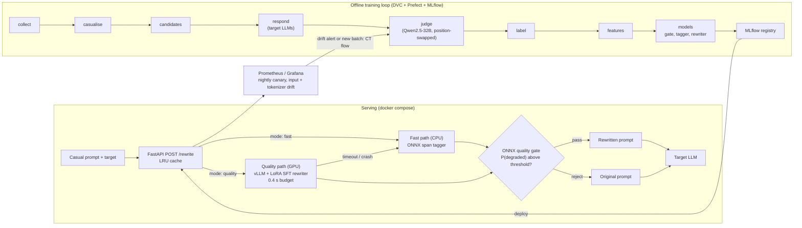

# Terser

**Rewriting casual prompts into token-efficient prompts that get the same output quality.**

Terser sits between a user and an LLM. It takes a prompt written the way people talk (filler,
hedging, restated requirements) and rewrites it for a specific target model, so that the prompt
costs fewer tokens on that model's tokenizer while the answer keeps the same quality and depth.
Every savings number is paired with a measured quality-preservation number; savings alone never
count as success. The project is also a course project that covers all four syllabus units
(concept learning to MLOps) on one problem ([syllabus map](docs/syllabus_map.md)).

## Architecture



The fast path never needs a GPU. The quality path falls back to the fast path when it misses its
budget, and when no rewriter produces a result the original prompt comes back
([C11.5](reports/p11_serving_checks.md)). Details: [ADR-0001](docs/decisions/ADR-0001-ml-lifecycle.md),
[ADR-0010](docs/decisions/ADR-0010-mlops.md), [API](docs/serving/api.md).

## Headline results

<!-- results:begin -->
Test split, evaluated once (row 12.1): 992 prompts in 234 source groups, two targets (Qwen2.5-7B,
Phi-3.5-mini), 95% cluster-bootstrap CIs over source groups. System: Terser full (`sft3bv2`
rewriter + quality gate + fallback). Full tables: [final_results.md](reports/final_results.md).

| # | Criterion (test split) | Target | Result |
| :---: | :--- | :--- | :--- |
| S1 | Median token savings | ≥ 30% (CI lower bound ≥ 25%) | **fail**: 0.0% [0.0, 0.0] on both targets |
| S2 | Quality preservation, overall | ≥ 95% | **pass**: 96.7% [95.4, 97.8] |
| S3 | Preservation, worst category | ≥ 90% | **fail**: 82.8% [77.8, 87.4] (`reason`, Qwen2.5) |
| S4 | Net savings after rewriter cost | positive at the 25th-percentile length, every target | **fail**: −58.6% (Qwen2.5), −57.5% (Phi-3.5) |
| S5 | S1–S3 per target model | hold for each target | **fail** on both targets |
| S7 | Fast-path latency | p95 ≤ 150 ms | **pass**: 20.9 ms at 20 RPS ([C11.2](reports/p11_serving_checks.md)) |
| S8 | Quality-path latency, one 24 GB GPU | p95 ≤ 400 ms | **fail**: 438 ms at 5 RPS, every request timed out to the fast path ([C11.3](reports/p11_quality_path.md)) |

S2 passes only because the gate rejects almost every rewrite (466 of 992 on Qwen2.5 and 589 on
Phi-3.5) and the rest fall back to the original, so the median prompt is served unchanged. No
system reaches S1 and S2 together. The systems that save tokens lose quality: the tuned 1.5B
rewriter saves 61.3% at 48.9% preserved, zero-shot Qwen2.5-32B 54.3% at 55.3%, and LLMLingua-2
51.4% at 26.5%. On the real-prompt slice (WildChat, reported, not gated) the full system preserves
97.3% at 0% savings.
<!-- results:end -->

## Status: honest summary

33 of 63 checkpoints pass and 30 are open ([status.md](docs/checkpoints/status.md)). Validation-split
results so far:

| What | Result | Source |
| :--- | :--- | :--- |
| Headroom exists (C2.7, hard gate) | **pass**: oracle median savings 46.5% (Qwen2.5) / 40.5% (Phi-3.5) | [p2_headroom.md](reports/p2_headroom.md) |
| Rule operators save tokens (C1.4) | **fail**: 1.7% median best-single-operator savings | [p1_tokenizer_study.md](reports/p1_tokenizer_study.md) |
| Rewriter main gate (C8.3, hard gate: ≥ 25% savings at ≥ 92% preserved) | **fail** on every rung: best savings 35.0% at 57.0% preserved (1.5B LoRA v2); best preservation 75.3% at 2.0% savings (7B QLoRA v2) | [p8_rewriter_val.md](reports/p8_rewriter_val.md) |
| vs zero-shot 32B / LLMLingua-2 (C8.4, C8.5) | **fail** | [p8_baselines.md](reports/p8_baselines.md) |
| Fast-path latency (C11.2) | **pass**: p95 20.9 ms at 20 RPS on CPU | [p11_serving_checks.md](reports/p11_serving_checks.md) |
| Quality-path latency and throughput (C11.3, C11.4) | **fail**: at the 0.4 s budget every quality request falls back; the uncapped rewriter needs p95 4.3 s (3B) / 1.8 s (1.5B v2) | [p11_quality_path.md](reports/p11_quality_path.md) |
| Fallback correctness (C11.5) | **pass**: 100% in all five fault scenarios | [p11_serving_checks.md](reports/p11_serving_checks.md) |
| Judge validated against humans (C2.3–C2.5, hard gates) | **open**: needs two human annotators; no script can stand in | [status.md](docs/checkpoints/status.md) |

What a user gets today: the ONNX gate rejects almost every rewrite at its deployed threshold
(298 of 300 fast-path rewrites, [p11_fast_path.md](reports/p11_fast_path.md)), so the service
mostly returns the original prompt. It is safe but saves little. The first nightly canary scored
98.0% preservation, but 380 of its 400 pairs were unchanged prompts; 12 of the 20 edited prompts
were preserved ([p11_canary.md](reports/p11_canary.md)). The full account, including every failed
checkpoint, is in the [report](docs/report.md).

## Quickstart (`docker compose up`)

```bash
dvc pull models/fast models/rewriter/sft-qwen3b-lora   # ONNX fast path + Staging LoRA rewriter
docker compose up --build                              # both paths + Prometheus, Pushgateway, Grafana
# CPU-only host (no NVIDIA GPU): fast path and monitoring only
docker compose up --build terser-cpu prometheus pushgateway grafana

curl -s localhost:8080/healthz
curl -s -X POST localhost:8080/rewrite -H 'content-type: application/json' \
  -d '{"prompt":"hey so um, could you maybe write a Python function that checks if a string is a palindrome? It should ignore case. Thanks so much!!","target":"qwen2.5","mode":"fast"}'
docker compose down
```

| Endpoint | URL |
| :--- | :--- |
| Rewrite API (`mode` `fast` or `quality`) | http://localhost:8080/rewrite |
| vLLM rewriter (`terser-gpu`, needs an NVIDIA GPU) | http://localhost:8000/v1 |
| Grafana (dashboard "Terser serving") | http://localhost:3000 |
| Prometheus / Pushgateway | http://localhost:9090 / http://localhost:9091 |

The first GPU start downloads `Qwen/Qwen2.5-3B-Instruct` into the `hf-cache` volume; wait for
`terser-gpu` to report healthy. On a Windows Docker host use a Windows copy of the repo, since a
WSL UNC path does not work as a bind-mount source
([p11_containers_dashboard.md](reports/p11_containers_dashboard.md)). Development setup without
Docker: [CONTRIBUTING.md § Getting started](CONTRIBUTING.md#getting-started).

## Repository layout

| Path | Contents |
| :--- | :--- |
| `src/terser/` | Package: `operators`, `tokenizers`, `concept`, `data`, `judge`, `llm`, `features`, `models/` (classical, neural, ensembles, clustering, rewriter, rl), `eval`, `hpo`, `serving`, `monitoring`, `flows`, `tracking`, `gpu_queue`, and one `phaseN` module of study scripts per phase |
| `configs/` | Hydra configs: `experiment/`, `model/`, `hardware/`, `serving/`, `budget.yaml` |
| `dvc.yaml`, `params.yaml` | Data pipeline stages (collect → … → features) |
| `data/` | DVC-tracked data: `raw`, `interim`, `processed`, `pilot`, `gold`, `canary` ([SOURCES.md](data/SOURCES.md)) |
| `models/` | DVC-tracked ONNX fast path and rewriter checkpoints |
| `docker/`, `compose.yaml` | CPU and GPU images, monitoring stack, Grafana dashboard |
| `gpu_queue/` | GPU job specs ([README](gpu_queue/README.md)) |
| `reports/` | Every experiment report, figures, monitoring snapshots |
| `docs/` | ADRs, model cards, data cards, derivations, checkpoints, serving docs |
| `tests/` | pytest suite (markers `gpu`, `api`, `slow`, `network`) |

## Further reading

- [Final report](docs/report.md): problem, method, validation results, negative results, limitations
- [Model cards](docs/model_cards/): [quality gate](docs/model_cards/quality_gate.md), [span tagger](docs/model_cards/span_tagger.md), [TextCNN](docs/model_cards/textcnn.md), [rewriter](docs/model_cards/rewriter.md)
- [Experiment reports](reports/)
- [Syllabus map](docs/syllabus_map.md): units 1–4 to phase, file and figure
- [CONTRIBUTING.md](CONTRIBUTING.md): the plan, every row and checkpoint, and how to contribute
- [Demo runbook](docs/demo.md)
