# ADR-0001: ML lifecycle for Terser

| Field | Value |
| :--- | :--- |
| Status | Accepted |
| Date | 2026-09-10 |
| Plan row(s) | 0.3.4 |
| Related | ADR-0002 (problem framing), ADR-0003 (training on model outputs), ADR-0010 (MLOps, row 11.1.1) |
| Amended | 2026-09-10: local open-source models only (see [Amendment](#amendment-2026-09-10-local-open-source-models)) |

## Context

Terser is several learned components (quality gate, span tagger, TextCNN span scorer, generative
rewriter, RL policy) that depend on one labelled dataset produced by an LLM judge. Its headline claim,
"fewer tokens at the same quality", is only credible if every model can be traced to the data, code,
config and checkpoint results that produced it, and if no model reaches users without passing the
quality checks defined in CONTRIBUTING.md.

Constraints that shape the lifecycle:

- Labels come from an open-source LLM judge served locally on vLLM (Qwen2.5-32B-Instruct-AWQ, fallback
  14B-AWQ), so labelling consumes GPU time, is capped by per-phase token budgets, and must be validated
  against humans before anything downstream is trusted (C2.3–C2.5).
- Savings are measured on each target's tokenizer, and tokenizers change between versions.
- The failure that matters most, silent over-compression, is invisible to token counts.
- The rewriter has its own cost and latency, which can cancel the savings it creates.
- Features are computed offline in DVC stages and online in the API; they can diverge.
- The RTX 4500 Ada is not connected yet, and there are no hosted LLM APIs. Every labelled example is produced
  on the GPU, so the GPU is on the critical path for labelling. Before it is connected, the lifecycle must
  run end to end on CPU with a tiny stand-in model (smoke tests only, outputs never used as labels).
- The project is also a syllabus deliverable (Unit 4: MLOps overview, lifecycle, production challenges).

Without a fixed lifecycle, stages would be run ad hoc, numbers would not be reproducible, and promotion
decisions would be made on aggregate metrics that hide per-category regressions.

## Decision

Terser adopts an eight-stage lifecycle with an explicit gate between stages:

**data → label → train → evaluate → register → deploy → monitor → retrain**, with retrain feeding back into data.

A model or dataset moves to the next stage only when that stage's gate passes. Gates are the checkpoints
in CONTRIBUTING.md; 🚧 gates allow no conditional pass. The tools per stage are fixed below; replacing a
tool requires a new ADR.

```mermaid
flowchart LR
    D["1. Data<br/>collect, scrub, casualise,<br/>dedupe, split<br/>(DVC)"]
    L["2. Label<br/>candidates, target outputs,<br/>position-swapped judge<br/>(vLLM on GPU, DVC)"]
    T["3. Train<br/>classical on CPU,<br/>neural via gpu_queue<br/>(Hydra, MLflow)"]
    E["4. Evaluate<br/>grouped CV, per category,<br/>net savings, latency<br/>(terser.eval)"]
    R["5. Register<br/>MLflow Model Registry<br/>None → Staging → Production"]
    P["6. Deploy<br/>FastAPI: fast path ONNX Runtime,<br/>quality path vLLM<br/>(GitHub Actions CD)"]
    M["7. Monitor<br/>Prometheus/Grafana, Evidently,<br/>tokenizer drift, shadow judging"]
    RT["8. Retrain<br/>Prefect CT flow,<br/>weekly or on drift alert"]

    D -->|"C2.1, C2.2 size and leakage"| L
    L -->|"🚧 C2.3–C2.5 judge valid<br/>🚧 C2.7 go/no-go"| T
    T -->|"smoke test green,<br/>run fully tagged"| E
    E -->|"phase checkpoint met,<br/>beats champion + original baseline"| R
    R -->|"Staging smoke + latency,<br/>manual approval"| P
    P -->|"C11.2–C11.5 latency,<br/>fallback 100%"| M
    M -->|"drift alert or<br/>preservation < 92%"| RT
    RT -->|"consented prompts"| D
    RT -.->|"promotion guard C11.7"| R
```

### Stage details

| # | Stage | What happens in Terser | Implemented by (phase / rows) | Tools | Gate to move on |
| :---: | :--- | :--- | :--- | :--- | :--- |
| 1 | **Data** | Collect permissively licensed instruction sets; licence audit; PII scrub before `data/interim/`; casualise in 5 styles; MinHash dedupe; source-grouped 70/15/15 splits; test split frozen and hash-locked; later cluster stratification; schema validation | 1.4.1, 2.1.1–2.1.7, 6.10, 11.1.2, 11.1.4 | DVC, pandera, Hydra, `terser.llm` provider `local` (casualisation on vLLM) | C2.1 (≥ 6,000 prompts, ≥ 800 per category, < 1% near-duplicates), C2.2 (0 shared source prompts), data card complete |
| 2 | **Label** | Generate 6 candidates per prompt; token counts on every target tokenizer; target outputs (Llama-3.1-8B-Instruct, Qwen2.5-7B-Instruct on vLLM); task metrics + position-swapped pairwise judge (Qwen2.5-32B-Instruct-AWQ on vLLM); judge self-preference control with a second Llama-3.1-8B judge; `preserved`/`degraded` label; 300 human-annotated pairs; oracle rewrite and headroom | 1.3.6, 2.2.1–2.2.5, 2.3.1–2.3.6, 2.4.1–2.4.3; needs 🚧 C7.1 | `terser.llm` provider `local` against vLLM with token-cap budget guard and disk cache (0.3.6); CPU stand-in via Ollama / llama.cpp for the pre-GPU smoke run only (2.2.4); DVC, tiktoken / HF tokenizers (Anthropic token counting optional, never required) | 🚧 C2.3 (human–human κ ≥ 0.60), 🚧 C2.4 (judge–human κ ≥ 0.60, ≥ 0.50 per category), 🚧 C2.5 (sensitivity ≥ 0.85, specificity ≥ 0.80), 🚧 C2.7 (oracle savings go/no-go), C2.6, C2.8, C2.9 |
| 3 | **Train** | Classical and small neural models on CPU (Phases 3–6); TextCNN, SFT rewriter ladder, GRPO and neural HPO as `gpu_queue/` jobs after a CPU smoke test | 3.3–3.6, 4.1–4.5, 5.1–5.3, 6.1–6.10, 8.2, 8.3, 9.2, 9.3, 10.1–10.7 | Hydra (`experiment=… hardware=…`), MLflow tracking, `terser.hardware.get_device`, `terser.gpu_queue`, PyTorch / PEFT / TRL, Optuna | Run logged with tags `phase`, `row`, `task`, `hardware`, `data_hash`, `git_sha`; CPU smoke test green; for GPU jobs 🚧 C7.1 passed and `est_vram_gb` ≤ 22 GB measured |
| 4 | **Evaluate** | `StratifiedGroupKFold` grouped by source prompt; per-category metrics; sensitivity-constrained threshold; McNemar / bootstrap vs champion and the original-prompt baseline; savings, preservation, net savings, latency; test split touched once in Phase 12 | 3.2.1–3.2.8, phase checkpoints C3–C10, 10.8, 12.1–12.12 | `terser.eval`, MLflow, `terser.eval.final` (only reader of test; implemented as `terser.phase12.unlock`) | The phase checkpoint (e.g. C5.1, 🚧 C8.3, C9.5, C10.3); per-category rows present; no test access (10.8); report in `reports/` with MLflow links |
| 5 | **Register** | Register gate, tagger and rewriter versions with lineage (git SHA, DVC hash, resolved config, checkpoints passed); model card written | 0.2.4, 11.2.1–11.2.3, 13.4 | MLflow Model Registry (`None → Staging → Production → Archived`) | Tracking audit finds 0 unlinked numbers (11.2.1); lineage complete (11.2.3); model card complete. Promotion to Staging only via the CT flow or a checkpoint PASS |
| 6 | **Deploy** | FastAPI `POST /rewrite`; fast path (span tagger + gate on ONNX Runtime, CPU); quality path (rewriter on vLLM + gate + fallback, GPU); cache; timeout fallback; per-request net-savings accounting; `terser-cpu` / `terser-gpu` containers; CD from tag `v*` through staging with manual approval | 11.3.1–11.3.7, 11.4.1, 11.4.2 | FastAPI, ONNX Runtime, vLLM, Docker / docker-compose, GitHub Actions | C11.2 (fast p95 ≤ 150 ms at 20 RPS), C11.3 (quality p95 ≤ 400 ms at 5 RPS), C11.4 (≥ 20 RPS for 30 min, no OOM), C11.5 (fallback returns original 100%), manual approval |
| 7 | **Monitor** | RPS, latency per path, fallback rate, gate rejections, tokens saved, net savings, GPU util/VRAM; daily input drift; tokenizer fixture re-count; 1% shadow judging of consented rewrites; structured logs with hashes by default | 11.5.1–11.5.6 | Prometheus, Grafana, Evidently, local judge on vLLM | Alerts wired and tested: C11.6 (synthetic shift or tokenizer swap alerts within one cycle); rolling preservation alert at < 92% |
| 8 | **Retrain** | Weekly or on drift alert: new consented prompts → judge labels → retrain gate/tagger on CPU → queue rewriter retrain on GPU → evaluate → register as Staging if checkpoints pass | 11.4.3, 11.4.4, 11.6.1, 11.6.2 | Prefect (`data_flow`, `train_classical_flow`, `train_rewriter_flow`, `evaluate_flow`, `promote_flow`, `drift_flow`), `gpu_queue`, DVC, MLflow | C11.7 (synthetic regression refused promotion); C11.1 (unattended CPU cycle on a fresh clone); new model re-enters stage 4 and must meet the same checkpoint targets as the model it replaces |

### Terser-specific production challenges

| Challenge | Why it is specific to Terser | Where the lifecycle handles it |
| :--- | :--- | :--- |
| **Judge cost** | Every label and every shadow-judged production request is a judge call on the single 24 GB GPU, competing with target serving, training and quality-path serving; CT multiplies this. The open judge may also be weaker than frontier models and prefer its own model family | Per-phase token caps and disk cache (0.3.6); exclusive, time-shared vLLM slots; quality gate as a cheap reward model in RL (9.2.1); small 8B judge only if κ ≥ 0.70 vs the 32B judge (C8.7); self-preference control (2.2.5); shadow judging limited to 1% (11.5.4); compute reports in generated tokens and GPU-hours (2.4.3, 12.10) |
| **Tokenizer drift** | Savings are defined on a target tokenizer; a provider tokenizer update changes every savings number and can change which substitution operator `S` picks | Tokenizer versions pinned in model cards; fixture re-count with alert (11.5.3); drift triggers CT; C0.2 exact-count test reused as regression test |
| **Silent over-compression** | A rewrite that drops a constraint is shorter, so token metrics improve while the answer gets worse; the user does not see the original output to compare | Positive class = degraded with threshold at sensitivity ≥ 0.95 (3.2.3); per-category preservation gates (🚧 C8.3, S3); fallback to lighter rewrite or original (8.3.7–8.3.8); failure taxonomy (8.3.10, 12.8); shadow judging and preservation alert (11.5.4–11.5.5) |
| **Rewriter latency and net savings** | The rewriter consumes compute and adds latency; on short prompts it can cost more than it saves | Net-savings accounting per request (11.3.6); CPU fast path (11.3.2); skip-short-prompts rule (3.5.4); timeout fallback (11.3.5); C11.2–C11.3 and S4 |
| **Training–serving skew** | Span and pair features are computed in DVC stages offline and inside FastAPI online; tokenizer and embedding versions can differ | One shared `terser.features` module (11.1.3) with 100/100 parity test in CI (11.4.1); same pinned tokenizer versions in training and serving images; data validation schemas (11.1.4) |
| **GPU not yet available** | Stage 2 needs the RTX 4500 Ada for every label (candidates, target outputs, judge), and stages 3, 6 and 8 need it for neural models, but the card is not connected | CPU-first ordering; Phase 2 stages smoke-tested end to end with a CPU stand-in (2.2.4); `gpu_queue/` jobs with CPU smoke tests; `hardware=auto` fallback; fast path runs on CPU; week-6 fallback plan in [hardware.md](../hardware.md#7-fallback-gpu-still-not-connected-by-week-6); the schedule slips, targets are not lowered |

## Alternatives considered

| Alternative | Pros | Cons | Why not chosen |
| :--- | :--- | :--- | :--- |
| Notebook-driven workflow, results copied into reports | Fast to start | No lineage, not reproducible, violates "every number links to an MLflow run" | Fails C0.3, C2.9, 11.2.1, S9 |
| Train directly on judge labels without human validation | Saves weeks 5–6 and annotation effort | All downstream numbers inherit an unmeasured judge error | Judge validity is the critical-path assumption (C2.3–C2.5, S6) |
| Continuous deployment with automatic promotion to Production | Less manual work | A regression in one category could reach users; silent over-compression is not caught by aggregate metrics | Manual approval plus promotion guard (11.4.2, 11.4.4) is required |
| Hosted managed platform (e.g. cloud ML pipelines and registry) | Less self-hosted infrastructure | Cost, account dependency, less transparency for a syllabus deliverable, no access to the local RTX 4500 Ada scheduling | Local DVC + MLflow + Prefect run on the laptop and the GPU machine alike |
| GPU-only serving | Simpler single path | Unavailable until Phase 7; higher cost; no fallback when GPU is busy with training | CPU fast path required (11.3.2, S7) |

## Consequences

- Positive:
  - Every registered model is traceable to git SHA, DVC hash, config and checkpoints passed.
  - No model reaches Production without per-category quality evidence and a passed latency test.
  - Code for stages 1–5 can be written and smoke-tested on CPU before the GPU is connected; labels and the numbers that depend on them wait for the GPU.
  - The same lifecycle is exercised end to end by the CT flow, which makes C11.1 a real test of it.
- Negative:
  - Overhead per experiment (tags, DVC stages, reports) slows early exploration.
  - Hard gates C2.3–C2.5 and C2.7 can stop the project after Phase 2; that outcome is accepted and would be reported as a negative result.
  - Shadow judging and CT keep a recurring GPU cost after deployment and compete with quality-path serving for the card.
  - Labelling cannot finish before Phase 7, so a late GPU delays everything downstream of stage 2.
- Follow-up:
  - ADR-0010 (row 11.1.1) refines stages 5–8 with the concrete MLOps architecture.
  - ADR-0003 records open-model licence compliance (Llama 3.1 Community Licence, Qwen2.5 licence) for training on model outputs before Phase 8.
  - Lifecycle risks are tracked in [risks.md](../risks.md) and reviewed at every checkpoint.

## Amendment 2026-09-10: local open-source models

**Change.** The project has no Anthropic or OpenAI API keys. All LLM work (casualisation, candidate
generation, target outputs, judging, shadow judging, RL audits) uses local open-source models behind
OpenAI-compatible servers, called through `terser.llm` provider `local` (CONTRIBUTING.md § Compute
Allocation). The stage structure, gates and checkpoint targets of this ADR are unchanged; the body above
has been updated where it referred to hosted APIs.

**Models (planning choices from CONTRIBUTING.md; VRAM figures are estimates verified in Phase 7).**

| Role | Model | Serving |
| :--- | :--- | :--- |
| Candidate generation + pairwise judge | Qwen2.5-32B-Instruct-AWQ (fallback Qwen2.5-14B-Instruct-AWQ) | vLLM on the RTX 4500 Ada, exclusive slot |
| Targets | Llama-3.1-8B-Instruct, Qwen2.5-7B-Instruct | vLLM bf16 |
| Small judge (self-preference control 2.2.5, audits 8.4) | Llama-3.1-8B-Instruct AWQ | vLLM; replaces the 32B judge only after C8.7 |
| CPU stand-in | Qwen2.5-0.5B / 1.5B | Ollama or llama.cpp on the laptop; smoke tests only, outputs tagged `stand_in: true`, never labels |

**Consequences for the lifecycle.**

- The GPU is on the critical path for stage 2: labelled data cannot be produced before 🚧 C7.1.
- Cost is measured in generated tokens and GPU-hours, not dollars. Per-phase `max_tokens` caps in
  `configs/budget.yaml` bound compute; USD caps apply only to priced providers, of which there are none.
- Judge, target serving, training and quality-path serving share one 24 GB card and must be scheduled in
  separate time slots.
- The open judge may be weaker than frontier models and may favour outputs from its own model family;
  C2.3–C2.5 and the self-preference control (2.2.5) must hold before labels are trusted.
- Compliance for training on model outputs follows the open models' licences (Llama 3.1 Community Licence,
  Qwen2.5 licence) instead of hosted-provider terms of service (ADR-0003).
- Optional Claude token counting may be used only if a key is ever added; no reported number depends on it.
