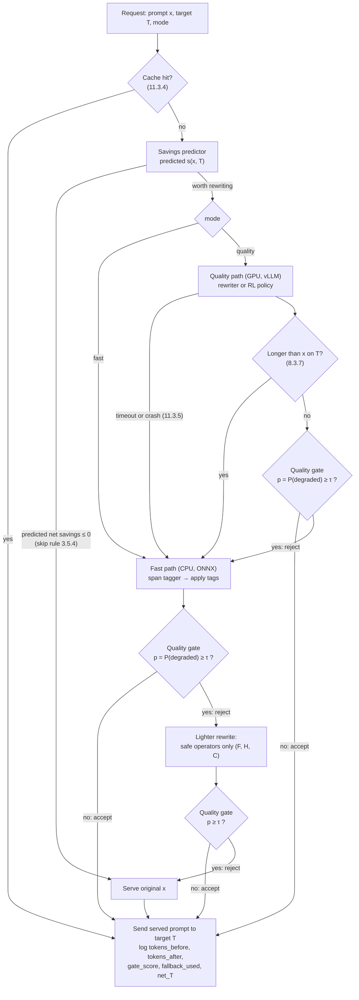

# ADR-0002: Problem framing for Terser

| Field | Value |
| :--- | :--- |
| Status | Accepted (2026-10-28, by the owner; ADRs no longer wait for a second contributor's review) |
| Date | 2026-09-10 |
| Plan row(s) | 1.1.1 (sub-problem taxonomy), 1.1.3 (positive-class convention) |
| Deciders | guru-bharadwaj20 |
| Related | ADR-0001 (ML lifecycle, local open-source models), [categories.md](../categories.md) (row 1.1.2), ADR-0003 (training on model outputs) |

## Context

Terser rewrites a casual prompt `x` into a shorter prompt `x'` for a target model `T` so that `T`'s
answer keeps the same quality. "Make prompts shorter without hurting answers" is not yet a learning
problem: it has no input space, output space, labels, loss or evaluation protocol. Every later phase
(3–12) trains or evaluates a model against one of these, and the syllabus (Unit 1, "Introduction to ML,
ML models") requires the framing to be explicit.

Forces:

- **Quality is only observable after the fact.** Whether `x'` is acceptable depends on `T`'s answer to
  `x'` compared with its answer to `x`, measured by the category's quality measure and the pairwise judge
  ([categories.md](../categories.md), row 2.3.4). At inference time neither answer exists yet.
- **Savings depend on the target.** Token counts differ between tokenizers, so the same rewrite saves
  different amounts on different targets (1.2.7, 1.4.4).
- **Errors are asymmetric.** A rewrite wrongly accepted as safe silently degrades the answer the user
  receives. A rewrite wrongly rejected only forfeits some savings.
- **Labels are expensive.** All labels come from local open-source models on one RTX 4500 Ada
  (ADR-0001 amendment): candidates and judging by Qwen2.5-32B-Instruct-AWQ (fallback 14B-AWQ), target
  answers by Llama-3.1-8B-Instruct and Qwen2.5-7B-Instruct. No hosted APIs are used. The GPU is not
  connected yet, so learned components must be trainable from one labelled dataset produced once in
  Phase 2.
- **Serving has two budgets.** A CPU fast path (p95 ≤ 150 ms, C11.2) and a GPU quality path
  (p95 ≤ 400 ms, C11.3). The rewriter's own compute can cancel the savings it creates (S4).
- **Casualised data creates near-duplicates.** Several casual variants, candidates and targets derive
  from one source prompt, so random splits leak (3.2.5).

Without a fixed framing, components would be trained on inconsistent labels, gate metrics would be
reported with different positive classes, and savings numbers would not be comparable across phases.

## Decision

Terser is framed as **six sub-problems** sharing one dataset, one set of definitions (below) and one
split unit. The system output is a rewrite that passes a learned **quality gate**, with fallback to a
lighter rewrite or the original prompt.

### Notation

| Symbol | Meaning |
| :--- | :--- |
| `x` | Casual prompt as written by the user |
| `x'` | Candidate rewrite of `x` |
| `T` | Target model: `llama-3.1-8b-instruct` or `qwen2.5-7b-instruct` (gpt-4o `o200k_base` is used as a tokenizer only, 1.4.2) |
| `c` | Task category of `x`, one of `code`, `fact`, `reason`, `explain`, `creative`, `transform` ([categories.md](../categories.md)) |
| `n_T(s)` | Number of tokens of string `s` on `T`'s official tokenizer, as counted by `terser.tokenizers` (exact, C0.2) |
| `g` | Source-prompt group id: the clean source instruction all casual variants of `x` were derived from (2.1.4–2.1.6) |
| `y ∈ {preserved, degraded}` | Quality label of `(x, x', T)` from the Phase 2 `label` stage (2.3.4) |

### Core definitions

**Token savings** of a rewrite on target `T`:

```
savings_T(x, x') = (n_T(x) − n_T(x')) / n_T(x)
```

Counted on `T`'s own tokenizer, never on a proxy tokenizer. A system that returns the original prompt
has savings 0. Rewrites longer than `x` on `T` are never served (8.3.7), so served savings are in
`[0, 1)`. Headline numbers are the **median** over prompts per target (C8.3, S1); the mean is reported
alongside.

**Quality preservation** of a system on target `T`:

```
preservation_T = share of (x, T) pairs whose served prompt is labelled preserved
```

The served prompt is whatever the system finally sends to `T`, after the gate and any fallback. The
label follows the 2.3.4 rule: the category's task metric is not worse **and** the position-swapped
judge says tie-or-rewrite-better in **both** A/B orders. A fallback to the original prompt counts as
preserved with savings 0, so a system cannot raise preservation without paying in savings. Preservation
is always reported overall **and** per category (C8.3, S2, S3), and always next to savings: savings
alone never count as success.

**Net savings** per request, in compute rather than money (no priced provider is used):

```
net_T(x) = k_T · (n_T(x) − n_T(x')) − (k_R · r(x) + k_G · q(x))
```

- `k_T`: measured compute cost of one prompt token on `T` (GPU-seconds per prefill token under vLLM on
  the RTX 4500 Ada, measured in 7.6 at the serving configuration).
- `r(x)`: rewriter work for the request (generated plus prompt tokens on the quality path; span-tagger
  work on the fast path), `k_R` its measured cost per unit.
- `q(x)`: gate and savings-predictor work, `k_G` its measured cost per unit.
- Costs are recorded in seconds of the hardware that did the work (GPU-seconds for vLLM, CPU-seconds for
  the ONNX fast path) and follow the GPU-hour accounting in [conventions.md](../conventions.md). The
  headline figure (S4, 12.7) states which hardware each term ran on. Plan row 11.3.6 writes this as
  `price_T × (tokens_before − tokens_after) − rewriter_cost`; for local models `price_T` is `k_T`.
- Changes in `T`'s **output** length are reported separately (12.7) and are not netted into savings,
  because a shorter answer can itself be a degradation.
- Net savings is also expressed in target-token equivalents, `net_T(x) / k_T`, so it can be compared
  with token savings.

**Split unit.** Every sub-problem splits by source-prompt group `g`: train 70 / val 15 / test 15
(2.1.6), paraphrase groups kept whole (2.1.5), cross-validation by `StratifiedGroupKFold(k=5)` with
stratification on category × label (3.2.4). All casual variants, all candidates and all target-specific
rows of one source prompt stay in the same fold. The test split is read once, in Phase 12 (12.1).

### The six sub-problems

#### 1. Quality gate (binary classification)

| Aspect | Definition |
| :--- | :--- |
| Input space | `(x, x', c, T)`, represented as pair features (3.1.3: token ratio on `T`, self-information removed, negations / numbers / constraint keywords removed, embedding cosine, category one-hot, target id) or the 1536-d pair embedding `[e_x, e_x', \|e_x − e_x'\|, e_x ⊙ e_x']` (4.1.2). **Target answers are not inputs**: the gate decides before `T` is called |
| Output space | `{preserved, degraded}`, via a score `p = P(degraded \| x, x', c, T) ∈ [0, 1]` and threshold `τ` |
| Label source | Phase 2 `label` stage (2.3.4) over candidates (2.2.1), target answers (2.2.3) and the position-swapped judge (2.3.3) |
| Loss | Log-loss for LR, MLP and GBM; entropy / information gain for trees; hinge for SVM; exponential loss for AdaBoost |
| Metric | ROC-AUC; **specificity at sensitivity ≥ 0.95**; PR-AP (degraded is the minority); full suite of 3.2.1 per category; all with positive class = degraded (see [Positive-class convention](#positive-class-convention-row-113)) |
| Syllabus models | Concept learning as a symbolic precursor (1.3); ID3 / C4.5 and pruning (3.3); logistic regression (3.4); KNN classification (3.5.1); MLP (4.1.4–4.1.6) with activation and optimizer studies (4.2, 4.3); SVM linear and polynomial (4.4); AdaBoost, Random Forest, LightGBM (5.1); Bayes optimal classifier over Phase 1 hypotheses (5.2.4); grid / random / Bayesian HPO (3.6.4, 4.5, 10.2–10.4) |
| Checkpoints | C3.3, C4.4, C4.5, C5.1, C10.2 |
| Baseline | Majority class, stratified random, "always preserved" (3.6.5) |
| Cost of failure | **False negative** (degraded rewrite accepted): silent over-compression reaches the user; the costliest error in the system. **False positive** (preserved rewrite rejected): fallback to a lighter rewrite or the original; savings lost, quality unaffected. Also serves as the RL reward model (9.2.1, 9.3.2), so a weak gate invites reward hacking (C9.3) |

#### 2. Span tagger (sequence labelling)

| Aspect | Definition |
| :--- | :--- |
| Input space | Token sequence of `x` (with `c`, `T`); per-token span features (3.1.2: token cost on `T`, GPT-2 self-information, stopword ratio, position, POS, filler-lexicon hit, negation / number / constraint flags), discretised observations for the HMM (5.3.1) or learned embeddings for the TextCNN (8.2.1) |
| Output space | One tag per token in `{KEEP, DROP, REPLACE}`; REPLACE takes its replacement from the phrase table of operator `S` (1.2.7). Applying the tags yields `x'` |
| Label source | Diff alignment of `x` with its oracle rewrite (3.1.1), where the oracle is the shortest preserved candidate per prompt and target (2.4.1) |
| Loss | Per-token cross-entropy (LR, MLP, TextCNN); information gain (trees); joint likelihood by supervised MLE and Baum-Welch EM (HMM, 5.3.2, 5.3.5) |
| Metric | Token macro-F1 over the three tags; end to end, savings and preservation of the tagged rewrite after the gate (C5.6) |
| Syllabus models | ID3 / C4.5 and LR on span features (3.3, 3.4); perceptron and hard / soft-margin SVM on filler spans (4.1.1, 4.4.5, 4.4.6); Naive Bayes filler detector (5.2.3); MLE token-cost priors (5.2.2); HMM with forward, Viterbi, Baum-Welch (5.3); GBM tagger (8.2.4); TextCNN (8.1.2, 8.2) with Bayesian HPO (10.6) |
| Checkpoints | C3.4, C5.3, C5.6, C8.1, C8.2 |
| Baseline | All-KEEP (savings 0); best single rule-based operator and the fixed operator stack `C H F I D S L` (1.2.8) |
| Cost of failure | DROP on a constraint, number, negation or payload token degrades the answer (caught only if the gate catches it). Too much KEEP loses savings. The tagger is the core of the CPU fast path, so its latency counts against C11.2 |

#### 3. Savings predictor (regression)

| Aspect | Definition |
| :--- | :--- |
| Input space | `(x, c, T)` only, before any rewrite: prompt embedding and cheap prompt features (length on `T`, filler density, constraint count) |
| Output space | Achievable savings `s ∈ [0, 1)` on `T`, the savings of the oracle rewrite |
| Label source | Oracle table (2.4.1); prompts with no preserved candidate get `s = 0` |
| Loss | Squared error |
| Metric | MAE (percentage points) and R² (C3.5); expected net-savings curve of the skip rule (3.5.4) |
| Syllabus models | KNN regression (3.5.2); squared-loss bias–variance decomposition over k (3.6.1); learning curves (3.6.3); the TextCNN prompt-compressibility head is a neural variant (8.2.1, 8.2.3) |
| Checkpoints | C3.5 |
| Baseline | Predict the training median savings for the prompt's category and target |
| Cost of failure | Over-prediction: the rewriter runs on prompts where its cost exceeds the savings, so net savings go negative (S4). Under-prediction: prompts are skipped and savings are lost. Neither affects quality |

#### 4. Intent discovery (clustering)

| Aspect | Definition |
| :--- | :--- |
| Input space | Prompt embeddings of train prompts (6.1: bge-small, 384-d) |
| Output space | Cluster id in `{1, …, k}` (flat) or a dendrogram (hierarchical) |
| Label source | None for fitting. Evaluation joins clusters with the six categories (6.8) and with per-cluster degradation rate and oracle savings from 2.3.4 and 2.4.1 (6.9) |
| Loss | Within-cluster sum of squares (K-means, bisecting K-means); linkage criterion (agglomerative); negative log-likelihood (GMM-EM) |
| Metric | Silhouette (C6.1), SSE / elbow, ARI and NMI against categories, K-means ⇔ EM assignment agreement (C6.2), degradation-rate ratio of the riskiest cluster (C6.3) |
| Syllabus models | K-means, bisecting K-means (6.2, 6.3); hierarchical vs non-hierarchical (6.4); agglomerative and divisive (6.5, 6.6); EM and GMM (5.2.5, 6.7) |
| Checkpoints | C6.1–C6.3 |
| Baseline | The six hand-defined categories used as clusters |
| Cost of failure | A missed high-risk intent family hides a per-slice regression behind a good aggregate. Clusters also feed stratification (6.10), so a poor clustering unbalances later training and evaluation. Fitted on train prompts only; val and test prompts are only assigned, never used to fit |

#### 5. Rewriter (conditional generation)

| Aspect | Definition |
| :--- | :--- |
| Input space | `<target=T>` conditioning prefix + `x` (8.3.1) |
| Output space | Rewrite `x'`: a token sequence over the rewriter's vocabulary, scored on `T`'s tokenizer |
| Label source | SFT pairs `(x, oracle preserved rewrite)` from the train split (8.3.1, from 2.4.1) |
| Loss | Token-level cross-entropy with teacher forcing |
| Metric | Median savings on every target and preservation overall and per category with gate and fallback on (🚧 C8.3); latency (C8.4, C11.3); tokenizer-awareness gain (C8.6) |
| Syllabus models | Deep learning foundations (8.1.1); SFT ladder Qwen2.5-0.5B full FT → 1.5B / 3B LoRA → 7B QLoRA (8.3.3–8.3.6); Bayesian HPO of LoRA settings (10.7) |
| Checkpoints | 🚧 C8.3, C8.4–C8.6, C10.3 |
| Baseline | Original prompt; best single operator; HMM compressor; LLMLingua-2; zero-shot Qwen2.5-32B-Instruct-AWQ "rewrite concisely" (8.3.9) |
| Cost of failure | Dropped constraint, tone, example or changed meaning (8.3.10) degrades the answer if the gate misses it; output longer than `x` wastes compute (blocked by 8.3.7); slow generation breaks C11.3 and eats net savings |

#### 6. Rewrite policy (reinforcement learning)

| Aspect | Definition |
| :--- | :--- |
| Input space | Tabular: state = (remaining filler bucket, constraint count, length bucket, category, operators applied) (9.1.2). Neural: `(T, x)` as for the rewriter |
| Output space | Tabular: action in `{F, H, D, I, L, C, S, STOP}` (9.1.3). Neural: a sampled rewrite `x'` |
| Label source | No supervised labels. Reward from the quality gate trained on 2.3.4 labels as a cheap reward model (9.2.1, 9.3.2), verified by the 32B judge (9.2.4, 9.3.3) |
| Loss | Tabular: Q-learning temporal-difference update derived from the Bellman optimality equation (9.1.6). Neural: GRPO objective with KL penalty to the SFT reference (9.3.1) |
| Reward | Tabular on `STOP`: `Δtokens% − 100 · 1[degraded]`, per step `−0.01` (9.1.4). Neural: `tokens_saved_pct × gate_pass`, `gate_pass = 1[p < τ]` (9.3.2) |
| Metric | Q-table convergence (C9.1); judge-verified savings and preservation (C9.2, C9.5); gate precision on RL rewrites vs Phase 2 data (C9.3); degenerate-output rate (C9.4) |
| Syllabus models | Agent, environment, states, actions, rewards, policy and value functions, Bellman equations (9.1); tabular Q-learning (9.2); policy optimisation of the neural rewriter (9.3) |
| Checkpoints | C9.1–C9.5 |
| Baseline | Best fixed operator order (C9.2); the SFT rewriter (C9.5) |
| Cost of failure | Reward hacking: the policy learns rewrites that fool the gate but degrade answers, which is why audits use the separate judge. Degenerate or empty outputs. If RL does not beat SFT, SFT stays champion |

### How the sub-problems compose at inference



The fallback chain only moves toward less compression, and it ends at the original prompt, so every
request is served (C11.5). Intent clusters are not on the request path: they shape sampling, evaluation
slices and monitoring (6.10, 12.3, 11.5.2). The exact operator set of the lighter rewrite is a
planning choice to be confirmed by the per-operator safety results of 1.3.7 and 1.4.

### Model choices

All LLM roles follow the local open-source model decision in ADR-0001 (amendment 2026-09-10). Labels,
metrics and reported numbers come only from GPU-served models; the CPU stand-ins (Qwen2.5-0.5B / 1.5B)
are for smoke tests and are never used as labels.

| Role in this framing | Model |
| :--- | :--- |
| Candidate generation (2.2.1), pairwise judge for labels (2.3.3), RL audits (9.3.3), zero-shot baseline (8.3.9) | Qwen2.5-32B-Instruct-AWQ (fallback Qwen2.5-14B-Instruct-AWQ) |
| Targets `T` (2.2.3) | Llama-3.1-8B-Instruct, Qwen2.5-7B-Instruct |
| Second judge for self-preference control (2.2.5), optional small judge (8.4) | Llama-3.1-8B-Instruct AWQ |
| Rewriter base (8.3) | Qwen2.5-0.5B → 1.5B → 3B → 7B ladder |

## Alternatives considered

| Alternative | Pros | Cons | Why not chosen |
| :--- | :--- | :--- | :--- |
| **Single end-to-end generator only** (fine-tune one rewriter, no gate, tagger or predictor) | One model; simplest serving; directly optimises the output | No calibrated safety check, so silent over-compression is invisible until judged offline; needs the GPU for every request, so no CPU fast path (C11.2, S7); nothing to train before Phase 8; no reward model for RL without calling the judge; covers only a small part of the syllabus | Fails the asymmetric-cost requirement and the CPU-first schedule. Kept as a component (sub-problem 5) and as an ablation ("remove gate / fallback", 12.6) |
| **LLMLingua-style token classification only** (a tagger that deletes tokens, no gate or generator) | Fast, CPU-friendly, well-studied, strong published baseline | Deletion only: cannot reorder, list-ify or rephrase (`I`, `L`, `S`); tends to produce ungrammatical prompts that some targets handle poorly; no explicit quality decision; savings measured on its own tokenizer, not on `T` | Kept as sub-problem 2 behind the gate, and LLMLingua-2 is a baseline (2.2.1, 8.3.9, C8.5) |
| **Heuristic operators only** (fixed `C H F I D S L` stack, no learning) | Transparent, deterministic, no training data, zero GPU | Cannot decide when an operator is unsafe (e.g. dropping tone cues in `creative`, categories.md §3.5); savings capped by hand-written rules; no way to adapt to new targets or drift | Operators remain the hypothesis-space building blocks (1.2) and a baseline (best single operator, 8.3.9); concept learning (1.3.8) documents why the conjunctive rule language is not enough |

## Consequences

- Positive:
  - Every phase has a fixed input, output, label source, metric and baseline, so results are comparable
    across models and phases and map directly to the syllabus units ([syllabus_map.md](../syllabus_map.md)).
  - One Phase 2 dataset (candidates, target answers, judge labels, oracle table) feeds all supervised
    sub-problems; the gate then replaces the judge as a cheap reward model and serving-time check.
  - Savings, preservation and net savings are defined once, on `T`'s tokenizer and in measured compute,
    so no reported savings number can appear without its preservation number.
  - The CPU fast path (tagger + gate + predictor) can be built and served without the GPU.
  - The positive-class convention fixes the meaning of sensitivity and specificity everywhere, including
    the RL gate precision C9.3.
- Negative:
  - Six components must be versioned, monitored and kept consistent (feature parity 11.1.3, registry
    11.2.2); errors compound along the fallback chain.
  - The gate inherits any judge bias, including self-preference of the Qwen judge towards Qwen outputs;
    mitigated by 2.2.5 and the position swap (C2.6), not eliminated.
  - Oracle-derived labels (tagger, predictor, rewriter) are bounded by the six candidates generated per
    prompt; savings beyond the best candidate cannot be learned from supervision.
  - A sensitivity ≥ 0.95 threshold will reject many safe rewrites when the gate is weak, lowering
    savings; this is accepted (see below).
  - Net savings depends on hardware measurements not yet available (Phase 7).
- Follow-up:
  - `terser.eval.labels` implements the positive-class convention now (1.1.3); `eval/metrics.py`
    (3.2.1), `eval/curves.py` (3.2.2) and `eval/threshold.py` (3.2.3) must import from it.
  - `k_T`, `k_R` and `k_G` are measured in 7.6 and 11.3 and recorded in the VRAM table and model cards.
  - The lighter-rewrite operator set in the inference diagram is confirmed or amended after 1.3.7 and
    1.4.3.
  - Verification: unit tests in `tests/test_eval_labels.py`; checkpoints C3.3,
    C3.4, C3.5, C6.3, 🚧 C8.3 and C9.3 exercise each sub-problem's definition.

---

## Positive-class convention (row 1.1.3)

This section is the decision for plan row 1.1.3. It applies to the quality gate, and to every binary metric computed by
`terser.eval`.

### Decision

**The positive class is `degraded`.**

| Constant in `terser.eval.labels` | Value | Meaning |
| :--- | :---: | :--- |
| `PRESERVED` | `0` | Label `preserved` from 2.3.4: the rewrite keeps answer quality |
| `DEGRADED` | `1` | Label `degraded`: the rewrite makes the answer worse |
| `POSITIVE_LABEL` | `DEGRADED` | Positive class for every binary metric |
| `LABEL_NAMES` | `{0: "preserved", 1: "degraded"}` | String form used in data files |

Gate scores are probabilities of the positive class, `p = P(degraded)`. A rewrite is rejected when
`p ≥ τ`.

### Metric meanings under this convention

| Metric | Formula | Meaning for Terser |
| :--- | :--- | :--- |
| **Sensitivity** (recall of degraded) | TP / (TP + FN) | Share of truly degraded rewrites that the gate catches |
| **Specificity** | TN / (TN + FP) | Share of truly preserved rewrites that the gate accepts |
| Precision | TP / (TP + FP) | Share of rejected rewrites that were truly degraded |
| False negative | degraded, predicted preserved | Silent over-compression reaches the user |
| False positive | preserved, predicted degraded | A safe rewrite is rejected; savings are lost |

ROC curves, PR curves, AP and F1 are computed with `pos_label=DEGRADED`. With scikit-learn, always pass
`pos_label=POSITIVE_LABEL` explicitly. `terser.eval.labels.sensitivity` and `specificity` return `nan`
when the denominator class is absent. The "always preserved" baseline (3.6.5) has sensitivity 0 and
specificity 1.

### Why degraded is positive

The two errors have very different costs. A missed degradation (FN) changes the answer the user gets,
and the user cannot see the answer the original prompt would have produced, so the failure is silent. A
false alarm (FP) only sends a lighter rewrite or the original prompt, costing savings but never quality.
Making degraded the positive class puts the costly error in the metric the constraint is placed on
(sensitivity) and keeps the savings cost in specificity. Degraded is also the expected minority class
(C2.8: 15–60% of candidates), which is the usual choice of positive class for PR analysis.

### Threshold rule (row 3.2.3)

Choose `τ` to **maximise specificity subject to sensitivity ≥ 0.95**:

```
τ* = argmax_τ specificity(τ)   subject to   sensitivity(τ) ≥ 0.95
```

- Computed on out-of-fold validation predictions from grouped cross-validation (3.2.4), never on the
  test split.
- Chosen once per (gate model, target). Sensitivity is also reported per category; a category below
  0.95 is reported, and any per-category threshold needs its own justification in the 3.2.3 report.
- The constraint is always feasible (rejecting everything gives sensitivity 1), so a weak gate shows up
  as low specificity, which is exactly what C3.3 (≥ 0.40) and C5.1 (≥ 0.60) measure.
- Implemented in `eval/threshold.py` (3.2.3) on top of `terser.eval.labels`.

### Where it is used

`src/terser/eval/labels.py` (`PRESERVED`, `DEGRADED`, `POSITIVE_LABEL`, `LABEL_NAMES`, `to_binary`,
`confusion_counts`, `sensitivity`, `specificity`) is the single source of the convention. Metrics (3.2.1),
curves (3.2.2), threshold selection (3.2.3), RL gate precision (C9.3) and gate
rejection monitoring (11.5.1) must use these constants rather than literal `0` / `1`.
