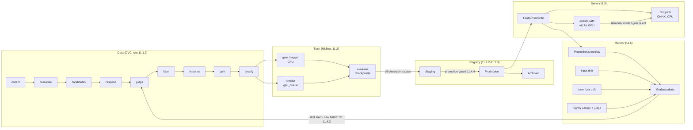

# ADR-0010: MLOps for Terser

| Field | Value |
| :--- | :--- |
| Status | Accepted |
| Date | 2026-10-01 |
| Plan row(s) | 11.1.1 (also frames 11.1–11.6) |
| Related | ADR-0001 (ML lifecycle, row 0.3.4), ADR-0004 (plan revision), ADR-0005 (judge protocol) |
| Deciders | Project owner |
| Reviewers | — |

## Context

ADR-0001 fixed the lifecycle stages (data → label → train → evaluate → register → deploy →
monitor → retrain). This ADR decides how Phase 11 operates that lifecycle in production and names
the failure modes specific to Terser that a generic MLOps stack would miss. Constraints:

- **No hosted LLM APIs.** Labels, canaries and the quality path all run on local open models
  (vLLM on 24 GB Ada GPUs). GPU time is the scarce resource; CPU work must never wait on it.
- **The product's metric is relative.** Savings are measured on each *target's* tokenizer, and
  quality is "the target's answer is preserved", which only an LLM judge (validated against
  humans, C2.3–C2.5) can measure.
- **Two serving paths** with different cost profiles: a CPU fast path (span tagger + gate on ONNX
  Runtime) and a GPU quality path (generative rewriter on vLLM) with a fallback to the fast path.

## Decision

### Lifecycle diagram

Orchestration is Prefect (11.6): `data_flow`, `train_classical_flow`, `train_rewriter_flow`
(which only *submits* to `gpu_queue`, never blocks on a GPU), `evaluate_flow`, `promote_flow`,
`drift_flow`, and two added later: `ct_flow` (continuous training) and `canary_flow`
(`src/terser/flows/flows.py`). Every LLM step is cached (`terser.llm` response cache), so a retry re-reads rather
than re-generates.

### Terser-specific production challenges and the control for each

| Challenge | Why it is specific to Terser | Control (row) |
| :--- | :--- | :--- |
| **Judge cost** | Every label and every quality measurement is an LLM-judge call on a GPU; a naive CT loop would re-judge everything | Response cache keyed on (model, messages, params); per-phase token budgets (`configs/budget.yaml`); CT judges only the new batch (11.4.3); the gate is a cheap reward model for RL (9.2.1) |
| **Tokenizer drift** | Savings are counted on target tokenizers; a tokenizer release silently changes every savings number and stale counts corrupt features | Pinned tokenizer versions; fixture re-count with alert on any change (`terser.monitoring.tokenizer_drift`, 11.5.3), run in CI |
| **Silent over-compression** | A rewrite can be shorter *and* wrong; token metrics improve while users get worse answers. Nothing in request logs reveals it | Gate on every rewrite with fallback to the original; nightly 200-prompt canary through the deployed service *and* the judge, alert at rolling preservation < 92% (11.5.4, 11.5.5); synthetic-regression promotion guard (11.4.4) |
| **Latency budget** | The rewriter's own latency and cost can cancel the savings it creates | Quality-path timeout ⇒ fast-path result (11.3.5); per-request net-savings accounting `price_T × Δtokens − rewriter_cost` (11.3.6); p95 targets C11.2/C11.3 |
| **Training/serving skew** | Features (token costs, self-information, keyword flags) are computed offline in DVC and online in the API | One `terser.features` package for both, with a 100/100 parity test in CI (11.1.3); pandera schemas on every stage boundary (11.1.4) |

### Promotion rule

A model moves `Staging → Production` only through `promote_flow`, which requires every checkpoint
the model depends on to be ✅ in its lineage record (git SHA, DVC hash, config, checkpoint IDs;
11.2.3). Production never sees a model trained on stand-in (`stand_in: true`) outputs.

## Alternatives considered

| Alternative | Pros | Cons | Why not chosen |
| :--- | :--- | :--- | :--- |
| Airflow instead of Prefect | Mature, common in industry | Heavy for one machine; DAG-file deployment | Prefect flows run as plain callables on a laptop and in CI |
| Kubeflow / KServe | End-to-end platform | Requires Kubernetes; no cluster available | Docker Compose covers one CPU host + one GPU worker (11.3.7) |
| Monitor only latency/error rate | Simple | Misses silent over-compression entirely | Quality must be measured with the judge |
| Re-judge the full dataset on every CT run | Labels always fresh | GPU cost grows with the dataset | Cache + judge only new batches |

## Consequences

- Positive: each Terser-specific failure mode has a named detector and an owner row; GPU work is
  queued, never on the CPU critical path.
- Negative: the canary needs a GPU judge nightly; until GPUs are permanently available it runs
  on demand and C11.6 cannot be checked continuously.
- Follow-up: rows 11.1.2, 11.2.2–11.2.3, 11.3.2–11.3.3, 11.3.7, 11.4.1–11.4.3, 11.5.2,
  11.5.4–11.5.5, 11.6.x; checkpoints C11.1–C11.7 verify this ADR.
