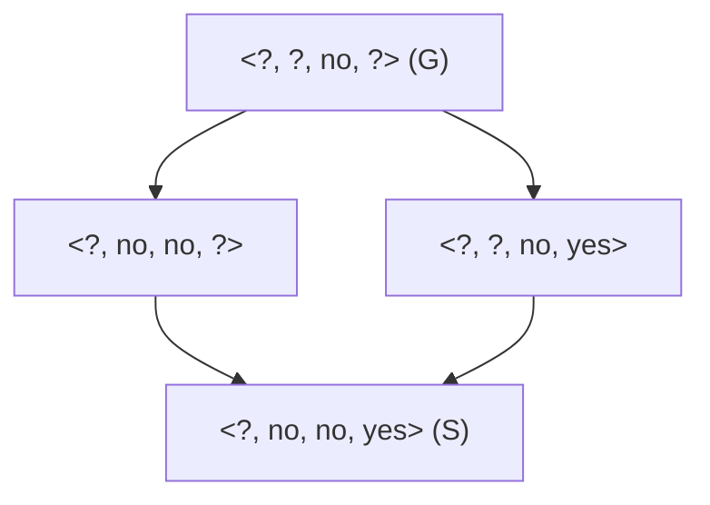

# Concept learning for Terser: hypotheses, Find-S, Candidate-Elimination

Plan row **1.3.2**. This note derives the concept-learning machinery used in
Phase 1 and ties each result to the code in `src/terser/concept/`:

| Module | Contents |
|---|---|
| `attributes.py` | Instance language: `ATTRIBUTES`, `DOMAINS`, `describe_prompt`, `instance` |
| `hypothesis.py` | `ANY`, `NONE`, `covers`, `more_general_or_equal`, `min_generalise`, `min_specialisations`, `hypothesis_space` |
| `find_s.py` | `find_s`, `covered_negatives` |
| `candidate_elimination.py` | `candidate_elimination`, `Collapse`, `minimal_conflict`, `BoundaryTooLargeError` |
| `version_space.py` | `iter_version_space`, `version_space`, `brute_force_version_space` |

The worked example in section 8 is encoded in `tests/concept/test_concept_learning_doc.py`,
which asserts every S, G and version space printed there. The treatment follows Mitchell,
*Machine Learning* (1997), chapter 2.

---

## 1. Instance space and target concept

An **instance** describes one (prompt, operator set) pair: five prompt attributes followed by
seven operator flags, in the order of `ATTRIBUTES`.

| # | Attribute | Domain | Meaning |
|---|---|---|---|
| 0 | `length` | `short`, `medium`, `long` | gpt-4o token count: `< 25` short, `<= 80` medium, otherwise long |
| 1 | `has_constraints` | `yes`, `no` | The prompt states an explicit requirement ("must", "at most", "3 bullets") |
| 2 | `has_payload` | `yes`, `no` | Code fence, inline code, a quotation of at least 40 characters, or a code keyword pattern |
| 3 | `tone_cue` | `yes`, `no` | A request about tone, style, register or audience |
| 4 | `filler_density` | `low`, `high` | Share of tokens removed by operators `F`, `H`, `C` is at least 0.15 |
| 5–11 | `op_F`, `op_H`, `op_D`, `op_I`, `op_L`, `op_C`, `op_S` | `yes`, `no` | Whether that operator is in the applied set |

The instance space `X` is the product of the domains, so

$$|X| = 3 \cdot 2^{11} = 6144.$$

`describe_prompt(text)` computes attributes 0–4 and `instance(prompt_attrs, ops)` appends the
flags, e.g. `instance(attrs, "FHC")` sets `op_F`, `op_H`, `op_C` to `yes` and the rest to `no`.

The **target concept** `c : X → {True, False}` is "the rewrite preserved output quality". A
labelled example is a pair `(x, c(x))`, the type `Example = tuple[Instance, bool]`, where
`True` means preserved. Concept learning treats *preserved* as the positive class. This is
the opposite of the quality-gate convention in ADR-0002 (row 1.1.3), where *degraded* is
positive; the two conventions live in different modules and must not be mixed.

## 2. Conjunctive hypotheses

### 2.1 Representation

A hypothesis `h` is a tuple with one constraint per attribute (`Hypothesis = tuple[str, ...]`).
Each constraint is

* a concrete domain value, which accepts only that value;
* `ANY = "?"`, which accepts every value;
* `NONE = "∅"`, which accepts no value.

`covers(h, x)` is true iff every constraint accepts the matching value of `x`:

$$\mathrm{covers}(h, x) \iff \forall a:\ h_a = {?} \ \lor\ h_a = x_a .$$

Any hypothesis containing `∅` covers nothing. All such tuples denote the same empty concept,
so the code treats them as one element, **bottom** `<∅, …, ∅>` (`canonical` rewrites them).
The most general hypothesis is **top** `<?, …, ?>`.

Terser examples over the 12 attributes, written with `format_hypothesis(h, ATTRIBUTE_NAMES)`
style (concrete values as `name=value`):

* `<length=long, ?, has_payload=no, tone_cue=no, filler_density=high, op_F=yes, ?, ?, ?, ?, ?, ?>`:
  "long, payload-free, tone-free, filler-heavy prompts rewritten with at least `F` are
  preserved" (the other operators are unconstrained).
* `<?, ?, ?, tone_cue=no, ?, ?, op_H=yes, ?, ?, ?, ?, ?>`: "removing hedging preserves quality
  whenever the prompt has no tone cue".
* `<?, ?, has_payload=no, ?, ?, ?, ?, ?, ?, ?, ?, op_S=no>`: "any rewrite that avoids
  substitution on a payload-free prompt is preserved".

The number of semantically distinct conjunctive hypotheses is one bottom plus one choice of
"value or `?`" per attribute:

$$|H| = 1 + \prod_a (|D_a| + 1) = 1 + 4 \cdot 3^{11} = 708\,589 .$$

`hypothesis_space(domains)` enumerates exactly these (bottom first). For EnjoySport it yields
973.

### 2.2 The more-general-than-or-equal order

Semantically, `h1 ≥g h2` iff every instance covered by `h2` is covered by `h1`. The code uses
the syntactic test in `more_general_or_equal(h1, h2)`:

* if `h2` is bottom, true;
* else if `h1` is bottom, false;
* else true iff for every attribute `h1[a] = ?` or `h1[a] = h2[a]`.

**Claim.** When every domain has at least two values the syntactic and semantic orders agree.
*Proof.* If the syntactic test holds, any `x` covered by `h2` matches every concrete constraint
of `h2`, hence every concrete constraint of `h1`, so `h1` covers `x`. Conversely suppose it
fails for non-bottom `h1`, `h2`: some attribute has `h1[a] = v` concrete and `h2[a] ≠ v`
(either `?` or another value). Build `x` from `h2` by choosing, at `a`, a value other than `v`
(possible because `|D_a| ≥ 2`) and any accepted value elsewhere. Then `h2` covers `x` and
`h1` does not. ∎ All Terser domains have size 2 or 3, so the condition holds.

`≥g` is a partial order (reflexive, antisymmetric on canonical hypotheses, transitive), not a
total one: `<?, no, ?, ?>` and `<?, ?, no, ?>` are incomparable. `more_general` is its strict
part.

### 2.3 A small lattice

The four hypotheses of the version space after example `x3` of section 8 form a diamond.
Arrows point from more general to more specific:



ASCII equivalent (attributes `length, has_constraints, tone_cue, op_H`):

```
             <?, ?, no, ?>            G
             /           \
   <?, no, no, ?>     <?, ?, no, yes>
             \           /
            <?, no, no, yes>          S
```

`<?, no, no, ?>` and `<?, ?, no, yes>` are incomparable; each is generalised to the top of the
diamond by replacing one concrete constraint with `?`.

## 3. Find-S

### 3.1 Minimal generalisation

For a hypothesis `h` and an instance `x`, `min_generalise(h, x)` returns

* `x` itself if `h` is bottom;
* otherwise `h` with every constraint that disagrees with `x` replaced by `?`.

**Claim.** This is the *unique* minimal generalisation of `h` covering `x`. *Proof.* Any
`h' ≥g h` that covers `x` must keep `?` where `h` has `?`, and at an attribute where
`h[a] ≠ x[a]` it must accept `x[a]` and `h[a]`, which only `?` does. Where `h[a] = x[a]` it may
keep the value. Keeping every such value gives the result, which is below every other
candidate. ∎

### 3.2 Algorithm

```
h ← <∅, …, ∅>
for (x, label) in D:
    if label and not covers(h, x):
        h ← min_generalise(h, x)
return h
```

`find_s(examples, n_attributes=None)` implements this; negatives are ignored. The result is the
most specific conjunctive hypothesis covering all positives; with no positives it is bottom. It
equals the componentwise "agree or `?`" of the positives, so it does not depend on example
order. On EnjoySport it returns `<Sunny, Warm, ?, Strong, ?, ?>` (row 1.3.3).

### 3.3 Limitations

1. **No convergence signal.** Find-S returns one hypothesis and cannot say whether others are
   also consistent. It cannot tell a learned concept from an under-determined one.
2. **Prefers the most specific answer** with no justification beyond the bias itself.
3. **Silently wrong on inconsistent data.** Because negatives are ignored, noise or a
   non-conjunctive target yields a hypothesis that covers some negatives.
   `covered_negatives(h, examples)` returns their indices so the caller can detect this.
4. **Single most specific hypothesis only.** For languages where several maximally specific
   hypotheses exist Find-S would need backtracking. For conjunctions this problem does not
   arise (section 4.3).

## 4. Candidate-Elimination

### 4.1 Version space and boundaries

The **version space** is

$$VS_{H,D} = \{ h \in H : \forall (x, c(x)) \in D,\ \mathrm{covers}(h, x) = c(x) \}$$

(`is_consistent(h, D)`). Candidate-Elimination stores it through two boundary sets:

* `S`: maximally specific members (no member of `VS` is strictly more specific);
* `G`: maximally general members (no member of `VS` is strictly more general).

Initially `S = {<∅, …, ∅>}` and `G = {<?, …, ?>}`, so `VS = H`.

### 4.2 Update rules

For a **positive** example `x`:

1. Remove from `G` every `g` with `not covers(g, x)`.
2. Replace each `s ∈ S` with `not covers(s, x)` by `min_generalise(s, x)`; keep it only if some
   `g ∈ G` satisfies `g ≥g` it.
3. Remove from `S` any member more general than another member (`maximally_specific`).

For a **negative** example `x`:

1. Remove from `S` every `s` with `covers(s, x)`.
2. Replace each `g ∈ G` with `covers(g, x)` by all of `min_specialisations(g, x, domains)`; keep
   each only if it is `≥g` some `s ∈ S`.
3. Remove from `G` any member more specific than another member (`maximally_general`).

In the code, step 2 for `S` iterates over all members (those already covering `x` pass through
unchanged) and duplicates are removed before pruning. The run stops at the first example after
which `S` or `G` is empty (section 6).

### 4.3 Minimal specialisation

`min_specialisations(g, x, domains)` returns `[g]` if `g` already excludes `x`. Otherwise it
returns every hypothesis obtained by replacing one `?` at attribute `a` by a value
`v ∈ D_a` with `v ≠ x[a]`. If there is no such replacement (no `?`, or only `?` on attributes
with a single value), it returns `[bottom]`.

**Claim.** These are exactly the minimal specialisations of `g` that exclude `x`. *Proof.* A
hypothesis `h ≤g g` excludes `x` iff some constraint of `h` rejects `x[a]`. Since `g` covers
`x`, every concrete constraint of `g` equals `x[a]`, so the rejecting constraint must sit at a
`?` of `g` and be a value other than `x[a]` (or `∅`, which gives bottom). Changing exactly one
`?` to such a value is necessary and sufficient, and each such single change is incomparable
with the others, so all are minimal. ∎

Unlike generalisation, specialisation is *not* unique: a covering `g` yields up to
`Σ_a (|D_a| − 1)` candidates, which is 13 for the Terser instance space.

### 4.4 Why S is a singleton for conjunctions

`S` starts as `{bottom}`. A negative example can only delete its member. A positive example
replaces it by `min_generalise(s, x)`, which is unique (section 3.1). So by induction `|S| ≤ 1`
at every step, and when non-empty `S = {find_s(positives so far)}`. `G` has no such property
because minimal specialisation branches.

Also, on consistent data the final `S` and `G` are the boundaries of `VS_{H,D}`, a set that
does not depend on example order, so the result does not depend on order either.

## 5. Version space representation theorem

**Theorem.** Let `S` and `G` be the boundary sets of `VS_{H,D}` for a finite conjunctive `H`.
Then

$$VS_{H,D} = \{ h \in H : \exists s \in S,\ \exists g \in G,\ g \ge_g h \ge_g s \}.$$

*Proof sketch.* (⊆) Take `h ∈ VS`. Follow strictly-more-general members of `VS` upward from `h`;
`H` is finite, so the chain ends at a maximally general member, which is in `G`. Symmetrically
a downward chain ends in `S`. (⊇) Take `s ≤g h ≤g g`. For a positive `x`, `s` covers `x`
(consistent) and `h ≥g s`, so `h` covers `x`. For a negative `x`, `g` rejects `x` and `h ≤g g`,
so `h` rejects `x`. Hence `h` is consistent. ∎

`iter_version_space(S, G, domains)` enumerates this set without searching `H`. For one pair
`(s, g)` with `s` non-bottom, attribute `a` can be `s[a]` when `g[a]` is `?` or `s[a]`, and can
also be `?` when `g[a] = ?`. So the pair contributes `2^k` hypotheses, where `k` counts the
attributes with `s[a]` concrete and `g[a] = ?`. When `s` is bottom (no positive seen yet) the
enumeration yields bottom once plus every non-bottom `h ≤g g`. A hypothesis is yielded only for
the first `g` containing it, so there are no duplicates. `version_space(result, domains)`
returns `[]` for a collapsed run. `brute_force_version_space(examples, domains)` filters the
whole `hypothesis_space` and is used in tests to check the enumerator (row 1.3.5).

## 6. Collapse and G blow-up

### 6.1 Collapse

The version space is **empty** when no conjunction fits the data, because of label noise or
because the target concept is not a conjunction. Candidate-Elimination shows this as `S = ∅`
or `G = ∅`. A negative example covered by the current `S` usually empties both: `S` loses its
member, then no specialisation of `G` is `≥g` a member of the empty `S`.

`candidate_elimination` stops at the first example `i` after which a boundary is empty and
returns a `CandidateEliminationResult` with `collapsed = True` and a `Collapse` record:

| Field | Meaning |
|---|---|
| `index` | The example that emptied the version space |
| `conflicting` | The other members of an inclusion-minimal inconsistent subset containing `index` (sorted, caller's indices) |
| `examples` | `index` plus `conflicting`, sorted |
| `negative` | The negative example in that subset |
| `witness` | `find_s` of the subset's positives, which covers `negative` |

`Collapse.describe(names)` renders a one-line diagnosis.

### 6.2 How the minimal conflicting set is found

**Lemma.** A set `E` of examples with at least one positive is consistent iff
`find_s(positives of E)` covers none of the negatives of `E`. With no positives, bottom is
consistent. *Proof.* If `find_s(P)` covers no negative, it is consistent. Conversely any
consistent `h` covers all of `P`, so `h ≥g find_s(P)` (the most specific such hypothesis), and
therefore covers every instance `find_s(P)` covers, including that negative. ∎

So an inconsistent set contains a negative `n` covered by `find_s(P)`. `minimal_conflict`
proceeds as follows:

1. Pool = the examples processed up to `i` (in processing order). `P` = the positives in the
   pool.
2. Candidate negatives: if `i` is negative, just `i`; if `i` is positive, every negative in the
   pool covered by `find_s(P)`.
3. For each candidate `n`, run a **deletion filter**: go through the positives in turn and drop
   `p` whenever `find_s` of the remaining positives still covers `n`.
4. Report the candidate with the fewest survivors (ties: the earliest negative).

Coverage is monotone in `P`: adding positives only generalises `find_s`. So after the filter
the survivors `P'` satisfy "`find_s(P')` covers `n`", while removing any single survivor breaks
it, and by monotonicity so does removing any larger subset. Hence `P' ∪ {n}` is inconsistent
and every proper subset is consistent: it is **inclusion-minimal**, though not necessarily of
minimum size. Example `i` always belongs to it, because the examples before `i` were
consistent.

This is what checkpoint C1.3 relies on: every collapse is explained by named examples.

### 6.3 G blow-up and the guard

While no positive has arrived, `S = {bottom}` and the filter "`≥g` some `s ∈ S`" admits every
specialisation. Each negative can then multiply `|G|` by up to `Σ_a (|D_a| − 1)` (13 for
Terser) before pruning. Negatives-first orderings are common in pilot data where most rewrites
of a category degrade quality.

Two mechanisms handle this:

* `max_boundary_size` (default `DEFAULT_MAX_BOUNDARY_SIZE = 5000`) caps the number of `G` (or
  `S`) candidates before pruning. Exceeding it raises `BoundaryTooLargeError` with advice.
  `None` disables the guard.
* `positives_first=True` processes all positives before negatives (stable within each label).
  On consistent data the boundaries are identical (section 4.4). Every specialisation must
  then be `≥g` the concrete `S`, so only `?`s of `G` where `S` is concrete, set to `S`'s value,
  survive, which keeps `G` small. `result.order` records the processing order; all reported
  indices refer to the caller's original order.

## 7. Inductive bias (summary)

Candidate-Elimination classifies an unseen instance only when every member of the version space
agrees, and it converges to the target only if the target lies in `H`. Its inductive bias is
exactly that assumption: **the target concept is a conjunction of attribute constraints**. The
Terser language cannot express disjunctions ("preserved if short *or* no tone cue"), exceptions
("dropping hedging preserves quality *unless* the prompt is creative and has a tone cue") or
interactions between operators beyond fixing each flag. A collapse on pilot data is evidence
that the target lies outside `H`, or that labels are noisy.

The full discussion, including why this motivates the learners of Phases 3–5, is in
[`inductive_bias.md`](inductive_bias.md) (row 1.3.8).

## 8. Worked example

### 8.1 Toy dataset

Four attributes taken from `ATTRIBUTES`, in this order:

| Attribute | Domain |
|---|---|
| `length` | `short`, `medium`, `long` |
| `has_constraints` | `yes`, `no` |
| `tone_cue` | `yes`, `no` |
| `op_H` | `yes`, `no` |

Hypotheses below are written `<length, has_constraints, tone_cue, op_H>`. Indices are 0-based,
matching the code.

| Ex. | `length` | `has_constraints` | `tone_cue` | `op_H` | Preserved? | Reading |
|---|---|---|---|---|---|---|
| x0 | long | no | no | yes | yes | Long plain prompt, hedging removed, fine |
| x1 | medium | no | no | yes | yes | Medium plain prompt, hedging removed, fine |
| x2 | long | yes | yes | yes | **no** | Constrained, tone-sensitive prompt, hedging removed, degraded |
| x3 | short | no | yes | yes | **no** | Short tone-sensitive prompt, hedging removed, degraded |
| x4 | long | no | no | no | yes | Long plain prompt, hedging kept, fine |
| x5 | medium | yes | no | yes | **no** | Constrained prompt, hedging removed, degraded |

Here `|X| = 3·2·2·2 = 24` and `|H| = 1 + 4·3·3·3 = 109`.

### 8.2 Candidate-Elimination step by step

**Start.** `S0 = {<∅, ∅, ∅, ∅>}`, `G0 = {<?, ?, ?, ?>}`.

**x0 = <long, no, no, yes>, positive.** `G` covers it, unchanged. `S` is bottom, so it becomes
`min_generalise(bottom, x0) = x0`.

* `S = {<long, no, no, yes>}`
* `G = {<?, ?, ?, ?>}`

**x1 = <medium, no, no, yes>, positive.** `G` unchanged. `S` disagrees on `length`, which
becomes `?`.

* `S = {<?, no, no, yes>}`
* `G = {<?, ?, ?, ?>}`

**x2 = <long, yes, yes, yes>, negative.** `S` rejects it (`has_constraints` differs), so `S` is
unchanged. `G`'s only member covers `x2`; its minimal specialisations are

| Candidate | `≥g <?, no, no, yes>`? |
|---|---|
| `<short, ?, ?, ?>` | no (`S` has `?` on `length`) |
| `<medium, ?, ?, ?>` | no |
| `<?, no, ?, ?>` | **yes** |
| `<?, ?, no, ?>` | **yes** |
| `<?, ?, ?, no>` | no (`S` has `yes`) |

The two survivors are incomparable, so both stay.

* `S = {<?, no, no, yes>}`
* `G = {<?, no, ?, ?>, <?, ?, no, ?>}`

**x3 = <short, no, yes, yes>, negative.** `S` rejects it (`tone_cue` differs). In `G`,
`<?, ?, no, ?>` already rejects `x3` and is kept. `<?, no, ?, ?>` covers `x3`; its
specialisations are `<medium, no, ?, ?>`, `<long, no, ?, ?>` (both fail the `S` test because
`S` has `?` on `length`), `<?, no, no, ?>` (passes) and `<?, no, ?, no>` (fails). Candidates
are `<?, no, no, ?>` and `<?, ?, no, ?>`; the first is strictly more specific than the second,
so pruning removes it.

* `S = {<?, no, no, yes>}`
* `G = {<?, ?, no, ?>}`

**x4 = <long, no, no, no>, positive.** `G` covers it, kept. `S` disagrees on `op_H`, which
becomes `?`, giving `<?, no, no, ?>`, and `<?, ?, no, ?> ≥g <?, no, no, ?>`, so it is kept.

* `S = {<?, no, no, ?>}`
* `G = {<?, ?, no, ?>}`

**x5 = <medium, yes, no, yes>, negative.** `S` rejects it (`has_constraints` differs). `G`'s
member covers it; specialisations are `<short, ?, no, ?>`, `<long, ?, no, ?>` (fail),
`<?, no, no, ?>` (passes) and `<?, ?, no, no>` (fails).

* `S = {<?, no, no, ?>}`
* `G = {<?, no, no, ?>}`

Summary (this table is `EXPECTED_TRACE` in the test):

| After | S | G |
|---|---|---|
| x0 | `<long, no, no, yes>` | `<?, ?, ?, ?>` |
| x1 | `<?, no, no, yes>` | `<?, ?, ?, ?>` |
| x2 | `<?, no, no, yes>` | `<?, no, ?, ?>`, `<?, ?, no, ?>` |
| x3 | `<?, no, no, yes>` | `<?, ?, no, ?>` |
| x4 | `<?, no, no, ?>` | `<?, ?, no, ?>` |
| x5 | `<?, no, no, ?>` | `<?, no, no, ?>` |

### 8.3 Version space after each example

Using the counting rule of section 5 (`2^k`, with `k` = attributes where `S` is concrete and
`G` is `?`, inclusion–exclusion for two `G` members):

| After | Size | Computation |
|---|---|---|
| x0 | 16 | `k = 4` |
| x1 | 8 | `k = 3` |
| x2 | 6 | 4 under `<?, no, ?, ?>` + 4 under `<?, ?, no, ?>` − 2 shared (`<?, no, no, yes>`, `<?, no, no, ?>`) |
| x3 | 4 | `k = 2` (`has_constraints`, `op_H`) |
| x4 | 2 | `k = 1` (`has_constraints`) |
| x5 | 1 | `k = 0` |

After x3 the version space is the diamond of section 2.3:
`<?, no, no, yes>`, `<?, no, no, ?>`, `<?, ?, no, yes>`, `<?, ?, no, ?>`.

**Final version space** (`S = G`, converged): the single hypothesis

`<?, has_constraints=no, tone_cue=no, ?>`

"a rewrite is preserved iff the prompt has no explicit constraints and no tone cue, whatever
its length and whether hedging was removed". Find-S on the same data returns the same
hypothesis, `covered_negatives` is empty, and `positives_first=True` (processing order
x0, x1, x4, x2, x3, x5) gives the same boundaries.

### 8.4 Collapse

Add **x6 = <short, no, no, no>, negative** (a short plain prompt that nevertheless degraded).
`S = {<?, no, no, ?>}` covers `x6`, so `S` becomes empty, and then no specialisation of `G`
passes the `S` test, so `G` is empty too. The run collapses at index 6.

Diagnosis: `P = {x0, x1, x4}`, `find_s(P) = <?, no, no, ?>` covers `x6`, so `n = x6`. Deletion
filter over the positives in order:

| Try dropping | Remaining | `find_s` | Covers x6? | Action |
|---|---|---|---|---|
| x0 | x1, x4 | `<?, no, no, ?>` | yes | drop x0 |
| x1 | x4 | `<long, no, no, no>` | no | keep x1 |
| x4 | x1 | `<medium, no, no, yes>` | no | keep x4 |

Result: `index = 6`, `conflicting = (1, 4)`, `examples = (1, 4, 6)`, `negative = 6`,
`witness = <?, no, no, ?>`. `describe(("length", "has_constraints", "tone_cue", "op_H"))`
prints

```
version space collapsed at example 6; minimal conflicting set [1, 4, 6]: its positives force <?, has_constraints=no, tone_cue=no, ?>, which covers negative example 6
```

Reading: x1 (medium) and x4 (long) together force `length = ?` and `op_H = ?`, so any
consistent conjunction must accept a short plain prompt with hedging kept, which x6 contradicts.
The set is minimal: {x1, x6} is fit by `<medium, ?, ?, ?>`-style hypotheses and {x4, x6} by
`<long, no, no, no>`.

### 8.5 The guard on the same data

Reorder the dataset negatives first: x2, x3, x5, x0, x1, x4. The first negative arrives while
`S` is bottom, so all `2 + 1 + 1 + 1 = 5` specialisations of top survive the `S` test. With
`max_boundary_size=4` this raises `BoundaryTooLargeError`. The same call with
`positives_first=True` succeeds (its largest `G` has two members) and returns
`S = G = {<?, no, no, ?>}`.
