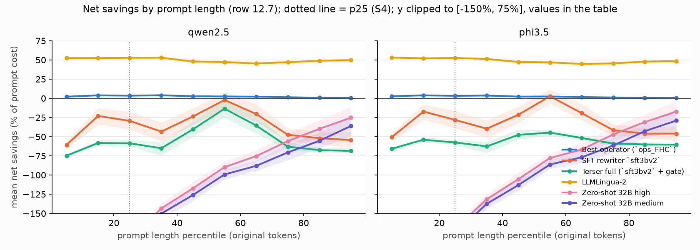

# Final results (test split) — rows 12.2-12.4, 12.6, 12.7

Generated by `python -m terser.phase12.results --split test`. 992 prompts (234 source groups) in the main slice, 1000 in the real-prompt slice; targets qwen2.5, phi3.5. Every cell: estimate [95% CI], cluster bootstrap over source groups, 1000 resamples, seed 0. Savings on each target's tokenizer, 8.3.7 safeguard on (fallbacks 0%); preservation from `label_v1` labels (served original = preserved); net savings = savings minus rewriter cost as a share of the prompt's target cost (`terser.serving.accounting.net_savings`, prices in `configs/serving/default.yaml`). Definitions: module docstring of `terser.phase12.results`.

## 12.2 Master table

| System | Median savings qwen2.5 | Median savings phi3.5 | Preserved qwen2.5 | Preserved phi3.5 | Preserved pooled | Worst category (pooled over targets) | Median net qwen2.5 | Median net phi3.5 | Mean net qwen2.5 | Mean net phi3.5 | Fell back · gate-rejected (qwen2.5 / phi3.5) | Latency / prompt | Labels |
|---|---|---|---|---|---|---|---|---|---|---|---|---|---|
| Original | 0.0% [0.0%, 0.0%] | 0.0% [0.0%, 0.0%] | 100.0% [100.0%, 100.0%] | 100.0% [100.0%, 100.0%] | 100.0% [100.0%, 100.0%] | 100.0% [100.0%, 100.0%] | 0.0% [0.0%, 0.0%] | 0.0% [0.0%, 0.0%] | 0.0% [0.0%, 0.0%] | 0.0% [0.0%, 0.0%] | 0·0 / 0·0 | 0.0 ms | complete |
| Best operator (`ops_FHC`) | 0.5% [0.3%, 0.7%] | 0.4% [0.3%, 0.6%] | 84.0% [81.6%, 86.2%] | 81.1% [78.3%, 83.7%] | 82.6% [80.5%, 84.6%] | 72.6% [66.7%, 77.6%] | 0.5% [0.3%, 0.7%] | 0.4% [0.3%, 0.6%] | 2.3% [2.1%, 2.7%] | 2.2% [1.9%, 2.5%] | 450·0 / 452·0 | 0.3 ms | complete |
| Q-learning policy | 0.0% [0.0%, 0.0%] | 0.0% [0.0%, 0.0%] | 88.8% [86.5%, 90.8%] | 87.7% [85.4%, 90.1%] | 88.3% [86.2%, 90.1%] | 78.2% [73.2%, 82.1%] | 0.0% [0.0%, 0.0%] | 0.0% [0.0%, 0.0%] | 1.9% [1.6%, 2.3%] | 1.8% [1.5%, 2.2%] | 635·0 / 636·0 | 0.1 ms | complete |
| HMM compressor | 11.7% [7.4%, 15.1%] | 11.2% [7.5%, 14.3%] | 59.8% [55.5%, 64.5%] | 56.5% [51.7%, 61.2%] | 58.1% [53.7%, 62.6%] | 28.3% [22.3%, 35.6%] | 11.7% [7.4%, 15.1%] | 11.2% [7.5%, 14.3%] | 20.9% [19.0%, 23.0%] | 20.3% [18.4%, 22.3%] | 383·0 / 381·0 | 0.4 ms | complete |
| GBM tagger + gate | 0.0% [0.0%, 0.0%] | 0.0% [0.0%, 0.0%] | 95.7% [93.8%, 97.3%] | 97.8% [96.6%, 98.8%] | 96.7% [95.4%, 97.9%] | 82.2% [77.0%, 87.3%] | 0.0% [0.0%, 0.0%] | 0.0% [0.0%, 0.0%] | 4.7% [3.4%, 6.2%] | 1.5% [0.9%, 2.2%] | 4·863 / 3·940 | 118 ms | complete |
| TextCNN + gate | 0.0% [0.0%, 0.0%] | 0.0% [0.0%, 0.0%] | 86.7% [82.8%, 90.4%] | 99.2% [98.5%, 99.8%] | 92.9% [90.8%, 94.8%] | 60.7% [57.9%, 63.9%] | 0.0% [0.0%, 0.0%] | 0.0% [0.0%, 0.0%] | 10.9% [7.6%, 14.2%] | 0.4% [0.1%, 0.6%] | 87·758 / 86·887 | 46 ms | complete |
| SFT rewriter `sft15v2` | 23.6% [15.0%, 33.5%] | 22.2% [14.3%, 32.3%] | 62.0% [58.4%, 65.4%] | 57.8% [54.5%, 61.2%] | 59.9% [56.8%, 62.9%] | 43.6% [34.0%, 51.8%] | -41.5% [-54.0%, -25.3%] | -36.7% [-46.6%, -21.8%] | -25.9% [-29.7%, -21.3%] | -21.1% [-24.8%, -16.9%] | 245·0 / 245·0 | 452 ms | complete |
| SFT rewriter `sft3bv2` | 27.5% [19.9%, 34.1%] | 24.6% [18.2%, 30.8%] | 66.7% [63.2%, 70.0%] | 63.6% [60.4%, 67.0%] | 65.2% [62.5%, 67.9%] | 52.6% [46.0%, 57.4%] | -35.1% [-45.6%, -25.5%] | -30.6% [-41.1%, -21.6%] | -28.4% [-32.5%, -24.5%] | -24.2% [-27.9%, -20.4%] | 255·0 / 244·0 | 728 ms | complete |
| SFT rewriter `sfthpo` | 65.2% [61.7%, 68.6%] | 63.5% [59.6%, 66.7%] | 48.7% [45.3%, 52.1%] | 42.9% [39.6%, 46.5%] | 45.8% [43.1%, 48.9%] | 33.7% [28.4%, 38.3%] | 21.7% [15.8%, 26.8%] | 23.4% [18.1%, 27.8%] | 6.1% [3.0%, 9.4%] | 9.6% [6.6%, 12.8%] | 71·0 / 70·0 | 398 ms | complete |
| Terser full (`sft3bv2` + gate) | 0.0% [0.0%, 0.0%] | 0.0% [0.0%, 0.0%] | 96.5% [94.9%, 98.0%] | 98.8% [98.1%, 99.4%] | 97.6% [96.7%, 98.5%] | 88.3% [84.2%, 92.2%] | -61.8% [-64.9%, -58.0%] | -55.2% [-58.4%, -52.5%] | -52.6% [-55.9%, -49.1%] | -54.1% [-55.6%, -52.6%] | 255·590 / 244·712 | 750 ms | complete |
| LLMLingua-2 | 51.4% [50.6%, 52.0%] | 50.0% [49.8%, 50.5%] | 27.4% [23.9%, 31.0%] | 25.6% [22.3%, 29.0%] | 26.5% [23.7%, 29.6%] | 12.3% [6.6%, 15.4%] | 51.4% [50.6%, 52.0%] | 50.0% [49.8%, 50.5%] | 49.7% [48.7%, 50.7%] | 49.0% [48.2%, 49.8%] | 1·0 / 1·0 | n/r | complete |
| Zero-shot 32B high | 60.2% [57.1%, 63.2%] | 58.4% [55.3%, 61.1%] | 52.5% [48.4%, 57.0%] | 46.0% [42.2%, 50.0%] | 49.2% [45.9%, 52.9%] | 35.0% [27.9%, 40.5%] | -105.2% [-116.7%, -89.9%] | -93.9% [-104.7%, -81.9%] | -190.1% [-212.0%, -169.5%] | -167.9% [-187.4%, -149.7%] | 71·0 / 75·0 | 225 ms | complete |
| Zero-shot 32B low | 45.5% [41.5%, 50.0%] | 44.2% [40.0%, 48.8%] | 59.1% [55.2%, 62.8%] | 52.6% [48.9%, 56.4%] | 55.8% [52.7%, 59.1%] | 39.8% [32.8%, 45.0%] | -118.6% [-128.2%, -108.6%] | -105.1% [-115.2%, -96.7%] | -200.1% [-220.0%, -180.5%] | -176.7% [-194.1%, -159.2%] | 79·0 / 74·0 | 232 ms | complete |
| Zero-shot 32B medium | 54.3% [50.5%, 57.8%] | 52.9% [49.3%, 56.3%] | 58.0% [53.7%, 61.8%] | 52.6% [48.5%, 56.8%] | 55.3% [51.8%, 58.8%] | 39.5% [33.1%, 45.2%] | -112.9% [-124.2%, -102.9%] | -100.9% [-111.4%, -91.5%] | -202.1% [-223.9%, -181.4%] | -178.3% [-197.4%, -159.6%] | 79·0 / 75·0 | 226 ms | complete |
| Fast path (deployed ONNX) | 0.0% [0.0%, 0.0%] | 0.0% [0.0%, 0.0%] | 99.2% [98.6%, 99.7%] | 98.6% [97.7%, 99.4%] | 98.9% [98.1%, 99.5%] | 93.9% [89.4%, 97.3%] | 0.0% [0.0%, 0.0%] | 0.0% [0.0%, 0.0%] | 0.9% [0.5%, 1.4%] | 0.8% [0.4%, 1.3%] | 4·961 / 4·961 | 1.0 ms | complete |

Preservation cells: † = some served rewrites have no judge label yet, so the rate is over the labelled pairs only; n/a = more than 5% unlabelled. Such systems are kept out of the McNemar ranking.

Gates: `tuned` = LightGBM 150 trees on the row 3.1.3 pair table (threshold 0.3063, reject if P(degraded) >= threshold; threshold = max specificity s.t. sensitivity >= 0.95 on grouped 5-fold OOF train scores (row 3.2.3)); `untuned` = LightGBM 150 trees on the row 3.1.3 pair table (threshold 0.2256, reject if P(degraded) >= threshold; threshold = max specificity s.t. sensitivity >= 0.95 on grouped 5-fold OOF train scores (row 3.2.3)); `onnx` = models/fast/gate.onnx (sklearn GradientBoosting, serving features) (threshold 0.2696, reject if P(degraded) > gate_threshold (configs/serving/fast_onnx.yaml)).

Latency notes: Q-learning policy: warm second pass; excludes the training-time reward gate; GBM tagger + gate: + gate 34 ms × 99% of requests; TextCNN + gate: bge-small forward per prompt (encoder loaded); CNN forward excluded; + gate 34 ms × 85% of requests; SFT rewriter `sft15v2`: HF generate, batch 16, per prompt; SFT rewriter `sft3bv2`: HF generate, batch 16, per prompt; SFT rewriter `sfthpo`: HF generate, batch 16, per prompt; Terser full (`sft3bv2` + gate): HF generate, batch 16, per prompt; + gate 34 ms × 64% of requests; LLMLingua-2: every output came from the Phase 2 disk cache; latency n/r; Zero-shot 32B high: vLLM run wall time / prompts written; Zero-shot 32B low: vLLM run wall time / prompts written; Zero-shot 32B medium: vLLM run wall time / prompts written; Fast path (deployed ONNX): + gate 0.2 ms × 99% of requests.

## Headline criteria for Terser full (`sft3bv2` + gate)

| Criterion | Target | Value | Verdict |
|---|---|---|---|
| S1 median savings per target | >= 30%, CI low >= 25% | qwen2.5 0.0% [0.0%, 0.0%], phi3.5 0.0% [0.0%, 0.0%] | fail |
| S2 preservation overall | >= 95% | 97.6% | pass |
| S3 worst category (pooled over targets) | >= 90% | 88.3% (per target: qwen2.5 81.6%, phi3.5 95.1%) | fail |
| S4 net savings at p25 length | > 0 per target | qwen2.5 -56.2% [-60.5%, -51.9%], phi3.5 -53.9% [-57.7%, -50.3%] | fail |
| S5 S1-S3 per target | each target | qwen2.5 no, phi3.5 no | fail |

## 12.3 Stratified: target x category

| System | Target | code | creative | explain | fact | reason | transform |
|---|---|---|---|---|---|---|---|
| Original | qwen2.5 | 100% / 0% | 100% / 0% | 100% / 0% | 100% / 0% | 100% / 0% | 100% / 0% |
| Original | phi3.5 | 100% / 0% | 100% / 0% | 100% / 0% | 100% / 0% | 100% / 0% | 100% / 0% |
| Best operator (`ops_FHC`) | qwen2.5 | 92% / 0% | 71% / 1% | 80% / 2% | 85% / 0% | 99% / 2% | 78% / 0% |
| Best operator (`ops_FHC`) | phi3.5 | 79% / 0% | 74% / 1% | 75% / 1% | 81% / 0% | 93% / 1% | 82% / 0% |
| Q-learning policy | qwen2.5 | 94% / 0% | 80% / 0% | 80% / 0% | 93% / 0% | 99% / 2% | 86% / 0% |
| Q-learning policy | phi3.5 | 87% / 0% | 83% / 0% | 77% / 0% | 92% / 0% | 97% / 2% | 89% / 0% |
| HMM compressor | qwen2.5 | 63% / 29% | 77% / 0% | 84% / 0% | 50% / 10% | 64% / 37% | 29% / 15% |
| HMM compressor | phi3.5 | 44% / 27% | 77% / 0% | 84% / 0% | 51% / 11% | 60% / 36% | 27% / 14% |
| GBM tagger + gate | qwen2.5 | 100% / 0% | 100% / 0% | 100% / 0% | 99% / 0% | 75% / 36% | 100% / 0% |
| GBM tagger + gate | phi3.5 | 99% / 0% | 100% / 0% | 100% / 0% | 99% / 0% | 89% / 0% | 100% / 0% |
| TextCNN + gate | qwen2.5 | 100% / 0% | 100% / 0% | 100% / 0% | 99% / 0% | 24% / 83% | 97% / 0% |
| TextCNN + gate | phi3.5 | 100% / 0% | 100% / 0% | 100% / 0% | 100% / 0% | 98% / 0% | 98% / 0% |
| SFT rewriter `sft15v2` | qwen2.5 | 73% / 17% | 60% / 36% | 64% / 34% | 69% / 6% | 46% / 69% | 60% / 3% |
| SFT rewriter `sft15v2` | phi3.5 | 66% / 15% | 58% / 33% | 59% / 37% | 67% / 6% | 41% / 65% | 55% / 3% |
| SFT rewriter `sft3bv2` | qwen2.5 | 60% / 32% | 53% / 52% | 67% / 18% | 76% / 3% | 79% / 62% | 59% / 10% |
| SFT rewriter `sft3bv2` | phi3.5 | 51% / 28% | 52% / 49% | 66% / 22% | 73% / 2% | 71% / 60% | 61% / 10% |
| SFT rewriter `sfthpo` | qwen2.5 | 54% / 42% | 41% / 72% | 45% / 78% | 52% / 69% | 70% / 66% | 33% / 55% |
| SFT rewriter `sfthpo` | phi3.5 | 43% / 38% | 38% / 69% | 37% / 77% | 45% / 67% | 61% / 65% | 35% / 55% |
| Terser full (`sft3bv2` + gate) | qwen2.5 | 100% / 0% | 100% / 0% | 100% / 0% | 100% / 0% | 82% / 61% | 97% / 0% |
| Terser full (`sft3bv2` + gate) | phi3.5 | 100% / 0% | 100% / 0% | 99% / 0% | 99% / 0% | 95% / 0% | 99% / 0% |
| LLMLingua-2 | qwen2.5 | 15% / 35% | 33% / 54% | 41% / 54% | 19% / 52% | 45% / 50% | 12% / 51% |
| LLMLingua-2 | phi3.5 | 12% / 37% | 35% / 53% | 36% / 53% | 20% / 50% | 39% / 49% | 12% / 49% |
| Zero-shot 32B high | qwen2.5 | 62% / 30% | 34% / 72% | 54% / 68% | 44% / 64% | 77% / 62% | 47% / 55% |
| Zero-shot 32B high | phi3.5 | 43% / 26% | 36% / 68% | 38% / 65% | 37% / 62% | 72% / 61% | 51% / 54% |
| Zero-shot 32B low | qwen2.5 | 68% / 25% | 41% / 60% | 45% / 63% | 58% / 50% | 89% / 49% | 56% / 25% |
| Zero-shot 32B low | phi3.5 | 60% / 23% | 39% / 59% | 42% / 62% | 54% / 50% | 64% / 48% | 56% / 25% |
| Zero-shot 32B medium | qwen2.5 | 63% / 25% | 41% / 67% | 47% / 70% | 56% / 56% | 89% / 55% | 52% / 42% |
| Zero-shot 32B medium | phi3.5 | 59% / 22% | 38% / 66% | 45% / 67% | 55% / 54% | 69% / 54% | 49% / 41% |
| Fast path (deployed ONNX) | qwen2.5 | 99% / 0% | 100% / 0% | 100% / 0% | 100% / 0% | 96% / 0% | 100% / 0% |
| Fast path (deployed ONNX) | phi3.5 | 100% / 0% | 100% / 0% | 100% / 0% | 100% / 0% | 92% / 0% | 100% / 0% |

Cells: preserved / median savings.

## 12.3 Stratified: target x Phase 6 cluster

K-means k = 9 refit on the train embeddings (Phase 6 recipe; agreement with the stored Phase 6 cluster x category table 100.0%); each prompt goes to its nearest centroid (bge-small). High-risk clusters (C6.3: degradation >= 1.15x overall, ADR-0012): 6.

| System | Target | c0 (risk 1.04) | c1 (risk 1.04) | c2 (risk 1.08) | c3 (risk 1.11) | c4 (risk 1.06) | c5 (risk 1.12) | c6 (risk 1.19, HR) | c7 (risk 0.56) | c8 (risk 1.08) |
|---|---|---|---|---|---|---|---|---|---|---|
| Original | qwen2.5 | 100% / 0% | 100% / 0% | 100% / 0% | 100% / 0% | 100% / 0% | 100% / 0% | 100% / 0% | 100% / 0% | 100% / 0% |
| Original | phi3.5 | 100% / 0% | 100% / 0% | 100% / 0% | 100% / 0% | 100% / 0% | 100% / 0% | 100% / 0% | 100% / 0% | 100% / 0% |
| Best operator (`ops_FHC`) | qwen2.5 | 79% / 0% | 81% / 1% | 83% / 0% | 69% / 2% | 92% / 0% | 82% / 0% | 78% / 0% | 99% / 2% | 86% / 0% |
| Best operator (`ops_FHC`) | phi3.5 | 79% / 0% | 73% / 1% | 86% / 0% | 74% / 2% | 79% / 0% | 80% / 0% | 76% / 0% | 93% / 1% | 78% / 0% |
| Q-learning policy | qwen2.5 | 90% / 0% | 85% / 0% | 92% / 0% | 77% / 0% | 94% / 0% | 78% / 0% | 80% / 0% | 99% / 2% | 97% / 0% |
| Q-learning policy | phi3.5 | 86% / 0% | 88% / 0% | 91% / 0% | 81% / 0% | 87% / 0% | 84% / 0% | 79% / 0% | 97% / 2% | 92% / 0% |
| HMM compressor | qwen2.5 | 53% / 11% | 81% / 0% | 48% / 10% | 77% / 0% | 63% / 29% | 40% / 11% | 57% / 2% | 65% / 36% | 63% / 0% |
| HMM compressor | phi3.5 | 53% / 11% | 77% / 0% | 44% / 10% | 77% / 0% | 44% / 27% | 37% / 10% | 64% / 2% | 61% / 34% | 63% / 0% |
| GBM tagger + gate | qwen2.5 | 100% / 0% | 100% / 0% | 100% / 0% | 100% / 0% | 100% / 0% | 99% / 0% | 99% / 0% | 76% / 36% | 99% / 0% |
| GBM tagger + gate | phi3.5 | 100% / 0% | 100% / 0% | 100% / 0% | 100% / 0% | 99% / 0% | 98% / 0% | 100% / 0% | 89% / 0% | 99% / 0% |
| TextCNN + gate | qwen2.5 | 98% / 0% | 100% / 0% | 98% / 0% | 100% / 0% | 100% / 0% | 99% / 0% | 100% / 0% | 25% / 83% | 98% / 0% |
| TextCNN + gate | phi3.5 | 99% / 0% | 100% / 0% | 99% / 0% | 100% / 0% | 100% / 0% | 97% / 0% | 100% / 0% | 98% / 0% | 100% / 0% |
| SFT rewriter `sft15v2` | qwen2.5 | 67% / 7% | 65% / 9% | 60% / 8% | 60% / 47% | 73% / 17% | 66% / 6% | 57% / 27% | 46% / 69% | 76% / 1% |
| SFT rewriter `sft15v2` | phi3.5 | 59% / 7% | 58% / 7% | 63% / 7% | 55% / 44% | 66% / 15% | 63% / 6% | 54% / 26% | 42% / 65% | 70% / 1% |
| SFT rewriter `sft3bv2` | qwen2.5 | 66% / 9% | 62% / 28% | 68% / 5% | 57% / 52% | 60% / 32% | 68% / 6% | 64% / 30% | 79% / 62% | 71% / 2% |
| SFT rewriter `sft3bv2` | phi3.5 | 66% / 8% | 65% / 24% | 63% / 5% | 56% / 47% | 51% / 28% | 67% / 4% | 66% / 26% | 70% / 60% | 70% / 2% |
| SFT rewriter `sfthpo` | qwen2.5 | 48% / 70% | 46% / 74% | 37% / 60% | 44% / 75% | 54% / 42% | 37% / 64% | 45% / 67% | 70% / 66% | 45% / 70% |
| SFT rewriter `sfthpo` | phi3.5 | 41% / 69% | 42% / 71% | 34% / 61% | 41% / 73% | 43% / 38% | 35% / 61% | 44% / 66% | 62% / 65% | 34% / 69% |
| Terser full (`sft3bv2` + gate) | qwen2.5 | 100% / 0% | 100% / 0% | 99% / 0% | 100% / 0% | 100% / 0% | 97% / 0% | 99% / 0% | 82% / 61% | 100% / 0% |
| Terser full (`sft3bv2` + gate) | phi3.5 | 99% / 0% | 100% / 0% | 100% / 0% | 99% / 0% | 100% / 0% | 100% / 0% | 100% / 0% | 95% / 0% | 99% / 0% |
| LLMLingua-2 | qwen2.5 | 27% / 53% | 38% / 55% | 13% / 52% | 31% / 54% | 15% / 35% | 20% / 50% | 30% / 51% | 45% / 50% | 26% / 52% |
| LLMLingua-2 | phi3.5 | 22% / 51% | 15% / 53% | 15% / 50% | 40% / 53% | 12% / 37% | 16% / 49% | 34% / 50% | 39% / 49% | 21% / 52% |
| Zero-shot 32B high | qwen2.5 | 44% / 68% | 54% / 58% | 34% / 64% | 41% / 73% | 62% / 30% | 53% / 50% | 53% / 56% | 76% / 62% | 51% / 67% |
| Zero-shot 32B high | phi3.5 | 33% / 66% | 38% / 56% | 29% / 62% | 41% / 69% | 43% / 26% | 51% / 47% | 51% / 56% | 72% / 61% | 46% / 65% |
| Zero-shot 32B low | qwen2.5 | 57% / 50% | 46% / 61% | 46% / 44% | 45% / 64% | 68% / 25% | 53% / 36% | 56% / 40% | 89% / 49% | 51% / 55% |
| Zero-shot 32B low | phi3.5 | 49% / 51% | 58% / 59% | 40% / 43% | 40% / 62% | 60% / 23% | 57% / 35% | 55% / 38% | 64% / 48% | 56% / 53% |
| Zero-shot 32B medium | qwen2.5 | 54% / 62% | 54% / 53% | 38% / 54% | 46% / 69% | 63% / 25% | 57% / 36% | 58% / 53% | 89% / 55% | 49% / 62% |
| Zero-shot 32B medium | phi3.5 | 53% / 62% | 65% / 52% | 35% / 53% | 41% / 67% | 59% / 22% | 52% / 36% | 56% / 51% | 68% / 54% | 52% / 61% |
| Fast path (deployed ONNX) | qwen2.5 | 100% / 0% | 100% / 0% | 100% / 0% | 100% / 0% | 99% / 0% | 100% / 0% | 100% / 0% | 96% / 0% | 100% / 0% |
| Fast path (deployed ONNX) | phi3.5 | 100% / 0% | 100% / 0% | 99% / 0% | 100% / 0% | 100% / 0% | 100% / 0% | 100% / 0% | 92% / 0% | 100% / 0% |

### High-risk slice x category

| System | Target | code | creative | explain | fact | reason | transform |
|---|---|---|---|---|---|---|---|
| Original | qwen2.5 | — | 100% / 0% (n 6) | 100% / 0% (n 37) | 100% / 0% (n 13) | — | 100% / 0% (n 40) |
| Original | phi3.5 | — | 100% / 0% (n 6) | 100% / 0% (n 37) | 100% / 0% (n 13) | — | 100% / 0% (n 40) |
| Best operator (`ops_FHC`) | qwen2.5 | — | 83% / 4% (n 6) | 78% / 2% (n 37) | 92% / 1% (n 13) | — | 72% / 0% (n 40) |
| Best operator (`ops_FHC`) | phi3.5 | — | 67% / 3% (n 6) | 68% / 2% (n 37) | 77% / 1% (n 13) | — | 85% / 0% (n 40) |
| Q-learning policy | qwen2.5 | — | 67% / 6% (n 6) | 78% / 0% (n 37) | 92% / 0% (n 13) | — | 80% / 0% (n 40) |
| Q-learning policy | phi3.5 | — | 50% / 5% (n 6) | 70% / 0% (n 37) | 100% / 0% (n 13) | — | 85% / 0% (n 40) |
| HMM compressor | qwen2.5 | — | 50% / 10% (n 6) | 84% / 0% (n 37) | 62% / 0% (n 13) | — | 32% / 19% (n 40) |
| HMM compressor | phi3.5 | — | 83% / 9% (n 6) | 86% / 0% (n 37) | 62% / 0% (n 13) | — | 40% / 17% (n 40) |
| GBM tagger + gate | qwen2.5 | — | 100% / 0% (n 6) | 100% / 0% (n 37) | 92% / 0% (n 13) | — | 100% / 0% (n 40) |
| GBM tagger + gate | phi3.5 | — | 100% / 0% (n 6) | 100% / 0% (n 37) | 100% / 0% (n 13) | — | 100% / 0% (n 40) |
| TextCNN + gate | qwen2.5 | — | 100% / 0% (n 6) | 100% / 0% (n 37) | 100% / 0% (n 13) | — | 100% / 0% (n 40) |
| TextCNN + gate | phi3.5 | — | 100% / 0% (n 6) | 100% / 0% (n 37) | 100% / 0% (n 13) | — | 100% / 0% (n 40) |
| SFT rewriter `sft15v2` | qwen2.5 | — | 50% / 31% (n 6) | 62% / 17% (n 37) | 69% / 48% (n 13) | — | 50% / 17% (n 40) |
| SFT rewriter `sft15v2` | phi3.5 | — | 50% / 30% (n 6) | 57% / 22% (n 37) | 54% / 50% (n 13) | — | 52% / 15% (n 40) |
| SFT rewriter `sft3bv2` | qwen2.5 | — | 83% / 55% (n 6) | 70% / 44% (n 37) | 54% / 11% (n 13) | — | 57% / 24% (n 40) |
| SFT rewriter `sft3bv2` | phi3.5 | — | 67% / 53% (n 6) | 59% / 42% (n 37) | 69% / 11% (n 13) | — | 70% / 21% (n 40) |
| SFT rewriter `sfthpo` | qwen2.5 | — | 50% / 65% (n 6) | 43% / 78% (n 37) | 62% / 69% (n 13) | — | 40% / 51% (n 40) |
| SFT rewriter `sfthpo` | phi3.5 | — | 50% / 62% (n 6) | 32% / 77% (n 37) | 62% / 67% (n 13) | — | 48% / 49% (n 40) |
| Terser full (`sft3bv2` + gate) | qwen2.5 | — | 100% / 0% (n 6) | 100% / 0% (n 37) | 100% / 0% (n 13) | — | 98% / 0% (n 40) |
| Terser full (`sft3bv2` + gate) | phi3.5 | — | 100% / 0% (n 6) | 100% / 0% (n 37) | 100% / 0% (n 13) | — | 100% / 0% (n 40) |
| LLMLingua-2 | qwen2.5 | — | 67% / 51% (n 6) | 51% / 53% (n 37) | 31% / 50% (n 13) | — | 5% / 50% (n 40) |
| LLMLingua-2 | phi3.5 | — | 67% / 52% (n 6) | 35% / 52% (n 37) | 23% / 50% (n 13) | — | 32% / 49% (n 40) |
| Zero-shot 32B high | qwen2.5 | — | 83% / 73% (n 6) | 46% / 69% (n 37) | 46% / 64% (n 13) | — | 57% / 40% (n 40) |
| Zero-shot 32B high | phi3.5 | — | 67% / 72% (n 6) | 35% / 65% (n 37) | 23% / 64% (n 13) | — | 72% / 33% (n 40) |
| Zero-shot 32B low | qwen2.5 | — | 33% / 35% (n 6) | 49% / 56% (n 37) | 69% / 57% (n 13) | — | 62% / 30% (n 40) |
| Zero-shot 32B low | phi3.5 | — | 83% / 35% (n 6) | 35% / 56% (n 37) | 23% / 57% (n 13) | — | 80% / 27% (n 40) |
| Zero-shot 32B medium | qwen2.5 | — | 67% / 52% (n 6) | 46% / 69% (n 37) | 69% / 52% (n 13) | — | 65% / 42% (n 40) |
| Zero-shot 32B medium | phi3.5 | — | 83% / 50% (n 6) | 32% / 68% (n 37) | 46% / 51% (n 13) | — | 78% / 41% (n 40) |
| Fast path (deployed ONNX) | qwen2.5 | — | 100% / 0% (n 6) | 100% / 0% (n 37) | 100% / 0% (n 13) | — | 100% / 0% (n 40) |
| Fast path (deployed ONNX) | phi3.5 | — | 100% / 0% (n 6) | 100% / 0% (n 37) | 100% / 0% (n 13) | — | 100% / 0% (n 40) |

## 12.3 Real-prompt slice (row 2.1.8)

| System | Median savings qwen2.5 | Median savings phi3.5 | Preserved qwen2.5 | Preserved phi3.5 | Preserved pooled | Worst category (pooled over targets) | Median net qwen2.5 | Median net phi3.5 | Mean net qwen2.5 | Mean net phi3.5 | Fell back · gate-rejected (qwen2.5 / phi3.5) | Latency / prompt | Labels |
|---|---|---|---|---|---|---|---|---|---|---|---|---|---|
| Original | 0.0% [0.0%, 0.0%] | 0.0% [0.0%, 0.0%] | 100.0% [100.0%, 100.0%] | 100.0% [100.0%, 100.0%] | 100.0% [100.0%, 100.0%] | 100.0% [100.0%, 100.0%] | 0.0% [0.0%, 0.0%] | 0.0% [0.0%, 0.0%] | 0.0% [0.0%, 0.0%] | 0.0% [0.0%, 0.0%] | 0·0 / 0·0 | 0.0 ms | complete |
| Best operator (`ops_FHC`) | 0.0% [0.0%, 0.0%] | 0.0% [0.0%, 0.0%] | 97.3% [96.1%, 98.3%] | 96.9% [95.7%, 97.9%] | 97.1% [96.1%, 98.0%] | 93.8% [90.6%, 96.2%] | 0.0% [0.0%, 0.0%] | 0.0% [0.0%, 0.0%] | 0.2% [0.1%, 0.3%] | 0.2% [0.1%, 0.2%] | 938·0 / 942·0 | 0.3 ms | complete |
| Q-learning policy | 0.0% [0.0%, 0.0%] | 0.0% [0.0%, 0.0%] | 94.5% [93.1%, 96.0%] | 94.2% [92.7%, 95.6%] | 94.3% [93.1%, 95.6%] | 89.9% [85.6%, 92.2%] | 0.0% [0.0%, 0.0%] | 0.0% [0.0%, 0.0%] | 0.7% [0.5%, 0.8%] | 0.6% [0.4%, 0.8%] | 897·0 / 902·0 | 0.1 ms | complete |
| HMM compressor | 0.0% [0.0%, 0.0%] | 0.0% [0.0%, 0.0%] | 84.2% [82.1%, 86.3%] | 82.8% [80.4%, 85.1%] | 83.5% [81.5%, 85.6%] | 76.6% [70.5%, 79.8%] | 0.0% [0.0%, 0.0%] | 0.0% [0.0%, 0.0%] | 6.2% [5.2%, 7.1%] | 5.9% [4.9%, 6.8%] | 764·0 / 761·0 | 0.4 ms | complete |
| GBM tagger + gate | 0.0% [0.0%, 0.0%] | 0.0% [0.0%, 0.0%] | 89.9% [88.1%, 91.6%] | 90.7% [88.8%, 92.3%] | 90.3% [88.6%, 91.8%] | 42.9% [37.2%, 48.5%] | 0.0% [0.0%, 0.0%] | 0.0% [0.0%, 0.0%] | 4.0% [3.4%, 4.6%] | 3.2% [2.7%, 3.7%] | 25·811 / 25·826 | 118 ms | complete |
| TextCNN + gate | 0.0% [0.0%, 0.0%] | 0.0% [0.0%, 0.0%] | 94.9% [93.4%, 96.3%] | 96.8% [95.6%, 97.8%] | 95.9% [94.8%, 96.9%] | 76.0% [70.7%, 81.5%] | 0.0% [0.0%, 0.0%] | 0.0% [0.0%, 0.0%] | 2.6% [1.9%, 3.4%] | 0.8% [0.6%, 1.2%] | 218·694 / 219·720 | 46 ms | complete |
| SFT rewriter `sft15v2` | 0.0% [0.0%, 1.1%] | 0.0% [0.0%, 1.2%] | 67.7% [64.8%, 70.7%] | 66.2% [63.3%, 69.1%] | 67.0% [64.2%, 69.7%] | 50.3% [43.1%, 57.3%] | -75.2% [-75.4%, -73.8%] | -63.7% [-64.6%, -62.1%] | -55.0% [-57.5%, -52.7%] | -48.0% [-50.3%, -45.8%] | 511·0 / 513·0 | 452 ms | complete |
| SFT rewriter `sft3bv2` | 3.3% [0.9%, 5.8%] | 2.6% [0.6%, 4.5%] | 69.0% [66.0%, 71.8%] | 70.1% [67.0%, 72.9%] | 69.5% [67.0%, 71.9%] | 59.6% [51.9%, 63.1%] | -71.4% [-74.1%, -68.4%] | -60.9% [-62.3%, -59.3%] | -59.3% [-61.7%, -57.1%] | -52.7% [-55.0%, -50.7%] | 456·0 / 461·0 | 728 ms | complete |
| SFT rewriter `sfthpo` | 17.2% [14.3%, 21.1%] | 15.8% [14.1%, 18.8%] | 52.7% [49.7%, 55.8%] | 51.8% [48.6%, 54.7%] | 52.2% [49.6%, 54.9%] | 29.0% [22.8%, 35.5%] | -52.2% [-56.2%, -46.9%] | -45.2% [-48.4%, -40.7%] | -40.9% [-43.5%, -38.3%] | -34.9% [-37.3%, -32.4%] | 280·0 / 277·0 | 398 ms | complete |
| Terser full (`sft3bv2` + gate) | 0.0% [0.0%, 0.0%] | 0.0% [0.0%, 0.0%] | 94.9% [93.6%, 96.1%] | 98.4% [97.6%, 99.2%] | 96.7% [95.8%, 97.5%] | 83.7% [79.6%, 87.6%] | -74.7% [-75.2%, -73.9%] | -64.3% [-65.2%, -63.6%] | -71.2% [-72.8%, -69.7%] | -64.8% [-66.4%, -63.5%] | 456·447 / 461·483 | 750 ms | complete |
| LLMLingua-2 | 51.9% [51.3%, 52.2%] | 50.0% [50.0%, 50.0%] | 14.3% [12.0%, 16.5%] | 12.9% [10.8%, 15.0%] | 13.6% [11.8%, 15.2%] | 6.0% [3.2%, 8.9%] | 51.9% [51.3%, 52.2%] | 50.0% [50.0%, 50.0%] | 50.9% [50.5%, 51.4%] | 49.8% [49.3%, 50.2%] | 0·0 / 0·0 | n/r | complete |
| Zero-shot 32B high | 29.4% [28.0%, 30.8%] | 26.9% [25.0%, 28.6%] | 48.2% [45.2%, 51.3%] | 47.6% [44.4%, 50.9%] | 47.9% [45.3%, 50.4%] | 27.8% [22.3%, 33.2%] | -279.9% [-317.9%, -250.3%] | -256.9% [-285.7%, -226.7%] | -461.5% [-488.4%, -436.8%] | -417.1% [-441.2%, -393.6%] | 157·0 / 178·0 | 225 ms | complete |
| Zero-shot 32B low | 10.0% [8.7%, 11.9%] | 9.5% [7.7%, 11.1%] | 68.0% [65.4%, 70.9%] | 68.0% [65.1%, 70.8%] | 68.0% [65.7%, 70.5%] | 50.3% [43.8%, 56.7%] | -293.0% [-332.1%, -262.5%] | -267.0% [-297.0%, -243.0%] | -467.5% [-493.9%, -443.3%] | -422.2% [-446.3%, -399.0%] | 346·0 / 347·0 | 232 ms | complete |
| Zero-shot 32B medium | 17.6% [15.4%, 19.9%] | 14.3% [12.7%, 16.7%] | 59.9% [57.0%, 63.2%] | 61.0% [58.1%, 63.9%] | 60.5% [58.0%, 62.9%] | 45.2% [39.3%, 51.6%] | -296.6% [-338.1%, -266.4%] | -268.7% [-297.2%, -243.3%] | -481.5% [-509.0%, -456.2%] | -435.3% [-460.4%, -411.1%] | 274·0 / 285·0 | 226 ms | complete |
| Fast path (deployed ONNX) | 0.0% [0.0%, 0.0%] | 0.0% [0.0%, 0.0%] | 97.5% [96.5%, 98.4%] | 96.6% [95.3%, 97.7%] | 97.0% [96.0%, 98.0%] | 92.3% [88.7%, 95.0%] | 0.0% [0.0%, 0.0%] | 0.0% [0.0%, 0.0%] | 0.6% [0.4%, 0.8%] | 0.5% [0.4%, 0.7%] | 8·948 / 8·948 | 1.0 ms | complete |

S1-S3 on the real slice are reported, not gated.

## 12.4 McNemar between the top systems

Top systems: complete systems ranked by the Phase 9 reward (mean over (prompt, target) of `100 x savings - 100 x 1[degraded]`), plus the full system. Exact McNemar on preserved flags of the same (prompt, target) pairs; Δ = A - B with a paired bootstrap CI.

| A | B | pairs | only A preserved | only B preserved | p | Δ preserved | Δ median savings |
|---|---|---|---|---|---|---|---|
| Zero-shot 32B medium | Zero-shot 32B high | 1984 | 351 | 231 | 7.44e-07 | +6.0 pp [+2.9, +9.5] | -5.4 pp [-7.8, -3.3] |
| Zero-shot 32B medium | Terser full (`sft3bv2` + gate) | 1984 | 30 | 870 | 2.4e-215 | -42.3 pp [-46.2, -38.6] | +53.7 pp [+50.0, +56.6] |
| Zero-shot 32B high | Terser full (`sft3bv2` + gate) | 1984 | 29 | 989 | 9.3e-251 | -48.4 pp [-52.1, -44.4] | +59.1 pp [+56.1, +62.0] |

### Seeds

| System | seeds | median savings qwen2.5 (mean ± sd) | preserved pooled (mean ± sd) |
|---|---|---|---|
| Q-learning policy | 3 | 0.0% ± 0.0% | 87.6% ± 0.9% |
| TextCNN + gate | 3 | 0.0% ± 0.0% | 92.7% ± 0.3% |
| SFT rewriter `sft3bv2` | 3 | 24.3% ± 7.6% | 64.4% ± 0.8% |
| Terser full (`sft3bv2` + gate) | 3 | 0.0% ± 0.0% | 97.8% ± 0.2% |

Seeds (row 12.4, >= 3 seeds): deterministic systems need none (original, operators, HMM, LLMLingua-2, deployed fast path, LightGBM tagger and both gates at a fixed random_state; greedy decoding of the SFT and zero-shot rewriters). Seeded CPU systems get seed variants from `terser.phase12.candidates build --textcnn-seeds 0,1,2 --rl-seeds 0,1,2` (methods `<method>_s<k>`, judged like any candidate, summarised above). The SFT rewriter's seed is its training seed: the main session retrains the chosen rung with `python -m terser.models.rewriter.train experiment=<rung> seed=<k>` on the GPU for k = 1, 2, generates with `terser.models.rewriter.generate`, imports each as tag `<rung>_s<k>` (`terser.phase12.candidates import-sft`) and passes `--sft <rung>_s<k>=<file>`. Judge sampling is greedy; creative prompts use the three fixed respond seeds (common random numbers). Bootstrap CIs cover prompt sampling, the seed table covers training variance.

## 12.6 Ablation matrix

| Variant | Median savings qwen2.5 | Median savings phi3.5 | Preserved pooled | Mean net qwen2.5 | Mean net phi3.5 | Δ savings qwen2.5 | Δ savings phi3.5 | Δ preserved | Labels |
|---|---|---|---|---|---|---|---|---|---|
| Terser full (`sft3bv2` + gate) | 0.0% [0.0%, 0.0%] | 0.0% [0.0%, 0.0%] | 97.6% [96.7%, 98.5%] | -52.6% [-55.9%, -49.1%] | -54.1% [-55.6%, -52.6%] | +0.0 pp | +0.0 pp | +0.0 pp | complete |
| Ablation: − gate | 27.5% [19.9%, 34.1%] | 24.6% [18.2%, 30.8%] | 65.2% [62.5%, 67.9%] | -28.4% [-32.5%, -24.5%] | -24.2% [-27.9%, -20.4%] | +27.5 pp | +24.6 pp | -32.5 pp | complete |
| Ablation: − fallback | 0.0% [0.0%, 0.0%] | 0.0% [0.0%, 0.0%] | 97.0% [96.0%, 97.9%] | -52.7% [-56.0%, -49.2%] | -54.2% [-55.8%, -52.8%] | +0.0 pp | +0.0 pp | -0.7 pp | complete |
| Ablation: − HPO (untuned gate) | 0.0% [0.0%, 0.0%] | 0.0% [0.0%, 0.0%] | 98.1% [97.4%, 98.8%] | -55.1% [-57.8%, -52.2%] | -54.0% [-55.4%, -52.5%] | +0.0 pp | +0.0 pp | +0.5 pp | complete |
| Ablation: operator-only (`ops_FHC` + gate) | 0.0% [0.0%, 0.0%] | 0.0% [0.0%, 0.0%] | 97.3% [96.4%, 98.2%] | 0.5% [0.3%, 0.6%] | 0.4% [0.3%, 0.5%] | +0.0 pp | +0.0 pp | -0.3 pp | complete |

Rows: the full system, then one change each. − gate: no quality gate. − fallback: the raw rewrite is served even when it is not shorter than the original (8.3.7 safeguard off; an empty rewrite still sends the original), still gated. − HPO: the gate refit with the untuned LightGBM parameters of row 10.5 and its own row 3.2.3 threshold. Operator-only: the generative rewriter replaced by the best operator stack, same gate and fallback.

## 12.7 Net savings by prompt length

| System | Target | p0-10 | p10-20 | p20-30 | p30-40 | p40-50 | p50-60 | p60-70 | p70-80 | p80-90 | p90-100 |
|---|---|---|---|---|---|---|---|---|---|---|---|
| Best operator (`ops_FHC`) | qwen2.5 | 2% | 4% | 3% | 4% | 3% | 2% | 2% | 1% | 1% | 0% |
| Best operator (`ops_FHC`) | phi3.5 | 3% | 4% | 3% | 4% | 2% | 2% | 2% | 1% | 1% | 0% |
| SFT rewriter `sft3bv2` | qwen2.5 | -59% | -8% | -18% | -16% | -19% | 2% | -17% | -45% | -48% | -56% |
| SFT rewriter `sft3bv2` | phi3.5 | -48% | -6% | -16% | -14% | -16% | 6% | -17% | -39% | -43% | -48% |
| Terser full (`sft3bv2` + gate) | qwen2.5 | -74% | -54% | -56% | -54% | -41% | -12% | -35% | -63% | -66% | -69% |
| Terser full (`sft3bv2` + gate) | phi3.5 | -65% | -50% | -54% | -52% | -49% | -44% | -49% | -58% | -59% | -61% |
| LLMLingua-2 | qwen2.5 | 52% | 52% | 53% | 53% | 48% | 47% | 45% | 47% | 49% | 50% |
| LLMLingua-2 | phi3.5 | 53% | 52% | 53% | 51% | 47% | 47% | 45% | 46% | 48% | 48% |
| Zero-shot 32B high | qwen2.5 | -903% | -279% | -184% | -143% | -117% | -90% | -75% | -56% | -40% | -25% |
| Zero-shot 32B high | phi3.5 | -784% | -256% | -170% | -131% | -105% | -78% | -67% | -47% | -31% | -17% |
| Zero-shot 32B medium | qwen2.5 | -932% | -284% | -191% | -150% | -126% | -99% | -88% | -70% | -55% | -36% |
| Zero-shot 32B medium | phi3.5 | -807% | -260% | -176% | -137% | -113% | -86% | -77% | -62% | -43% | -29% |

Cells: mean net savings per prompt-length decile (original tokens on the target); S4 reads the p20-30 decile (the 25th percentile).
