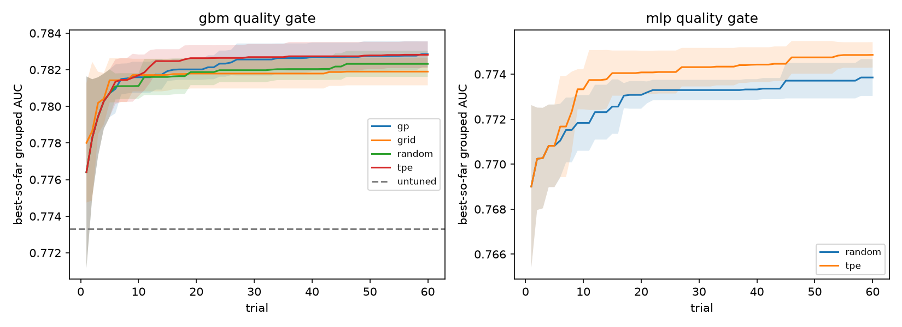

# Hyperparameter-search methods (rows 10.2, 10.5; C10.1, C10.2)

Generated by `python -m terser.phase10.hpo_study run ...` / `report`. Objective: grouped 5-fold OOF ROC-AUC of the quality gate on the row 3.1.3 pair table (train split only). Each method: 60 trials x 5 repeats (seeds 0-4), every trial logged to MLflow (experiment tags phase 10, row 10.2).

| model | method | trials | best_auc | best_auc_sd | best_at_20 | best_params (seed 0) |
|---|---|---|---|---|---|---|
| gbm | gp | 60 | 0.7829 | 0.0007 | 0.7820 | {'learning_rate': 0.019083055421086518, 'num_leaves': 27, 'min_child_samples': 197} |
| gbm | grid | 60 | 0.7819 | 0.0007 | 0.7818 | {'learning_rate': 0.031072325059538608, 'num_leaves': 10, 'min_child_samples': 200} |
| gbm | random | 60 | 0.7823 | 0.0007 | 0.7819 | {'learning_rate': 0.024591256383397347, 'num_leaves': 33, 'min_child_samples': 25} |
| gbm | tpe | 60 | 0.7828 | 0.0007 | 0.7826 | {'learning_rate': 0.01908791657352333, 'num_leaves': 23, 'min_child_samples': 152} |
| mlp | random | 60 | 0.7739 | 0.0008 | 0.7731 | {'depth': 3, 'width': 169, 'dropout': 0.48838054409516857, 'lr': 0.0016206567392037178, 'weight_decay': 0.0009058458887563657} |
| mlp | tpe | 60 | 0.7749 | 0.0006 | 0.7741 | {'depth': 3, 'width': 125, 'dropout': 0.46406024162310683, 'lr': 0.0012038957508584169, 'weight_decay': 0.00996953547832788} |

Untuned LightGBM (lr 0.1, 31 leaves, min_child 20, 150 trees): AUC **0.7733**. Best tuned: **0.7829** (gain +0.0095). C10.2 (>= +0.01 or a documented plateau): **plateau**.

## Reading

* **C10.1.** Four methods on the GBM gate and two on the MLP, each 60 trials x 5 seeds at the
  same budget: curves above, table with mean ± sd over seeds.
* **The methods tie.** All four GBM searches end within 0.001 AUC of each other (0.7819-0.7829,
  sd 0.0007 over seeds). TPE and GP reach their final value fastest (best at 20 trials 0.7826 /
  0.7820); the grid is last because its first 60 points of a 4 x 4 x 4 lattice cover the
  learning-rate axis coarsely. With three hyperparameters and a smooth response surface,
  Bayesian search has little room to beat random search.
* **C10.2: documented plateau.** Tuning lifts the gate from 0.7733 to 0.7829 (+0.0095, about 13
  seed-sd), just under the +0.01 bar. Every method converges to the same region (learning rate
  about 0.02, many trees' worth of shrinkage, large `min_child_samples`), i.e. stronger
  regularisation than the defaults, and the best-so-far curves are flat after about 20 trials.
  The remaining error is in the features (rows 3.3.7, 5.4: which spans were removed), not in the
  GBM's hyperparameters, so more search would not reach +0.01.
* **MLP.** The tuned MLP (0.7749, TPE) stays below the tuned GBM, matching C4.4: the classical
  model remains the champion on these 27 tabular features.
