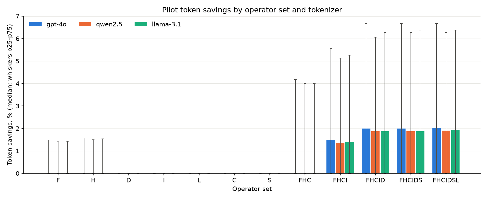
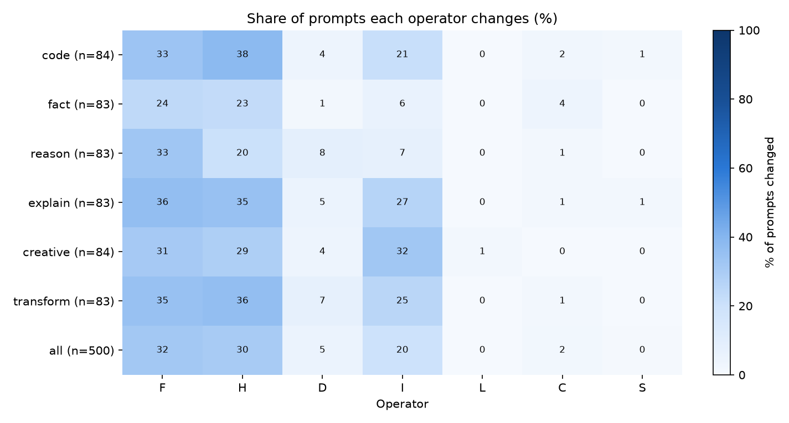

# Phase 1 pilot tokenizer study

Rows **1.4.2** (per-operator savings), **1.4.3** (operator applicability) and **1.4.4** (cross-tokenizer agreement). Generated by `python -m terser.phase1.token_study experiment=p1_token_study`; raw rows in `reports/p1_tokenizer_study.csv`.

- Prompts: **500**; targets: gpt-4o, qwen2.5, llama-3.1 (token counts only, no model calls; gpt-4o via tiktoken `o200k_base`).
- Savings = `100 * (tokens_before - tokens_after) / tokens_before`; negative means the rewrite costs more tokens. `S` is tokenizer-aware, so every rewrite is computed per target.

## Checkpoint verdicts

- **C1.4 Savings exist: PASS** under the revised target ([ADR-0012](../docs/decisions/ADR-0012-feasible-checkpoint-targets.md): >= 1.5% on every target; the original >= 10% is not met). Median best-single-operator savings: gpt-4o 1.7%, qwen2.5 1.6%, llama-3.1 1.6%.
- **C1.5 Tokenizer dependence: PASS (documented agreement).** every pair has rho >= 0.9; lowest rho = 0.991 (95% CI 0.975-1.000) for gpt-4o vs qwen2.5. Finding: savings rankings agree across tokenizers, so Phase 8 can ship a single target-agnostic rewriter.

## 1.4.2 Per-operator savings

Savings (%) per operator set and target over all prompts; `changed` is the share of prompts whose text the operator set altered.

| op_set   | target    |   median |   mean |   p25 |   p75 |   changed_share |   n |
|:---------|:----------|---------:|-------:|------:|------:|----------------:|----:|
| F        | gpt-4o    |     0.00 |   1.23 |  0.00 |  1.48 |            0.32 | 500 |
| F        | qwen2.5   |     0.00 |   1.16 |  0.00 |  1.41 |            0.32 | 500 |
| F        | llama-3.1 |     0.00 |   1.18 |  0.00 |  1.43 |            0.32 | 500 |
| H        | gpt-4o    |     0.00 |   1.90 |  0.00 |  1.57 |            0.30 | 500 |
| H        | qwen2.5   |     0.00 |   1.83 |  0.00 |  1.50 |            0.30 | 500 |
| H        | llama-3.1 |     0.00 |   1.85 |  0.00 |  1.54 |            0.30 | 500 |
| D        | gpt-4o    |     0.00 |   0.66 |  0.00 |  0.00 |            0.05 | 500 |
| D        | qwen2.5   |     0.00 |   0.64 |  0.00 |  0.00 |            0.05 | 500 |
| D        | llama-3.1 |     0.00 |   0.64 |  0.00 |  0.00 |            0.05 | 500 |
| I        | gpt-4o    |     0.00 |   1.01 |  0.00 |  0.00 |            0.20 | 500 |
| I        | qwen2.5   |     0.00 |   0.94 |  0.00 |  0.00 |            0.20 | 500 |
| I        | llama-3.1 |     0.00 |   0.95 |  0.00 |  0.00 |            0.20 | 500 |
| L        | gpt-4o    |     0.00 |   0.00 |  0.00 |  0.00 |            0.00 | 500 |
| L        | qwen2.5   |     0.00 |   0.00 |  0.00 |  0.00 |            0.00 | 500 |
| L        | llama-3.1 |     0.00 |   0.00 |  0.00 |  0.00 |            0.00 | 500 |
| C        | gpt-4o    |     0.00 |   0.19 |  0.00 |  0.00 |            0.02 | 500 |
| C        | qwen2.5   |     0.00 |   0.18 |  0.00 |  0.00 |            0.02 | 500 |
| C        | llama-3.1 |     0.00 |   0.19 |  0.00 |  0.00 |            0.02 | 500 |
| S        | gpt-4o    |     0.00 |   0.02 |  0.00 |  0.00 |            0.00 | 500 |
| S        | qwen2.5   |     0.00 |   0.02 |  0.00 |  0.00 |            0.00 | 500 |
| S        | llama-3.1 |     0.00 |   0.02 |  0.00 |  0.00 |            0.00 | 500 |
| FHC      | gpt-4o    |     0.00 |   3.30 |  0.00 |  4.17 |            0.50 | 500 |
| FHC      | qwen2.5   |     0.00 |   3.16 |  0.00 |  4.00 |            0.50 | 500 |
| FHC      | llama-3.1 |     0.00 |   3.21 |  0.00 |  4.00 |            0.50 | 500 |
| FHCI     | gpt-4o    |     1.48 |   4.43 |  0.00 |  5.56 |            0.55 | 500 |
| FHCI     | qwen2.5   |     1.35 |   4.21 |  0.00 |  5.13 |            0.55 | 500 |
| FHCI     | llama-3.1 |     1.39 |   4.26 |  0.00 |  5.26 |            0.55 | 500 |
| FHCID    | gpt-4o    |     2.00 |   5.08 |  0.00 |  6.67 |            0.58 | 500 |
| FHCID    | qwen2.5   |     1.88 |   4.83 |  0.00 |  6.06 |            0.58 | 500 |
| FHCID    | llama-3.1 |     1.88 |   4.89 |  0.00 |  6.27 |            0.58 | 500 |
| FHCIDS   | gpt-4o    |     2.00 |   5.10 |  0.00 |  6.67 |            0.58 | 500 |
| FHCIDS   | qwen2.5   |     1.88 |   4.85 |  0.00 |  6.27 |            0.58 | 500 |
| FHCIDS   | llama-3.1 |     1.88 |   4.91 |  0.00 |  6.38 |            0.58 | 500 |
| FHCIDSL  | gpt-4o    |     2.02 |   5.10 |  0.00 |  6.67 |            0.58 | 500 |
| FHCIDSL  | qwen2.5   |     1.90 |   4.86 |  0.00 |  6.27 |            0.58 | 500 |
| FHCIDSL  | llama-3.1 |     1.92 |   4.91 |  0.00 |  6.38 |            0.58 | 500 |

### Best single operator per prompt

| target    |   count |   mean |   std |   min |   25% |   50% |   75% |   max |
|:----------|--------:|-------:|------:|------:|------:|------:|------:|------:|
| gpt-4o    |  500.00 |   3.83 |  5.50 |  0.00 |  0.00 |  1.70 |  5.36 | 31.25 |
| qwen2.5   |  500.00 |   3.64 |  5.34 |  0.00 |  0.00 |  1.61 |  5.10 | 30.61 |
| llama-3.1 |  500.00 |   3.68 |  5.38 |  0.00 |  0.00 |  1.61 |  5.26 | 30.61 |

How often each operator is the best single operator:

| best_op   |   gpt-4o |   qwen2.5 |   llama-3.1 |
|:----------|---------:|----------:|------------:|
| C         |        5 |         5 |           5 |
| D         |       24 |        24 |          24 |
| F         |       97 |        99 |          99 |
| H         |       98 |        98 |          98 |
| I         |       63 |        59 |          59 |
| L         |        1 |         1 |           1 |
| S         |        1 |         1 |           1 |
| none      |      211 |       213 |         213 |

### All operators (`FHCIDSL`) median savings by category

| category   |   gpt-4o |   qwen2.5 |   llama-3.1 |
|:-----------|---------:|----------:|------------:|
| code       |     1.90 |      1.86 |        1.86 |
| creative   |     3.03 |      2.86 |        2.88 |
| explain    |     4.00 |      2.70 |        2.70 |
| fact       |     0.00 |      0.00 |        0.00 |
| reason     |     0.00 |      0.00 |        0.00 |
| transform  |     2.17 |      2.11 |        2.11 |

### All operators (`FHCIDSL`) median savings by style

| style       |   gpt-4o |   qwen2.5 |   llama-3.1 |
|:------------|---------:|----------:|------------:|
| efficient   |     0.00 |      0.00 |        0.00 |
| hedging     |     1.54 |      1.53 |        1.54 |
| over_polite |     8.29 |      8.08 |        8.08 |
| rambling    |     2.90 |      2.69 |        2.77 |
| repetitive  |     3.87 |      3.14 |        3.14 |
| texting     |     0.00 |      0.00 |        0.00 |

## 1.4.3 Operator applicability

Share of prompts (%) each single operator changes (on any target), per category and per style; `n` is the number of prompts.

### By category

| category   |   F |   H |   D |   I |   L |   C |   S |   n |
|:-----------|----:|----:|----:|----:|----:|----:|----:|----:|
| code       |  33 |  38 |   4 |  21 |   0 |   2 |   1 |  84 |
| fact       |  24 |  23 |   1 |   6 |   0 |   4 |   0 |  83 |
| reason     |  33 |  20 |   8 |   7 |   0 |   1 |   0 |  83 |
| explain    |  36 |  35 |   5 |  27 |   0 |   1 |   1 |  83 |
| creative   |  31 |  29 |   4 |  32 |   1 |   0 |   0 |  84 |
| transform  |  35 |  36 |   7 |  25 |   0 |   1 |   0 |  83 |
| all        |  32 |  30 |   5 |  20 |   0 |   2 |   0 | 500 |

### By style

| style       |   F |   H |   D |   I |   L |   C |   S |   n |
|:------------|----:|----:|----:|----:|----:|----:|----:|----:|
| efficient   |   0 |   0 |   0 |   0 |   0 |   0 |   0 |  60 |
| hedging     |  25 |  40 |   0 |   5 |   0 |   0 |   0 |  96 |
| over_polite |  51 |  82 |   0 |  29 |   0 |   0 |   1 |  80 |
| rambling    |  71 |  15 |   0 |  52 |   0 |   5 |   0 |  96 |
| repetitive  |   4 |  32 |  29 |  15 |   1 |   1 |   1 |  84 |
| texting     |  29 |   7 |   0 |  10 |   0 |   2 |   0 |  84 |
| all         |  32 |  30 |   5 |  20 |   0 |   2 |   0 | 500 |

## 1.4.4 Cross-tokenizer agreement

Spearman rho of per-(prompt, operator set) savings for each tokenizer pair. 95% CI: percentile bootstrap over prompts, 1000 resamples, seed 0. `_changed` columns restrict to rows the operator set changed on at least one target.

| target_a   | target_b   |    n |   rho |   ci_low |   ci_high |   n_changed |   rho_changed |   ci_low_changed |   ci_high_changed |
|:-----------|:-----------|-----:|------:|---------:|----------:|------------:|--------------:|-----------------:|------------------:|
| gpt-4o     | qwen2.5    | 6000 | 0.991 |    0.975 |     1.000 |        1843 |         0.976 |            0.943 |             0.995 |
| gpt-4o     | llama-3.1  | 6000 | 0.991 |    0.975 |     1.000 |        1843 |         0.976 |            0.943 |             0.995 |
| qwen2.5    | llama-3.1  | 6000 | 1.000 |    1.000 |     1.000 |        1843 |         0.999 |            0.999 |             1.000 |

Prompts whose best single operator differs across tokenizers: **6 of 500** (1.2%). `none` means no single operator saves tokens.

| category   |   differs |   prompts |
|:-----------|----------:|----------:|
| code       |         1 |        84 |
| creative   |         0 |        84 |
| explain    |         5 |        83 |
| fact       |         0 |        83 |
| reason     |         0 |        83 |
| transform  |         0 |        83 |

Examples (first 10):

| id          | gpt-4o   | llama-3.1   | qwen2.5   |
|:------------|:---------|:------------|:----------|
| code-023    | I        | F           | F         |
| explain-022 | I        | F           | F         |
| explain-040 | F        | none        | none      |
| explain-048 | I        | F           | F         |
| explain-065 | I        | H           | H         |
| explain-071 | H        | none        | none      |
