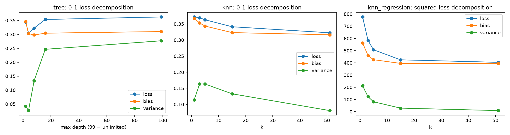

# Bias-variance decomposition

Plan row 3.6.1. Generated by `python -m terser.phase3.studies`.
- data: `data/processed/pair_features.parquet` (sha256 58168abedb1abad0), 14732 pairs, 1262 source prompts, degraded share 0.431
- seeds: 0, 1, 2

200 bootstrap resamples of the training part; evaluation = first grouped fold. 0-1 loss (Domingos): loss = bias + V_unbiased - V_biased. Squared loss (KNN regression of savings, 80/20 split of source prompts): loss = bias² + variance.

| model | param | loss | bias | variance | variance_unbiased | variance_biased |
|---|---|---|---|---|---|---|
| knn | 1 | 0.372 | 0.367 | 0.114 | 0.059 | 0.055 |
| knn | 3 | 0.369 | 0.353 | 0.163 | 0.090 | 0.074 |
| knn | 5 | 0.363 | 0.343 | 0.163 | 0.091 | 0.072 |
| knn | 15 | 0.341 | 0.323 | 0.133 | 0.076 | 0.057 |
| knn | 51 | 0.323 | 0.316 | 0.081 | 0.043 | 0.037 |
| knn_regression | 1 | 775.874 | 563.629 | 212.245 | n/a | n/a |
| knn_regression | 3 | 583.870 | 460.334 | 123.536 | n/a | n/a |
| knn_regression | 5 | 507.278 | 425.901 | 81.377 | n/a | n/a |
| knn_regression | 15 | 424.818 | 395.519 | 29.299 | n/a | n/a |
| knn_regression | 51 | 404.293 | 395.093 | 9.199 | n/a | n/a |
| tree | 2 | 0.344 | 0.346 | 0.042 | 0.020 | 0.022 |
| tree | 4 | 0.304 | 0.303 | 0.026 | 0.014 | 0.012 |
| tree | 8 | 0.322 | 0.298 | 0.134 | 0.079 | 0.055 |
| tree | 16 | 0.354 | 0.304 | 0.246 | 0.148 | 0.099 |
| tree | 99 | 0.363 | 0.310 | 0.277 | 0.165 | 0.112 |

- tree: minimum expected loss 0.304 at param 4.
- knn: minimum expected loss 0.323 at param 51.
- knn_regression: minimum expected loss 404.293 at param 51.

Interpretation (bias vs variance at the minimum) is written by the analyst from these numbers.

**Reading.** All three models are *bias-limited* at their minimum. The tree's loss is lowest
at depth 4 (0.304): depth 2 is underfit (bias 0.346), and beyond depth 4 the bias stays flat
near 0.30 while the variance climbs from 0.026 to 0.277, so every extra level adds variance and
no accuracy. KNN classification moves the other way: bias falls from 0.367 (k = 1) to 0.316
(k = 51) and the variance peaks at k = 3-5, so the loss keeps falling to the largest k tried;
the minimum is at the edge of the grid, which agrees with C3.3, where k = 51 has the top AUC.
k = 1 has less variance than k = 3-5, likely because many pairs share their feature vector
with pairs of the same prompt, so 1-NN copies the same label in most bootstraps. At both
minima the net variance (unbiased minus biased) is small (tree 0.002, KNN 0.006) next to a
bias of 0.30-0.32. KNN regression of savings shows the same floor: variance drops from 212 to
9 but bias stays near 395 (an RMSE of about 20 pp) from k = 15 on, which is why C3.5 misses its original target (MAE ≤ 10 pp); it passes the revised target ([ADR-0012](../docs/decisions/ADR-0012-feasible-checkpoint-targets.md): MAE ≤ 17 pp, R² ≥ 0.25).
More capacity or tuning inside these families cannot remove this error; it needs better
features, which is what Phases 5 and 8 test (gradient boosting 0.78 AUC, TextCNN).

