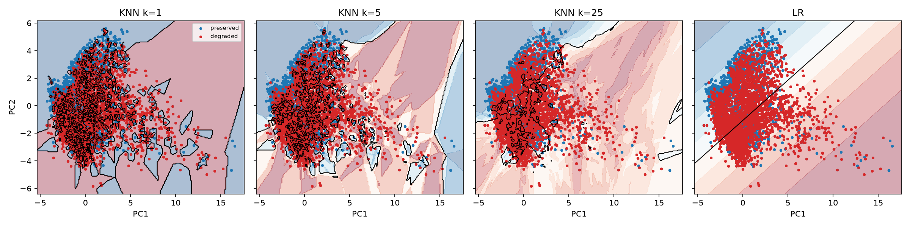

# KNN quality-gate grid

Plan row 3.5.1. Generated by `python -m terser.phase3.studies`.
- data: `data/processed/pair_features.parquet` (sha256 58168abedb1abad0), 14732 pairs, 1262 source prompts, degraded share 0.431
- seeds: 0, 1, 2

Grouped-OOF ROC-AUC on standardised features.

| model | all | code | creative | explain | fact | reason | transform |
|---|---|---|---|---|---|---|---|
| KNN k=1 euclidean uniform | 0.620 ± 0.001 | 0.590 ± 0.001 | 0.604 ± 0.007 | 0.581 ± 0.003 | 0.637 ± 0.006 | 0.581 ± 0.002 | 0.645 ± 0.003 |
| KNN k=1 euclidean distance | 0.620 ± 0.001 | 0.590 ± 0.001 | 0.604 ± 0.007 | 0.581 ± 0.003 | 0.637 ± 0.006 | 0.581 ± 0.002 | 0.645 ± 0.003 |
| KNN k=1 manhattan uniform | 0.624 ± 0.002 | 0.604 ± 0.002 | 0.615 ± 0.009 | 0.585 ± 0.007 | 0.631 ± 0.005 | 0.588 ± 0.002 | 0.648 ± 0.004 |
| KNN k=1 manhattan distance | 0.624 ± 0.002 | 0.604 ± 0.002 | 0.615 ± 0.009 | 0.585 ± 0.007 | 0.631 ± 0.005 | 0.588 ± 0.002 | 0.648 ± 0.004 |
| KNN k=1 cosine uniform | 0.619 ± 0.001 | 0.590 ± 0.003 | 0.599 ± 0.008 | 0.581 ± 0.001 | 0.637 ± 0.010 | 0.581 ± 0.005 | 0.650 ± 0.004 |
| KNN k=1 cosine distance | 0.619 ± 0.001 | 0.590 ± 0.003 | 0.599 ± 0.008 | 0.581 ± 0.001 | 0.637 ± 0.010 | 0.581 ± 0.005 | 0.650 ± 0.004 |
| KNN k=3 euclidean uniform | 0.677 ± 0.002 | 0.636 ± 0.004 | 0.664 ± 0.008 | 0.630 ± 0.006 | 0.673 ± 0.005 | 0.654 ± 0.004 | 0.703 ± 0.003 |
| KNN k=3 euclidean distance | 0.677 ± 0.002 | 0.637 ± 0.003 | 0.662 ± 0.008 | 0.629 ± 0.006 | 0.677 ± 0.004 | 0.654 ± 0.004 | 0.701 ± 0.002 |
| KNN k=3 manhattan uniform | 0.687 ± 0.002 | 0.657 ± 0.001 | 0.672 ± 0.006 | 0.636 ± 0.001 | 0.684 ± 0.005 | 0.660 ± 0.006 | 0.713 ± 0.006 |
| KNN k=3 manhattan distance | 0.687 ± 0.002 | 0.658 ± 0.001 | 0.673 ± 0.008 | 0.636 ± 0.003 | 0.683 ± 0.005 | 0.659 ± 0.004 | 0.711 ± 0.006 |
| KNN k=3 cosine uniform | 0.678 ± 0.002 | 0.633 ± 0.003 | 0.664 ± 0.011 | 0.634 ± 0.005 | 0.680 ± 0.007 | 0.651 ± 0.005 | 0.702 ± 0.005 |
| KNN k=3 cosine distance | 0.679 ± 0.002 | 0.635 ± 0.003 | 0.663 ± 0.010 | 0.633 ± 0.005 | 0.682 ± 0.007 | 0.651 ± 0.005 | 0.703 ± 0.005 |
| KNN k=5 euclidean uniform | 0.698 ± 0.003 | 0.659 ± 0.001 | 0.672 ± 0.009 | 0.647 ± 0.004 | 0.699 ± 0.006 | 0.671 ± 0.009 | 0.725 ± 0.004 |
| KNN k=5 euclidean distance | 0.700 ± 0.002 | 0.660 ± 0.001 | 0.675 ± 0.009 | 0.646 ± 0.005 | 0.702 ± 0.006 | 0.675 ± 0.009 | 0.725 ± 0.003 |
| KNN k=5 manhattan uniform | 0.710 ± 0.002 | 0.675 ± 0.004 | 0.688 ± 0.009 | 0.659 ± 0.001 | 0.707 ± 0.003 | 0.685 ± 0.011 | 0.734 ± 0.004 |
| KNN k=5 manhattan distance | 0.710 ± 0.002 | 0.678 ± 0.003 | 0.689 ± 0.010 | 0.658 ± 0.001 | 0.706 ± 0.003 | 0.686 ± 0.010 | 0.735 ± 0.004 |
| KNN k=5 cosine uniform | 0.700 ± 0.002 | 0.664 ± 0.002 | 0.673 ± 0.009 | 0.657 ± 0.004 | 0.693 ± 0.006 | 0.672 ± 0.008 | 0.726 ± 0.005 |
| KNN k=5 cosine distance | 0.700 ± 0.002 | 0.662 ± 0.001 | 0.674 ± 0.010 | 0.653 ± 0.005 | 0.697 ± 0.007 | 0.674 ± 0.007 | 0.726 ± 0.005 |
| KNN k=7 euclidean uniform | 0.711 ± 0.001 | 0.673 ± 0.004 | 0.673 ± 0.007 | 0.660 ± 0.002 | 0.713 ± 0.002 | 0.690 ± 0.010 | 0.736 ± 0.003 |
| KNN k=7 euclidean distance | 0.712 ± 0.002 | 0.673 ± 0.004 | 0.678 ± 0.008 | 0.659 ± 0.003 | 0.716 ± 0.002 | 0.693 ± 0.010 | 0.736 ± 0.002 |
| KNN k=7 manhattan uniform | 0.722 ± 0.002 | 0.685 ± 0.005 | 0.688 ± 0.005 | 0.672 ± 0.004 | 0.721 ± 0.004 | 0.700 ± 0.012 | 0.744 ± 0.001 |
| KNN k=7 manhattan distance | 0.722 ± 0.002 | 0.688 ± 0.005 | 0.691 ± 0.007 | 0.669 ± 0.002 | 0.720 ± 0.004 | 0.701 ± 0.011 | 0.746 ± 0.002 |
| KNN k=7 cosine uniform | 0.712 ± 0.002 | 0.679 ± 0.002 | 0.675 ± 0.007 | 0.665 ± 0.005 | 0.703 ± 0.002 | 0.686 ± 0.009 | 0.738 ± 0.004 |
| KNN k=7 cosine distance | 0.711 ± 0.002 | 0.676 ± 0.002 | 0.679 ± 0.008 | 0.661 ± 0.005 | 0.708 ± 0.003 | 0.688 ± 0.008 | 0.738 ± 0.004 |
| KNN k=11 euclidean uniform | 0.723 ± 0.002 | 0.691 ± 0.003 | 0.674 ± 0.003 | 0.668 ± 0.003 | 0.719 ± 0.002 | 0.709 ± 0.010 | 0.748 ± 0.003 |
| KNN k=11 euclidean distance | 0.725 ± 0.002 | 0.691 ± 0.002 | 0.679 ± 0.005 | 0.667 ± 0.003 | 0.724 ± 0.003 | 0.709 ± 0.010 | 0.749 ± 0.003 |
| KNN k=11 manhattan uniform | 0.738 ± 0.003 | 0.708 ± 0.008 | 0.697 ± 0.005 | 0.684 ± 0.006 | 0.737 ± 0.003 | 0.716 ± 0.009 | 0.758 ± 0.004 |
| KNN k=11 manhattan distance | 0.738 ± 0.002 | 0.708 ± 0.007 | 0.699 ± 0.005 | 0.681 ± 0.004 | 0.737 ± 0.002 | 0.717 ± 0.009 | 0.759 ± 0.004 |
| KNN k=11 cosine uniform | 0.726 ± 0.001 | 0.694 ± 0.004 | 0.682 ± 0.003 | 0.676 ± 0.002 | 0.718 ± 0.003 | 0.708 ± 0.008 | 0.750 ± 0.005 |
| KNN k=11 cosine distance | 0.725 ± 0.001 | 0.690 ± 0.002 | 0.685 ± 0.004 | 0.669 ± 0.003 | 0.721 ± 0.004 | 0.706 ± 0.007 | 0.750 ± 0.005 |
| KNN k=15 euclidean uniform | 0.730 ± 0.001 | 0.697 ± 0.002 | 0.682 ± 0.005 | 0.673 ± 0.004 | 0.726 ± 0.004 | 0.717 ± 0.009 | 0.756 ± 0.002 |
| KNN k=15 euclidean distance | 0.732 ± 0.001 | 0.697 ± 0.001 | 0.686 ± 0.004 | 0.672 ± 0.004 | 0.731 ± 0.004 | 0.717 ± 0.009 | 0.757 ± 0.002 |
| KNN k=15 manhattan uniform | 0.745 ± 0.002 | 0.723 ± 0.003 | 0.694 ± 0.006 | 0.693 ± 0.006 | 0.740 ± 0.003 | 0.721 ± 0.007 | 0.765 ± 0.004 |
| KNN k=15 manhattan distance | 0.745 ± 0.001 | 0.721 ± 0.003 | 0.696 ± 0.006 | 0.690 ± 0.004 | 0.742 ± 0.003 | 0.722 ± 0.008 | 0.766 ± 0.004 |
| KNN k=15 cosine uniform | 0.735 ± 0.002 | 0.708 ± 0.003 | 0.686 ± 0.003 | 0.684 ± 0.003 | 0.723 ± 0.002 | 0.717 ± 0.006 | 0.758 ± 0.004 |
| KNN k=15 cosine distance | 0.733 ± 0.001 | 0.701 ± 0.002 | 0.689 ± 0.004 | 0.676 ± 0.003 | 0.727 ± 0.003 | 0.714 ± 0.006 | 0.758 ± 0.005 |
| KNN k=25 euclidean uniform | 0.741 ± 0.001 | 0.715 ± 0.004 | 0.684 ± 0.005 | 0.680 ± 0.003 | 0.739 ± 0.001 | 0.728 ± 0.006 | 0.767 ± 0.002 |
| KNN k=25 euclidean distance | 0.743 ± 0.001 | 0.715 ± 0.003 | 0.688 ± 0.005 | 0.681 ± 0.003 | 0.743 ± 0.001 | 0.728 ± 0.007 | 0.767 ± 0.002 |
| KNN k=25 manhattan uniform | 0.754 ± 0.001 | 0.732 ± 0.002 | 0.698 ± 0.005 | 0.699 ± 0.003 | 0.748 ± 0.002 | 0.731 ± 0.008 | 0.775 ± 0.003 |
| KNN k=25 manhattan distance | 0.755 ± 0.001 | 0.731 ± 0.003 | 0.700 ± 0.005 | 0.698 ± 0.003 | 0.751 ± 0.003 | 0.731 ± 0.008 | 0.775 ± 0.003 |
| KNN k=25 cosine uniform | 0.743 ± 0.000 | 0.723 ± 0.003 | 0.682 ± 0.005 | 0.686 ± 0.003 | 0.740 ± 0.004 | 0.728 ± 0.004 | 0.765 ± 0.004 |
| KNN k=25 cosine distance | 0.742 ± 0.000 | 0.716 ± 0.002 | 0.689 ± 0.005 | 0.683 ± 0.001 | 0.740 ± 0.003 | 0.726 ± 0.005 | 0.765 ± 0.004 |
| baseline: majority | 0.500 ± 0.000 | 0.500 ± 0.000 | 0.500 ± 0.000 | 0.500 ± 0.000 | 0.500 ± 0.000 | 0.500 ± 0.000 | 0.500 ± 0.000 |
| baseline: stratified | 0.502 ± 0.002 | 0.502 ± 0.004 | 0.490 ± 0.008 | 0.508 ± 0.002 | 0.506 ± 0.010 | 0.495 ± 0.010 | 0.503 ± 0.005 |
| baseline: always_preserved | 0.500 ± 0.000 | 0.500 ± 0.000 | 0.500 ± 0.000 | 0.500 ± 0.000 | 0.500 ± 0.000 | 0.500 ± 0.000 | 0.500 ± 0.000 |

**Reading.** AUC rises monotonically with k (0.62 at k = 1 to 0.755 at k = 25): single
neighbours memorise label noise from the judge, and averaging over more neighbours trades
variance for a smoother, better-ranked score. Manhattan beats Euclidean and cosine at every
k > 1 (+0.01-0.015), because the L1 distance is less dominated by the few heavy-tailed
features (`max_si_removed`, `tokens_saved`). Distance weighting barely matters once k >= 5.
The best KNN (k = 25, Manhattan, distance) reaches the logistic regression (0.748) and the
pruned tree; `explain` and `creative` stay hardest (about 0.70) for every k.

Row 3.5.3: KNN k = 1 / 5 / 25 and LR on the 2-D PCA plane refit on the training fold of seed 0.
k = 1 carves islands around single points; k = 25 leaves one smooth "preserved" region in the
upper-left (low PC1, high PC2) and calls the rest degraded; LR draws the single diagonal
boundary through the same region.
