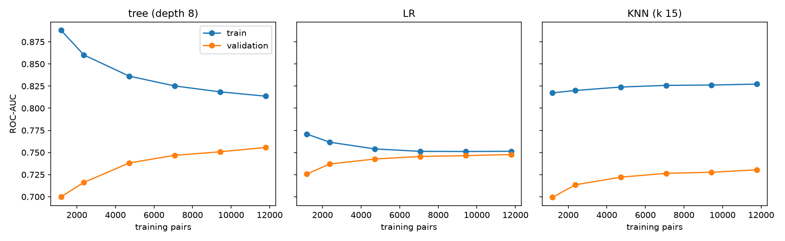

# Learning curves (row 3.6.3)

Generated by `python -m terser.phase3.studies --studies learning_curves` on the row 3.1.3 pair
table; training size 10% → 100% of the grouped training folds (≈1.2k → 11.8k pairs), grouped
validation, seeds 0-2.

| model | train AUC at 1.2k → 11.8k | val AUC at 1.2k → 11.8k | final gap | diagnosis |
|---|---|---|---|---|
| tree (depth 8) | 0.888 → 0.813 | 0.700 → 0.756 | 0.057 | variance shrinking, still rising |
| LR | 0.771 → 0.751 | 0.726 → 0.748 | 0.003 | **high bias** |
| KNN (k = 15) | 0.817 → 0.827 | 0.699 → 0.730 | 0.097 | **high variance** |

* **LR is bias-limited.** Train and validation meet at about 0.75 by 7k pairs and stay flat. More
  data will not help a linear boundary on these 27 features; it needs new features or
  interactions (row 5.1.7, polynomial SVM 4.4.7, trees / boosting).
* **The depth-8 tree is variance-limited but converging.** Train AUC falls and validation rises
  monotonically, and the gap halves from 0.19 to 0.06. It is the only model whose validation
  curve still rises at 11.8k pairs, so more labelled pairs would still pay off. Boosting (5.1.5,
  0.778) gets that variance reduction without new data.
* **KNN has the largest gap, and it does not close.** Train AUC even *rises* with n, as denser
  neighbourhoods memorise paraphrase siblings. Validation creeps up only 0.03, so KNN on
  standardised hand-built features is a poor quality gate here.
