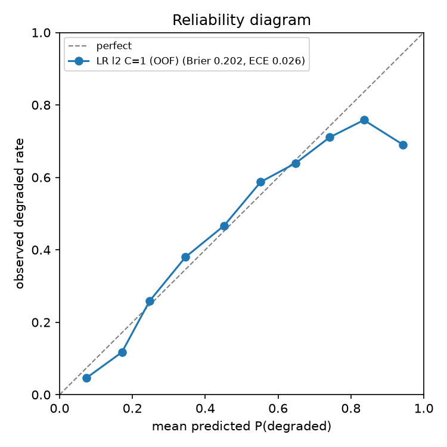

# LR coefficients as odds ratios

Plan row 3.4.5. Generated by `python -m terser.phase3.studies`.
- data: `data/processed/pair_features.parquet` (sha256 58168abedb1abad0), 14732 pairs, 1262 source prompts, degraded share 0.431
- seeds: 0, 1, 2

L2, C = 1, fitted on all labelled pairs; odds ratio per +1 SD.

| feature | coef | odds_ratio |
|---|---|---|
| drop_ratio | 1.087 | 2.965 |
| sum_si_removed | -0.486 | 0.615 |
| tokens_saved | 0.477 | 1.611 |
| token_ratio | 0.465 | 1.591 |
| cat_reason | -0.447 | 0.639 |
| max_si_removed | 0.367 | 1.444 |
| prompt_stopword_ratio | -0.193 | 0.825 |
| cat_creative | 0.152 | 1.165 |
| prompt_tokens | 0.127 | 1.136 |
| constraints_removed | 0.124 | 1.132 |
| cat_transform | 0.107 | 1.113 |
| cat_code | 0.101 | 1.106 |
| cat_explain | 0.101 | 1.106 |
| prompt_numbers | -0.092 | 0.912 |
| target_phi | 0.080 | 1.083 |
| prompt_log_tokens | -0.069 | 0.934 |
| prompt_mean_si | -0.068 | 0.934 |
| prompt_negations | 0.064 | 1.066 |
| prompt_words | -0.060 | 0.942 |
| negations_removed | -0.058 | 0.944 |
| embedding_cosine | -0.054 | 0.947 |
| prompt_has_code | -0.039 | 0.962 |
| numbers_removed | -0.035 | 0.965 |
| prompt_filler_ratio | -0.034 | 0.967 |
| prompt_constraints | -0.025 | 0.975 |
| prompt_filler | -0.010 | 0.990 |
| cat_fact | -0.009 | 0.991 |

