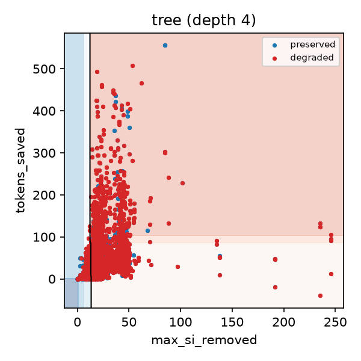

# Hypothesis search and inductive bias: decision tree vs Phase 1 conjunctions (row 3.3.6)

Both learners try to predict the judge's `preserved` / `degraded` label. They differ in **which
hypotheses they can express** (restriction bias) and **which consistent hypothesis they prefer**
(preference bias).

## Phase 1: Candidate-Elimination over conjunctions, a restriction bias

`reports/p1_version_spaces.md` runs Candidate-Elimination over a **conjunctive** language of 12
attributes (5 prompt attributes + 7 operator flags). Every hypothesis has the form
`<a1, ..., a12>` with each slot a value or `?`. The search is complete (S and G bound *every*
consistent conjunction) and has no preference among them. The only bias is the restriction to
conjunctions, and that restriction was wrong. The version space collapsed in **6 of 6**
categories (C1.3 fails). For example, in `code` the preserved examples force
`<?, ?, ?, tone_cue=no, filler_density=low, ?, ...>`, which also covers the degraded
`code-002:I`. Safety depends on *how much* and *which* content an operator removes, and a single
conjunction of coarse attributes cannot express that.

## Phase 3: greedy information-gain trees, a preference bias

The tree (rows 3.3.1-3.3.4) searches a **complete** hypothesis space. Any boolean function of the
discretised features is some tree, so no target is excluded. Its bias is entirely in the
**search**: greedy, top-down, highest information gain first, no backtracking. That gives the
ID3 preference for *short trees with high-gain attributes near the root*: Occam's razor,
implemented by the search order rather than by a constraint.

What the bias produced on 14,732 labelled pairs (`p3_tree_rules.md`, `p3_tree_pruning.md`):

* The root split is `max_si_removed <= 1.90`, so "nothing surprising was removed" means
  preserved (acc 0.996, n = 1,190). The highest-gain test is exactly the quantity the
  conjunctive language could not express: an amount of removed information, not an operator
  flag.
* Grown to full depth the tree has **1,439 leaves** and fits the training set (F1 0.981) but
  not validation (0.572). A complete hypothesis space plus a weak preference overfits: greedy
  search keeps adding splits while they lower training entropy.
* Strengthening the preference for short trees fixes it. Cost-complexity pruning to
  **3 leaves** gives val F1 0.692 with a train-val gap of 0.001 (C3.6). The preference bias,
  made explicit, does the work the restriction bias tried and failed to do.

## Comparison

| | Phase 1 Candidate-Elimination | Phase 3 decision tree |
|---|---|---|
| hypothesis space | conjunctions over 12 discrete attributes | all trees over 27 continuous features (C4.5 thresholds) |
| restriction bias | strong (conjunctions only) | none (complete space) |
| preference bias | none (keeps all consistent hypotheses) | short trees, high-gain attributes first (greedy) |
| search | complete, version space S / G | greedy hill-climbing, no backtracking |
| noise tolerance | none: one mislabelled example collapses the space | pruning trades training fit for generalisation |
| outcome on judge labels | collapsed in 6 / 6 categories | val F1 0.692 (pruned), grouped AUC up to 0.75 |

**Takeaway.** On noisy judge labels a *restriction* bias is brittle: if the target is not in
the space, or one label is wrong, nothing is left. A *preference* bias over a complete space
degrades gracefully: the learner always returns its best short hypothesis, and pruning sets how
strongly shortness is preferred.

