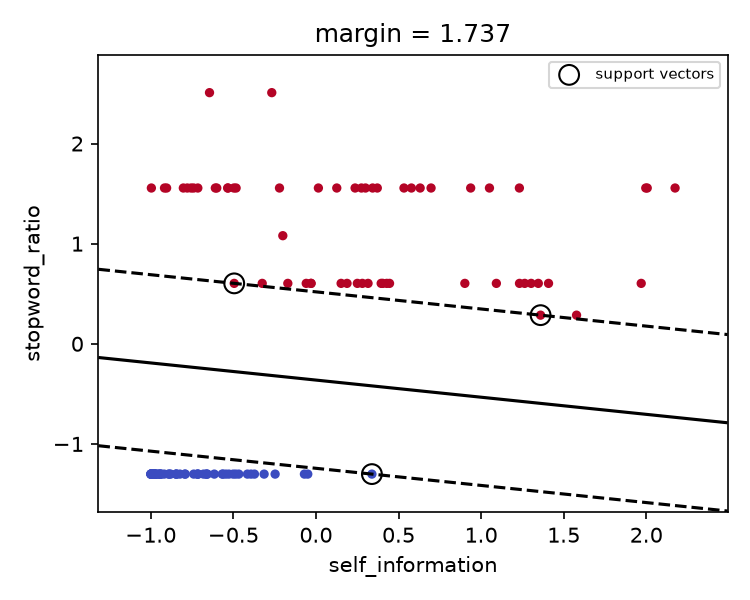
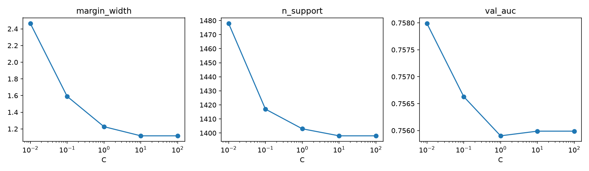
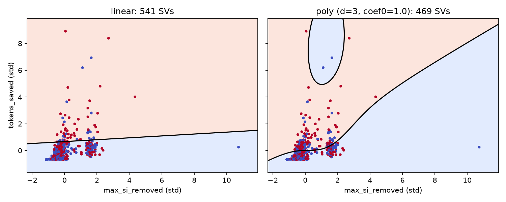

# Phase 4 SVM studies (rows 4.4.5-4.4.8)

From-scratch `DualSVM` (cvxopt QP, row 4.4.4) on the row 3.1.3 pair table, first grouped fold as
validation, 2,000 standardised training pairs (QP memory is O(n²)). Tables from
`python -m terser.phase4.svm_studies --table data/processed/p4_pairs.parquet` (`p4_svm_soft_margin.csv`,
`p4_svm_kernels.csv`), figures from `python -m terser.phase4.svm_figures`.

## 4.4.5 Hard margin

DROP vs KEEP span tokens in the (`self_information`, `stopword_ratio`) plane. The full token set
is not linearly separable, so the subset keeps the 60 tokens per class that a C = 1 soft SVM
scores most confidently. The hard-margin fit separates all 120 with **3 support vectors**,
margin 2/‖w‖ = 1.737.

## 4.4.6 Soft margin

| C | margin width | # SVs | val AUC | val F1 |
|---|---|---|---|---|
| 0.01 | 3.271 | 1428 | 0.724 | 0.665 |
| 0.1 | 2.422 | 1389 | 0.721 | 0.667 |
| 1 | 1.960 | 1382 | 0.721 | 0.668 |
| 10 | 1.884 | 1383 | 0.720 | 0.668 |
| 100 | 1.879 | 1383 | 0.720 | 0.668 |

Raising C shrinks the margin (3.27 → 1.88) and slightly reduces the support-vector count, then
both flatten above C = 10, once few slack variables remain to trade off. About 70% of the 2,000
points stay support vectors at every C, which shows how much the classes overlap. Val AUC is
flat (0.720-0.724), so the gate is limited by the features, not by C.

## 4.4.7 Polynomial kernel

| kernel | degree | coef0 | C | val AUC | fit (s) | # SVs |
|---|---|---|---|---|---|---|
| linear | - | - | 0.1 | 0.721 | 21.8 | 1389 |
| linear | - | - | 1 | 0.721 | 19.4 | 1382 |
| linear | - | - | 10 | 0.720 | 27.1 | 1383 |
| poly | 2 | 0 | 0.1 | 0.708 | 19.0 | 1813 |
| poly | 2 | 0 | 1 | 0.697 | 18.5 | 1502 |
| poly | 2 | 0 | 10 | 0.682 | 19.3 | 1346 |
| poly | 2 | 1 | 0.1 | **0.733** | 17.8 | 1402 |
| poly | 2 | 1 | 1 | 0.715 | 18.9 | 1345 |
| poly | 2 | 1 | 10 | 0.684 | 19.9 | 1315 |
| poly | 3 | 0 | 0.1 | 0.723 | 15.6 | 1698 |
| poly | 3 | 0 | 1 | 0.703 | 17.7 | 1475 |
| poly | 3 | 0 | 10 | 0.640 | 18.7 | 1320 |
| poly | 3 | 1 | 0.1 | 0.724 | 19.2 | 1381 |
| poly | 3 | 1 | 1 | 0.686 | 18.3 | 1318 |
| poly | 3 | 1 | 10 | 0.644 | 20.1 | 1252 |

The best kernel is degree 2 with coef0 = 1 and C = 0.1 (AUC 0.733, +0.012 over linear).
coef0 = 1 keeps the linear terms alongside the pairwise interactions; coef0 = 0 has only pure
degree-d terms and is worse at every C. Larger C overfits the polynomial feature space quickly
(degree 3, C = 10: 0.640). Fit time is about the same for every kernel because the QP size is
fixed by n.

## 4.4.8 Decision surfaces

Linear vs degree-3 polynomial (coef0 = 1, C = 1) on the Phase 3 plane (`max_si_removed` x
`tokens_saved`, as in rows 3.3.5 / 3.5.3), 600 standardised pairs. The polynomial boundary bends
toward "degraded" when a few high-information tokens are dropped, even if few tokens are saved.
That is the same region where the Phase 3 tree splits first (`max_si_removed > 1.90`).
