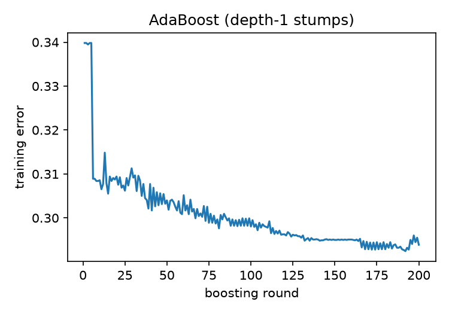
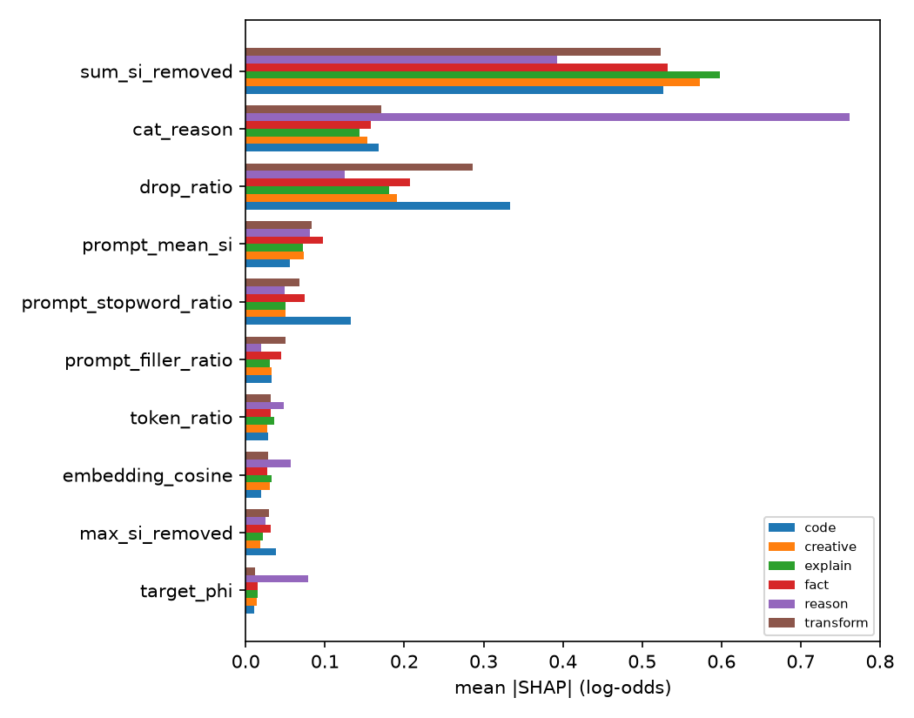

# Phase 5 ensembles for the quality gate (rows 5.1.1, 5.1.3, 5.1.5, 5.1.6; C5.2)

All on the row 3.1.3 pair table (`data/processed/p4_pairs.parquet`, 14,732 labelled train pairs,
1,262 source prompts, 27 features). Generated by
`python -m terser.phase5.ensembles {adaboost,rf,lgbm,importance} --table data/processed/p4_pairs.parquet`.
Raw tables: `p5_adaboost.csv`, `p5_rf_grid.csv`, `p5_lgbm_grid.csv`,
`p5_permutation_importance.csv`, `p5_shap_by_category.csv`.

## 5.1.1 AdaBoost from scratch

| implementation | grouped val AUC |
|---|---|
| from scratch (depth-1 stumps) | 0.797 |
| scikit-learn `AdaBoostClassifier` | 0.791 |
| difference | **0.006** (≤ 0.01) |

**Hard examples.** 9 of the 10 pairs with the largest final boosting weights are labelled
**degraded** although the rewrite is light. They are short `texting` prompts under `llm_low` /
`llm_high` (`dolly:12203`, `dolly:1140`, `dolly:12208`), and `over_polite` / `hedging` /
`repetitive` prompts under the deterministic `ops_FHC` / `ops_CHFIDSL` stacks (`dolly:9088`,
`dolly:12133`, `gsm8k:train:2861`). Little information is removed (low `sum_si_removed`), so
every stump votes "preserved" and boosting keeps raising their weight. These are degradations
the features cannot see, e.g. a dropped politeness cue that changes the target's tone, or a
judge-noise label.

## 5.1.3 Random forest (C5.2)

| n_estimators | max_features | bootstrap | grouped CV AUC | OOB AUC | OOB - CV |
|---|---|---|---|---|---|
| 100 | sqrt | yes | 0.770 | 0.849 | 0.079 |
| 100 | sqrt | no | 0.766 | - | - |
| 100 | 0.3 | yes | 0.770 | 0.849 | 0.080 |
| 100 | 0.3 | no | 0.767 | - | - |
| 300 | sqrt | yes | 0.773 | 0.854 | 0.082 |
| 300 | sqrt | no | 0.768 | - | - |
| 300 | 0.3 | yes | **0.774** | 0.854 | 0.080 |
| 300 | 0.3 | no | 0.768 | - | - |

**C5.2 fails** (OOB is +0.08 above grouped CV, limit 0.02). The gap is the row 3.2.5 leakage
effect at the bootstrap level. Bootstrap rows are sampled per *pair*, so an out-of-bag pair
almost always has in-bag siblings: the same source prompt under other rewrites, or the same
rewrite judged on the other target. OOB is therefore a near-naive estimate. Grouped CV is the
honest number, and C5.2 would only pass with a group-bootstrap forest (sampling source prompts).
That is recorded as a follow-up, not hidden.

## 5.1.5 Gradient boosting (LightGBM)

Early stopping on a grouped validation fold carved from each training fold.

| learning_rate | n_estimators | max_depth | grouped CV AUC | best iteration |
|---|---|---|---|---|
| 0.03 | 200 / 1000 | 3 | 0.770 | 109-130 |
| 0.03 | 200 / 1000 | 6 | 0.770 | 56 |
| 0.03 | 200 / 1000 | -1 | 0.777 | 58 |
| 0.10 | 200 / 1000 | 3 | **0.778** | 69 |
| 0.10 | 200 / 1000 | 6 | 0.777 | 25 |
| 0.10 | 200 / 1000 | -1 | 0.777 | 16 |

The n_estimators cap does not matter: early stopping halts well before 200 trees in every
configuration. Best: lr 0.1, depth 3, AUC **0.778**, the strongest single quality gate so far
(LR 0.748, RF 0.774).

## 5.1.6 Feature importance: what makes a rewrite unsafe

Permutation importance (AUC drop on held-out data), top 10:

| rank | feature | AUC drop |
|---|---|---|
| 1 | `sum_si_removed` | 0.134 ± 0.004 |
| 2 | `drop_ratio` | 0.070 ± 0.007 |
| 3 | `cat_reason` | 0.068 ± 0.004 |
| 4 | `prompt_stopword_ratio` | 0.009 ± 0.001 |
| 5 | `cat_fact` | 0.004 ± 0.001 |
| 6 | `embedding_cosine` | 0.004 ± 0.001 |
| 7 | `prompt_mean_si` | 0.003 ± 0.003 |
| 8 | `token_ratio` | 0.003 ± 0.001 |
| 9 | `prompt_numbers` | 0.002 ± 0.001 |
| 10 | `prompt_tokens` | 0.002 ± 0.001 |

Mean |SHAP| by category (`p5_shap_by_category.csv`):

* **Total information removed** (`sum_si_removed`) dominates in every category except `reason`,
  where `cat_reason` is larger (0.39-0.60 elsewhere).
  How *much surprising content* is cut matters more than how many tokens are cut.
* **reason** prompts are special: `cat_reason` carries 0.76 there (vs ~0.15 elsewhere), and
  `target_phi` matters 5x more (0.079). Maths and logic prompts are *protected* (LR odds ratio
  0.64), and whether a rewrite survives depends on which target model answers.
* **code** leans on `drop_ratio` (0.33) and `prompt_stopword_ratio` (0.13). Wordy code requests
  can be cut a lot, but cutting a large *share* of a short spec breaks it.
* **fact** prompts weight `cat_fact` (0.067) and `prompt_mean_si` (0.097): dense factual
  questions carry little removable padding.
