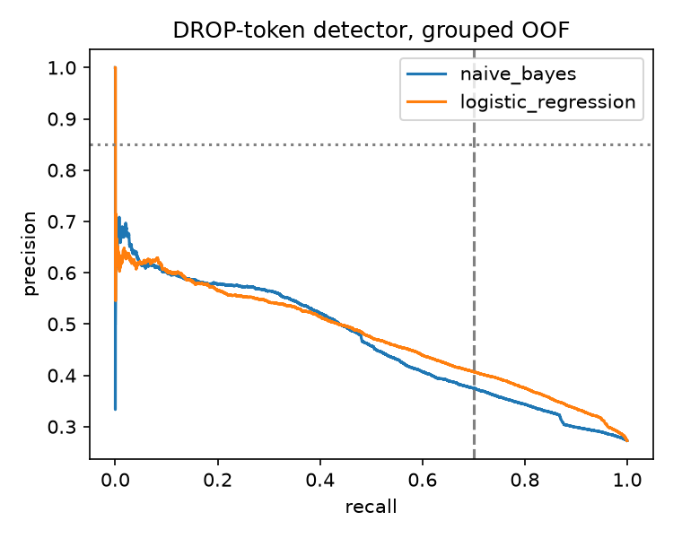

# p5_naive_bayes

Generated by `python -m terser.phase5.real_studies naive_bayes`.

## 5.2.3 Naive Bayes filler detector (C5.3)

40,000 sampled train tokens; text = 5-word window with the centre token marked; label = droppable in the oracle rewrite (DROP or REPLACE, 42.1% positive). Multinomial NB with Laplace smoothing (alpha = 1, the MAP estimate under a symmetric Dirichlet(2) prior, so no unseen n-gram gets zero probability) vs logistic regression on the same 1-3-gram counts, grouped 5-fold.

| model | roc_auc | average_precision | precision_at_recall_0.70 |
|---|---|---|---|
| naive_bayes | 0.740 | 0.661 | 0.594 |
| logistic_regression | 0.758 | 0.666 | 0.615 |

NB precision at recall >= 0.70: **0.594**; C5.3 (>= 0.85): **fail**. As revised by [ADR-0012](../docs/decisions/ADR-0012-feasible-checkpoint-targets.md) (>= 0.55): **pass**.
