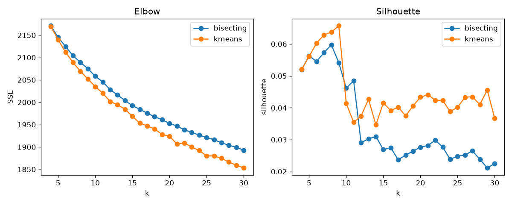
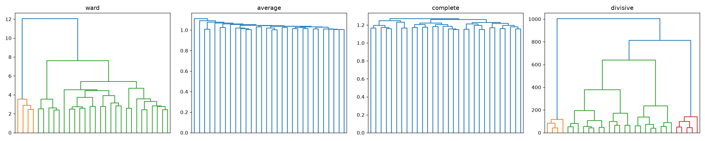

# Phase 6 clustering results (rows 6.2, 6.3, 6.5, 6.6, 6.8; C6.1, C6.2)

4,955 train prompts, bge-small 384-d (row 6.1). Generated by `python -m terser.phase6.studies`; raw numbers in `reports/p6_results.json`.

## 6.2 / 6.3 K-means vs bisecting K-means

| k | kmeans_sse | bisecting_sse | kmeans_silhouette | bisecting_silhouette | kmeans_size_balance | bisecting_size_balance |
|---|---|---|---|---|---|---|
| 4 | 2169.907 | 2171.181 | 0.052 | 0.052 | 0.973 | 0.977 |
| 5 | 2139.718 | 2145.411 | 0.056 | 0.056 | 0.997 | 0.985 |
| 6 | 2112.155 | 2124.770 | 0.060 | 0.055 | 0.974 | 0.991 |
| 7 | 2088.989 | 2104.311 | 0.063 | 0.057 | 0.982 | 0.965 |
| 8 | 2069.505 | 2089.228 | 0.064 | 0.060 | 0.971 | 0.956 |
| 9 | 2052.163 | 2075.130 | 0.066 | 0.054 | 0.966 | 0.960 |
| 10 | 2035.256 | 2058.421 | 0.041 | 0.046 | 0.987 | 0.963 |
| 11 | 2020.398 | 2045.712 | 0.035 | 0.048 | 0.991 | 0.962 |
| 12 | 2001.856 | 2028.418 | 0.037 | 0.029 | 0.984 | 0.969 |
| 13 | 1994.522 | 2016.391 | 0.043 | 0.030 | 0.977 | 0.966 |
| 14 | 1984.368 | 2004.061 | 0.035 | 0.031 | 0.975 | 0.973 |
| 15 | 1968.772 | 1992.596 | 0.042 | 0.027 | 0.973 | 0.986 |
| 16 | 1953.353 | 1984.403 | 0.039 | 0.027 | 0.984 | 0.985 |
| 17 | 1947.338 | 1975.375 | 0.040 | 0.024 | 0.979 | 0.990 |
| 18 | 1940.366 | 1967.853 | 0.037 | 0.025 | 0.984 | 0.986 |
| 19 | 1927.851 | 1960.846 | 0.041 | 0.026 | 0.979 | 0.984 |
| 20 | 1924.047 | 1952.936 | 0.043 | 0.028 | 0.968 | 0.983 |
| 21 | 1906.932 | 1946.942 | 0.044 | 0.028 | 0.980 | 0.978 |
| 22 | 1909.022 | 1938.402 | 0.042 | 0.030 | 0.961 | 0.975 |
| 23 | 1899.695 | 1932.800 | 0.042 | 0.028 | 0.972 | 0.979 |
| 24 | 1892.215 | 1926.474 | 0.039 | 0.024 | 0.963 | 0.974 |
| 25 | 1880.345 | 1921.287 | 0.040 | 0.025 | 0.970 | 0.973 |
| 26 | 1879.705 | 1916.188 | 0.043 | 0.025 | 0.975 | 0.973 |
| 27 | 1874.992 | 1909.656 | 0.043 | 0.026 | 0.966 | 0.972 |
| 28 | 1866.278 | 1903.697 | 0.041 | 0.024 | 0.964 | 0.978 |
| 29 | 1859.263 | 1899.307 | 0.046 | 0.021 | 0.975 | 0.979 |
| 30 | 1853.206 | 1892.883 | 0.037 | 0.023 | 0.984 | 0.979 |

Chosen k = **9** (max K-means silhouette 0.066). **C6.1** (silhouette >= 0.10): **fail**.

## C6.2 K-means as the sigma -> 0 limit of EM

| sigma | agreement with K-means | mean max responsibility |
|---|---|---|
| 0.1 | 0.9701 | 0.888 |
| 0.05 | 0.9889 | 0.985 |
| 0.02 | 0.9893 | 1.000 |
| 0.01 | 0.9893 | 1.000 |
| 0.005 | 0.9893 | 1.000 |

**C6.2** (agreement >= 98% at the smallest sigma): **pass**.

## 6.5 / 6.6 Agglomerative vs divisive (2,000-prompt sample)

| tree | cophenetic correlation | ARI vs K-means (cut at k) |
|---|---|---|
| ward | 0.291 | 0.649 |
| average | 0.657 | 0.005 |
| complete | 0.550 | 0.229 |
| divisive | 0.366 | 0.544 |

## 6.8 Clusters vs categories

ARI **0.490**, NMI **0.485**.

| cluster | code | creative | explain | fact | reason | transform |
|---|---|---|---|---|---|---|
| 0 | 0 | 47 | 152 | 115 | 0 | 141 |
| 1 | 0 | 108 | 60 | 26 | 3 | 45 |
| 2 | 0 | 46 | 74 | 218 | 6 | 296 |
| 3 | 0 | 310 | 198 | 33 | 4 | 3 |
| 4 | 945 | 0 | 1 | 6 | 0 | 0 |
| 5 | 0 | 65 | 71 | 95 | 30 | 89 |
| 6 | 0 | 69 | 156 | 78 | 0 | 112 |
| 7 | 1 | 6 | 10 | 4 | 803 | 0 |
| 8 | 0 | 109 | 87 | 204 | 1 | 128 |
