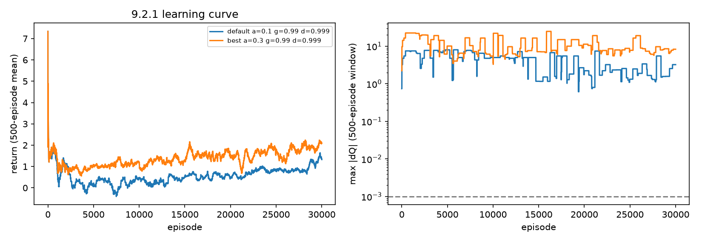

# Tabular Q-learning over operators (rows 9.2.1, 9.2.2; C9.1)

Generated by `python -m terser.phase9.qlearning_study --prompts 300 --episodes 30000`. 300 train prompts; reward = savings % - 100 x gate-degraded at STOP, -0.01 per operator; gate = LightGBM on the row 3.1.3 features (no LLM calls).

## 9.2.2 Sweep

| alpha | gamma | eps_decay | eps_min | return_last_1000 | max_dQ_last_1000 |
|---|---|---|---|---|---|
| 0.3 | 0.99 | 0.999 | 0.05 | 1.952 | 8.307 |
| 0.3 | 0.9 | 0.999 | 0.05 | 1.883 | 9.706 |
| visits | 0.9 | 0.999 | 0.05 | 1.478 | 50 |
| visits | 0.9 | 0.9995 | 0 | 1.321 | 11.14 |
| 0.1 | 0.9 | 0.999 | 0.05 | 1.309 | 3.235 |
| 0.3 | 0.99 | 0.9995 | 0 | 1.275 | 14.74 |
| 0.1 | 0.99 | 0.999 | 0.05 | 1.264 | 3.235 |
| visits | 0.99 | 0.999 | 0.05 | 1.154 | 55 |
| 0.3 | 0.9 | 0.9995 | 0 | 1.098 | 6.325 |
| visits | 0.99 | 0.9995 | 0 | 1.075 | 9.166 |
| 0.1 | 0.9 | 0.9995 | 0 | 0.8949 | 2.172 |
| 0.05 | 0.9 | 0.999 | 0.05 | 0.882 | 0.8475 |
| 0.05 | 0.99 | 0.999 | 0.05 | 0.8563 | 0.8475 |
| 0.1 | 0.99 | 0.9995 | 0 | 0.7753 | 1.543 |
| 0.05 | 0.99 | 0.9995 | 0 | 0.3158 | 0.4931 |
| 0.05 | 0.9 | 0.9995 | 0 | 0.3042 | 0.4931 |

## C9.1 Tabular convergence

Most settled learner (alpha=0.05, gamma=0.9, decay=0.9995, eps_min=0.0): max |dQ| over the last 1,000 episodes = **4.93e-01** (target < 1e-3: **fail**).
